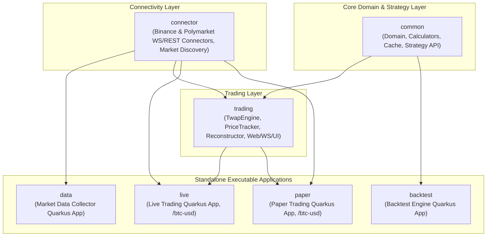

# Architecture Guide for AI Agents & Developers

This document defines the architectural boundaries, module hierarchy, and design rules for the **Polymarket Bot** project. All AI agents and developers **MUST** strictly adhere to these rules when modifying or adding code.

---

## 1. Module Hierarchy & Dependencies

The project is structured as a Maven Multi-Module project with 7 distinct submodules:

### Dependency Matrix & Isolation Rules

| Module | Packaging | Depends On | Allowed Dependencies | Prohibited Dependencies |
| :--- | :--- | :--- | :--- | :--- |
| **`common`** | `jar` (library) | *None* | Pure domain, math calculators, cache, strategy API, Java standard library | `connector`, `trading`, `data`, `live`, `paper`, `backtest`, heavy frameworks |
| **`connector`** | `jar` (library) | *None* | Quarkus Arc, Vert.x, Jackson, Java standard library (`HttpClient`) | `common`, `trading`, `data`, `live`, `paper`, `backtest` |
| **`data`** | `jar` (app) | `connector` | `connector`, `zstd-jni`, Quarkus Scheduler/REST | **`common`**, `trading`, `live`, `paper`, `backtest` |
| **`trading`** | `jar` (library) | `common`, `connector` | `common`, `connector`, Quarkus platform extensions (REST, Qute, WebSockets, Vert.x) | `data`, `backtest`, `live`, `paper` |
| **`live`** | `jar` (app) | `trading`, `connector` | `trading`, `connector` (transitive: `common`) | `data`, `backtest`, `paper` |
| **`paper`** | `jar` (app) | `trading`, `connector` | `trading`, `connector` (transitive: `common`) | `data`, `backtest`, `live` |
| **`backtest`**| `jar` (app) | `common` | `common`, historical data parsers, DuckDB, `zstd-jni`, testing engines | `connector`, `trading`, `data`, `live`, `paper` |

---

## 2. Invariant Rules (NON-NEGOTIABLE)

### Rule 1: Zero Backtest Leakage into Production & Zero Strategy Leakage into Data Collector
- The production live trading system (`live`) and paper trading system (`paper`) **MUST NEVER** include backtesting dependencies, historical simulation scripts, or offline data ingestion tools.
- The market data collector (`data`) and shared `connector` module **MUST NEVER** depend (directly or transitively) on `common` or `trading`. The data collector records raw market streams with minimal overhead and does not load strategies, indicators, or mathematical calculators.
- Historical data loaders (Parquet, DuckDB, bulk CSV replays) belong exclusively in `backtest`.

### Rule 2: Zero Discrepancy between Backtest, Paper, and Live
Strategies, indicators, mathematical formulas, and order execution interfaces are defined once in `common`:
- A strategy implements `TradingStrategy` from `common`.
- The strategy interacts with the market solely via `StrategyContext` and `ExecutionRouter` from `common`.
- **Backtest**: `ExecutionRouter` is implemented as an in-memory simulated matching engine.
- **Paper Trading**: `ExecutionRouter` is implemented as a virtual simulator running against live Polymarket order books.
- **Live Trading**: `ExecutionRouter` is implemented as a signed EIP-712 order gateway executing on the real Polymarket CLOB.
- **Result**: The strategy bytecode is 100% identical in backtest, paper, and live.

### Rule 3: Jandex Indexing for Shared Quarkus Libraries
Because `common`, `connector`, and `trading` are library modules consumed by the runnable Quarkus applications (`data`, `live`, `paper`, `backtest`), all beans and endpoints in `common`, `connector`, and `trading` must be indexed via the `jandex-maven-plugin` and include `META-INF/beans.xml`.

---

## 3. Submodule Responsibilities

### `common`
- **Domain Models**: Immutable records and compact structures (`Timeframe`, `PriceSnapshot`, `TwapPoint`, `TwapUpdate`, `CandleTwapState`, `MarketCandle`, `OrderBookQuote`, `TradeRecord`).
- **Calculators & Math**: `MedianCalculator`, `TwapCalculator`, `VwapCalculator`, `RealizedVolatilityCalculator`, `KellyPositionSizer`, `PerformanceMetricsCalculator`.
- **In-Memory Cache**: `HourlyPriceCache` (sliding 3600-second window).
- **Strategy & Execution Contracts**: `TradingStrategy`, `StrategyContext`, `ExecutionRouter`, `OrderCommand`, `ExecutionReport`, `TWAPArbitrageStrategy`.

### `connector`
- **Resilient WebSocket Core**: `ReconnectingWebSocketStream`, `ConnectionState`, `RawWebSocketListener`, `AbstractExchangeWebSocketClient`, `ExchangePriceListener`.
- **Binance Connectors**: `BinanceStreamConnector`, `BinanceStreamType` (Spot `aggTrades`, Futures `aggTrades`, Futures Diff. Book Depth 100ms, Futures Partial Book Depth 100ms, Futures Liquidation Orders `forceOrder`).
- **Deribit Connectors**: `DeribitStreamConnector` (Deribit v2 `wss://www.deribit.com/ws/api/v2` for authenticated raw Futures trade streams, e.g. `trades.BTC-PERPETUAL.raw`, with automated JSON-RPC authentication via `public/auth` client credentials, subscription, and keep-alive handling).
- **Polymarket Connectors**: `PolymarketGammaClient` (market discovery by slug and resolution polling), `PolymarketPolyBoltClient` (PolyBolt v2 `wss://ws-live-v2.polymarket.com/ws` for `price.crypto.twap` 60s TWAP and `price.crypto`), `PolymarketClobClient` (per-market CLOB order book and trade WebSocket streams).
- **Shared Client Configuration**: `AppConfig` (`HttpClient`, `ObjectMapper`), `Exchange`, `BinanceTicker`.

### `data`
- Standalone runnable Quarkus application (`quarkus.http.port=8084`) for low-latency raw stream recording in AWS `eu-west`.
- **Storage**: Writes raw WebSocket JSON payloads paired with local receipt timestamps (`ts`) directly to EBS in **JSONL + Zstandard Streaming (`.jsonl.zst`)** format (`ZstdJsonlWriter`) with zero WebSocket JSON parsing overhead.
- **Binance, Deribit & PolyBolt Daily Files**: `DailyBinanceStorageManager` writes each of the 5 Binance streams into separate UTC daily files, `DailyDeribitStorageManager` writes the Deribit Futures trade stream (`trades.<instrument>.raw`) into separate UTC daily files, and `DailyPolyBoltStorageManager` writes the Polymarket PolyBolt `price.crypto` and `price.crypto.twap` (60s) streams into separate UTC daily files.
- **Polymarket Per-Market Lifecycle Files**: `PolymarketLifecycleCoordinator` and `PolymarketMarketStorageManager` record the current market plus `lookahead-count` (default `5`) future markets (Gamma discovery, CLOB order book/trade events, and resolution), disconnecting each market's stream, closing its file, and opening the next future market stream once resolution is recorded.
- **Status Endpoint**: `/api/collector/status` (`CollectorStatusResource`).

### `trading`
- **Exchange Trackers & Reconstructors**: `BinanceWebSocketClient`, `CoinbaseWebSocketClient`, `KrakenWebSocketClient`, `BinanceHistoricalClient`, `ExchangePayloadParser`, `ExchangePriceTracker`, `HistoricalDataReconstructor`.
- **Engines**: `TwapEngine` (1-second tick loop, candle rollover lifecycle, Binance timestamp synchronization).
- **Web & Streaming**: `BtcUsdResource`, `TwapWebSocketEndpoint`, Qute templates (`btc-usd.html`), static CSS and JavaScript (`btc-usd.js`).
- **Configuration**: `ChartRangeConfig`.

### `live`
- Standalone runnable Quarkus application for live real-money execution.
- Configured with `quarkus.http.port=8080`, `polymarket.trading.mode=live`.
- Direct connectivity to Polymarket CLOB and wallet signing.

### `paper`
- Standalone runnable Quarkus application for real-time virtual trading.
- Configured with `quarkus.http.port=8082`, `polymarket.trading.mode=paper`.
- Streams real market data but routes orders to a paper execution simulator.

### `backtest`
- Standalone runnable Quarkus application for backtesting strategies against historical datasets.
- Configured with `quarkus.http.port=8083`, `polymarket.trading.mode=backtest`.
- Exposes consolidated REST endpoints (`/api/status`, `/api/backtest/run`, `/api/data/download/binance`) for starting asynchronous simulations, triggering Binance data ingestion, and querying results.

---

## 4. Low-Latency Engineering Principles
For detailed performance guidelines on AWS Ireland (`eu-west-1`) deployment, memory layout, GC elimination, and networking, see [`VISION.md`](VISION.md).
