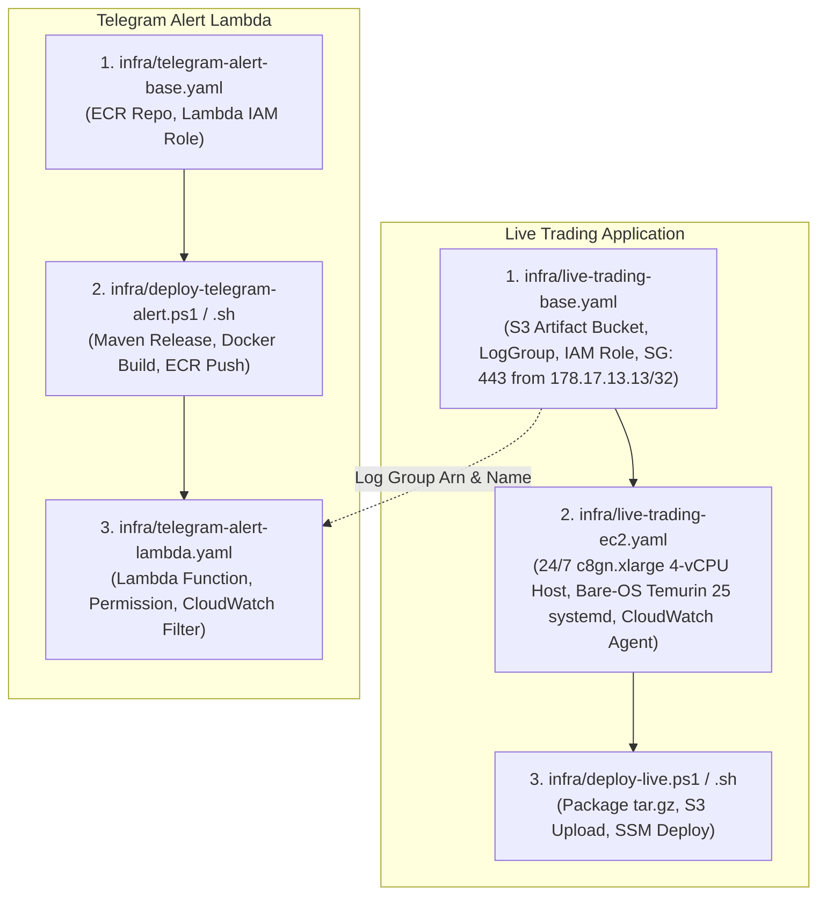

# Deployment Guide - Polymarket Bot on AWS EC2 & CloudFormation (`eu-west-1`)

This guide outlines the modular CloudFormation architecture, infrastructure provisioning, automated Maven release workflow, and **mandatory continuous execution requirements** for running the Polymarket Bot applications ([`live`](file:///c:/work/workspace-java/polymarket-bot/live), [`data`](file:///c:/work/workspace-java/polymarket-bot/data), [`paper`](file:///c:/work/workspace-java/polymarket-bot/paper)) and the Java 25 Telegram Alert Lambda in **AWS Ireland (`eu-west-1`)**.

**AWS CloudFormation is the preferred and mandatory standard** for provisioning and managing all production infrastructure in this repository. All resources are organized into decoupled, modular templates in [`infra/`](file:///c:/work/workspace-java/polymarket-bot/infra) to eliminate chicken-and-egg deployment dependencies and provide independent lifecycle management.

---

## 1. Modular Architecture Overview

The deployment architecture is split into clean, single-responsibility units for both the **Live Trading Engine** and the **Telegram Alert Lambda Function**:



### Key Architectural Invariants:
1. **AWS Region**: `eu-west-1` (Ireland / Dublin) for physical proximity (~5-8 ms RTT over AWS backbone) to Polymarket CLOB in London (`eu-west-2`).
2. **Compute & 4-Core Pipeline**:
   - Dedicated, non-throttled **`c8gn.xlarge`** (4 vCPU Graviton4 ARM64, 8 GiB RAM, 30 Gbps Enhanced Networking / Nitro v5) for Live Trading.
   - Each of the 4 physical Neoverse-V2 cores is mapped to a dedicated lock-free thread (`clob-ws-io-reader`, `clob-book-worker`, `strategy-calculator-worker`, `order-execution-io-worker`) running under Java 25 **Generational ZGC** (`-XX:+UseZGC -XX:+AlwaysPreTouch -XX:+UseTransparentHugePages -XX:+UseThreadPriorities -Xms6g -Xmx6g`).
   - `t4g.small` with **Unlimited CPU Credits** and persistent gp3 EBS volume for the Data Collector (`data`).
3. **Bare-OS Direct Execution (Zero Docker / Zero NAT Overhead for `live`)**:
   - The Live Trading application runs directly on Amazon Linux 2023 via **`systemd`** (`polymarket-live.service`) with `AmbientCapabilities=CAP_NET_BIND_SERVICE CAP_SYS_NICE CAP_IPC_LOCK` and `Nice=-20`—completely eliminating `dockerd`, `containerd`, `seccomp-bpf` syscall filtering, and `iptables` NAT (`nf_conntrack`).
   - Application logs are appended to `/var/log/polymarket-live/live-trading.log` and streamed asynchronously by the Amazon CloudWatch Agent to `/polymarket-bot/polymarket-bot-live-base/live-trading`.
   - Live trading statistics are read externally from the Polymarket REST API; no secondary EBS volume or disk I/O is attached to the `live` instance.
4. **Network & Security**:
   - Inbound port 443 (bound directly by Quarkus via `net.ipv4.ip_unprivileged_port_start=443`) access is restricted strictly to authorized IP **`178.17.13.13/32`**.
   - No public SSH (port 22) is open. Management and deployment are executed exclusively via **AWS Systems Manager (SSM)**.
5. **SemVer & Maven Release**:
   - Before deploying the Live Trading Engine, run `mvnw release:clean release:prepare` (or `mvnw release:clean release:prepare "-DreleaseVersion=1.1.0"`), which packages the release artifact `.\live\target\quarkus-app\app\live-{x.y.z}.jar`.
   - `infra/deploy-live.ps1` and `infra/deploy-live.sh` determine the version `{x.y.z}` directly from `.\live\target\quarkus-app\app\live-{x.y.z}.jar`, package `quarkus-app` into `live-{x.y.z}.tar.gz`, upload it to the encrypted S3 artifact bucket, and deploy via SSM.

---

## 2. Live Trading Application Deployment

### Step 2.1: Deploy Base Infrastructure Stack (`infra/live-trading-base.yaml`)
Provisions the private encrypted S3 artifact bucket (`LiveTradingArtifactBucket`), CloudWatch Logs group, IAM role with SSM/S3/SecretsManager access, and the security group allowing inbound port 443 access strictly from `178.17.13.13/32`.

#### Windows 11 (PowerShell):
```powershell
aws cloudformation deploy `
  --region eu-west-1 `
  --stack-name polymarket-bot-live-base `
  --template-file infra/live-trading-base.yaml `
  --capabilities CAPABILITY_NAMED_IAM `
  --parameter-overrides AllowedInboundCidr="178.17.13.13/32"
```

#### Linux / macOS (Bash):
```bash
aws cloudformation deploy \
  --region eu-west-1 \
  --stack-name polymarket-bot-live-base \
  --template-file infra/live-trading-base.yaml \
  --capabilities CAPABILITY_NAMED_IAM \
  --parameter-overrides AllowedInboundCidr="178.17.13.13/32"
```

---

### Step 2.2: Deploy Compute Infrastructure Stack (`infra/live-trading-ec2.yaml`)
Provisions the 24/7 `c8gn.xlarge` (4 vCPU Graviton4) EC2 instance referencing the base stack outputs. UserData installs ARM64 Eclipse Temurin 25, tunes kernel TCP receive buffers (`rmem_default = 16777216`, `rmem_max = 33554432`, `busy_read = 50`, `busy_poll = 50`, `ip_unprivileged_port_start = 443`), configures the CloudWatch Agent, and creates `/etc/systemd/system/polymarket-live.service` and `/usr/local/bin/deploy-polymarket-live.sh`.

#### Windows 11 (PowerShell):
```powershell
aws cloudformation deploy `
  --region eu-west-1 `
  --stack-name polymarket-bot-live-ec2 `
  --template-file infra/live-trading-ec2.yaml `
  --parameter-overrides BaseStackName="polymarket-bot-live-base" InstanceType="c8gn.xlarge"
```

#### Linux / macOS (Bash):
```bash
aws cloudformation deploy \
  --region eu-west-1 \
  --stack-name polymarket-bot-live-ec2 \
  --template-file infra/live-trading-ec2.yaml \
  --parameter-overrides BaseStackName="polymarket-bot-live-base" InstanceType="c8gn.xlarge"
```

---

### Step 2.3: Build & Deploy Live Trading Application
First, execute Maven release to build the release artifacts (including `.\live\target\quarkus-app\app\live-{x.y.z}.jar`), then run the deployment script to package `live-{x.y.z}.tar.gz`, upload it to S3, and trigger atomic `systemd` deployment on EC2 via AWS Systems Manager (SSM).

#### Windows 11 (PowerShell) - Primary:
```powershell
# 1. Prepare Maven release (auto-increment patch version or specify releaseVersion):
.\mvnw -B release:clean release:prepare
# or:
.\mvnw -B release:clean release:prepare "-DreleaseVersion=1.1.0"

# 2. Package archive, upload to S3, and deploy systemd service to EC2:
.\infra\deploy-live.ps1
```

#### Linux / macOS (Bash) - Alternative:
```bash
# 1. Prepare Maven release (auto-increment patch version or specify releaseVersion):
./mvnw release:clean release:prepare
# or:
./mvnw release:clean release:prepare -DreleaseVersion=1.1.0

# 2. Package archive, upload to S3, and deploy systemd service to EC2:
./infra/deploy-live.sh
```

---

## 3. Telegram Alert Lambda Deployment

### Step 3.1: Deploy Alert Base Infrastructure Stack (`infra/telegram-alert-base.yaml`)
Provisions the ECR repository (`polymarket-bot-alert-base-telegram-alert-repo`) and least-privilege IAM execution role (`TelegramAlertRole`) with Secrets Manager access for `polymarket-sniper/telegram-credentials`.

#### Windows 11 (PowerShell):
```powershell
aws cloudformation deploy `
  --region eu-west-1 `
  --stack-name polymarket-bot-alert-base `
  --template-file infra/telegram-alert-base.yaml `
  --capabilities CAPABILITY_NAMED_IAM
```

#### Linux / macOS (Bash):
```bash
aws cloudformation deploy \
  --region eu-west-1 \
  --stack-name polymarket-bot-alert-base \
  --template-file infra/telegram-alert-base.yaml \
  --capabilities CAPABILITY_NAMED_IAM
```

---

### Step 3.2: Build & Upload Alert Lambda Container Image
Executes Maven release in `infra/telegram_alert`, packages the Java 25 shaded jar, builds the Docker image with SemVer and `latest` tags, and pushes to Amazon ECR.

#### Windows 11 (PowerShell) - Primary:
```powershell
# Option A: Automatic patch version increment:
.\infra\deploy-telegram-alert.ps1

# Option B: Explicit SemVer release version:
.\infra\deploy-telegram-alert.ps1 -Version "1.0.1"
```

#### Linux / macOS (Bash) - Alternative:
```bash
# Option A: Automatic patch version increment:
./infra/deploy-telegram-alert.sh

# Option B: Explicit SemVer release version:
./infra/deploy-telegram-alert.sh -v 1.0.1
```

---

### Step 3.3: Deploy Alert Lambda Function Stack (`infra/telegram-alert-lambda.yaml`)
Provisions `AWS::Lambda::Function` referencing the pushed ECR image, authorizes CloudWatch Logs invocation, and attaches `AWS::Logs::SubscriptionFilter` to the Live Trading Log Group for pattern `?WARN ?warn ?ERROR ?error ?FATAL ?fatal ?Exception ?Error`.

#### Windows 11 (PowerShell):
```powershell
aws cloudformation deploy `
  --region eu-west-1 `
  --stack-name polymarket-bot-alert-lambda `
  --template-file infra/telegram-alert-lambda.yaml `
  --parameter-overrides `
      AlertBaseStackName="polymarket-bot-alert-base" `
      LiveBaseStackName="polymarket-bot-live-base" `
      ImageTag="1.0.0"
```

#### Linux / macOS (Bash):
```bash
aws cloudformation deploy \
  --region eu-west-1 \
  --stack-name polymarket-bot-alert-lambda \
  --template-file infra/telegram-alert-lambda.yaml \
  --parameter-overrides \
      AlertBaseStackName="polymarket-bot-alert-base" \
      LiveBaseStackName="polymarket-bot-live-base" \
      ImageTag="1.0.0"
```

---

## 4. Application Update Lifecycle (Updates & Maintenance)

Once base infrastructure is provisioned, you **never** need to recreate EC2 instances or CloudFormation stacks for standard code updates:

### Updating the Live Trading Engine:
First, prepare the Maven release, and then run the deployment script:
```powershell
# Windows 11:
.\mvnw -B release:clean release:prepare
# or with explicit release version:
.\mvnw -B release:clean release:prepare "-DreleaseVersion=1.1.0"

.\infra\deploy-live.ps1

# Linux:
./mvnw -B release:clean release:prepare
# or with explicit release version:
./mvnw -B release:clean release:prepare -DreleaseVersion=1.1.0

./infra/deploy-live.sh
```
The deployment script determines the release version from `.\live\target\quarkus-app\app\live-{x.y.z}.jar`, packages `live\target\quarkus-app` into `live-{x.y.z}.tar.gz`, uploads it to the encrypted S3 artifact bucket (`LiveTradingArtifactBucket`), and instructs the running EC2 instance via AWS SSM (`/usr/local/bin/deploy-polymarket-live.sh`) to extract the release and restart `polymarket-live.service` within seconds—without downtime of the underlying server.

### Updating the Telegram Alert Lambda:
Simply run the alert deployment script:
```powershell
# Windows 11:
.\infra\deploy-telegram-alert.ps1 -Version "1.0.2"

# Linux:
./infra/deploy-telegram-alert.sh -v 1.0.2
```
If the Lambda function is already deployed, the script automatically updates the function code via `aws lambda update-function-code`.

---

## 5. Operational Verification & Access

### 5.1 Accessing the Web Dashboard & Telemetry API
Because inbound port 443 is strictly whitelisted for IP `178.17.13.13/32`:
- Open `http://<EC2-Public-IP>:443` directly from your authorized IP (`178.17.13.13`), or query `/api/live/telemetry` and `/api/live/status`.
- Or use secure AWS Systems Manager Port Forwarding from any authorized developer workstation without exposing ports:
  ```powershell
  # Windows 11:
  $InstanceId = (aws cloudformation describe-stacks --stack-name polymarket-bot-live-ec2 --region eu-west-1 --query "Stacks[0].Outputs[?OutputKey=='InstanceId'].OutputValue" --output text)

  aws ssm start-session `
    --target $InstanceId `
    --region eu-west-1 `
    --document-name AWS-StartPortForwardingSession `
    --parameters "portNumber=443,localPortNumber=8080"
  ```
  Then navigate to `http://localhost:8080` or `http://localhost:8080/api/live/telemetry`.

### 5.2 Verifying CloudWatch Logs
Tail live application logs directly from CloudWatch:
```powershell
aws logs tail "/polymarket-bot/polymarket-bot-live-base/live-trading" --region eu-west-1 --follow
```
Any `WARN`, `ERROR`, or exception log entry will automatically trigger the Telegram Alert Lambda and deliver a formatted notification to your configured Telegram chat.
