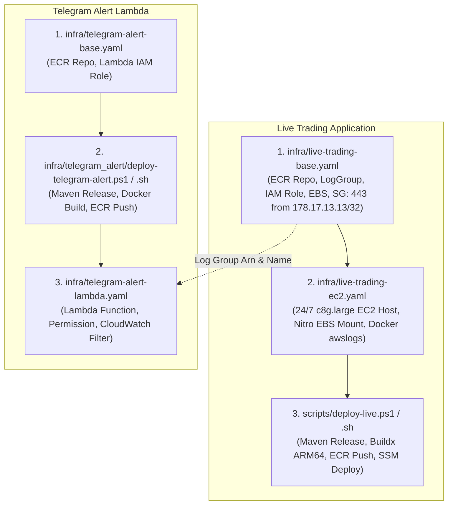

# Deployment Guide - Polymarket Bot on AWS EC2 & CloudFormation (`eu-west-1`)

This guide outlines the modular CloudFormation architecture, infrastructure provisioning, automated Maven release workflow, and **mandatory continuous execution requirements** for running the Polymarket Bot applications ([`live`](file:///c:/work/workspace-java/polymarket-bot/live), [`data`](file:///c:/work/workspace-java/polymarket-bot/data), [`paper`](file:///c:/work/workspace-java/polymarket-bot/paper)) and the Java 25 Telegram Alert Lambda in **AWS Ireland (`eu-west-1`)**.

**AWS CloudFormation is the preferred and mandatory standard** for provisioning and managing all production infrastructure in this repository. All resources are organized into decoupled, modular templates in [`infra/`](file:///c:/work/workspace-java/polymarket-bot/infra) to eliminate chicken-and-egg deployment dependencies and provide independent lifecycle management.

---

## 1. Modular Architecture Overview

The deployment architecture is split into clean, single-responsibility units for both the **Live Trading Engine** and the **Telegram Alert Lambda Function**:



### Key Architectural Invariants:
1. **AWS Region**: `eu-west-1` (Ireland / Dublin) for physical proximity (~5-8 ms RTT over AWS backbone) to Polymarket CLOB in London (`eu-west-2`).
2. **Compute**: Dedicated, non-throttled compute (`c8g.large` Graviton4 ARM64 for Live Trading; `t4g.small` with **Unlimited CPU Credits** for Data Collector).
3. **Storage**: Encrypted persistent **Amazon EBS (`gp3`)** mounted at `/mnt/ebs/polymarket-data` (`DeletionPolicy: Retain`).
4. **Network & Security**:
   - Inbound HTTPS (port 443) access is restricted strictly to authorized IP **`178.17.13.13/32`**.
   - No public SSH (port 22) is open. Management and deployment are executed exclusively via **AWS Systems Manager (SSM)**.
5. **SemVer & Automated Maven Release**:
   - Deployment scripts accept an optional SemVer parameter `-Version x.y.z`.
   - If supplied: sets `-DreleaseVersion=x.y.z` and `-DdevelopmentVersion=x.y.(z+1)-SNAPSHOT`.
   - If omitted: Maven release automatically increments the patch version in batch mode.
   - The released SemVer version is used as the Docker image tag (along with `latest`). Git push of release tags and version bumps is enabled during script execution.

---

## 2. Live Trading Application Deployment

### Step 2.1: Deploy Base Infrastructure Stack (`infra/live-trading-base.yaml`)
Provisions the ECR repository (`polymarket-bot-live-base-repo`), CloudWatch Logs group, IAM role with SSM/SecretsManager access, encrypted gp3 EBS volume, and the security group allowing inbound port 443 access strictly from `178.17.13.13/32`.

#### Windows 11 (PowerShell):
```powershell
aws cloudformation deploy `
  --region eu-west-1 `
  --stack-name polymarket-bot-live-base `
  --template-file infra/live-trading-base.yaml `
  --capabilities CAPABILITY_NAMED_IAM `
  --parameter-overrides AllowedInboundCidr="178.17.13.13/32"
```

#### Linux / macOS (Bash):
```bash
aws cloudformation deploy \
  --region eu-west-1 \
  --stack-name polymarket-bot-live-base \
  --template-file infra/live-trading-base.yaml \
  --capabilities CAPABILITY_NAMED_IAM \
  --parameter-overrides AllowedInboundCidr="178.17.13.13/32"
```

---

### Step 2.2: Deploy Compute Infrastructure Stack (`infra/live-trading-ec2.yaml`)
Provisions the 24/7 `c8g.large` EC2 instance referencing the base stack outputs. UserData automatically attaches and mounts the persistent gp3 EBS volume to `/mnt/ebs/polymarket-data`, sets up Docker with `awslogs` driver, and creates `/usr/local/bin/start-polymarket-live.sh`.

#### Windows 11 (PowerShell):
```powershell
aws cloudformation deploy `
  --region eu-west-1 `
  --stack-name polymarket-bot-live-ec2 `
  --template-file infra/live-trading-ec2.yaml `
  --parameter-overrides BaseStackName="polymarket-bot-live-base" InstanceType="c8g.large"
```

#### Linux / macOS (Bash):
```bash
aws cloudformation deploy \
  --region eu-west-1 \
  --stack-name polymarket-bot-live-ec2 \
  --template-file infra/live-trading-ec2.yaml \
  --parameter-overrides BaseStackName="polymarket-bot-live-base" InstanceType="c8g.large"
```

---

### Step 2.3: Build & Deploy Live Trading Application
Executes Maven release, builds multi-arch `linux/arm64` container image via Docker Buildx, pushes to ECR, and triggers container launch on EC2 via AWS Systems Manager (SSM).

#### Windows 11 (PowerShell) - Primary:
```powershell
# Option A: Automatic patch version increment (e.g. 1.0.0-SNAPSHOT -> 1.0.0 -> 1.0.1-SNAPSHOT):
.\scripts\deploy-live.ps1

# Option B: Explicit SemVer release version:
.\scripts\deploy-live.ps1 -Version "1.1.0"

# Option C: Deploy in dry-run mode (virtual order execution against real Polymarket CLOB):
.\scripts\deploy-live.ps1 -DryRun
```

#### Linux / macOS (Bash) - Alternative:
```bash
# Option A: Automatic patch version increment:
./scripts/deploy-live.sh

# Option B: Explicit SemVer release version:
./scripts/deploy-live.sh -v 1.1.0

# Option C: Deploy in dry-run mode:
./scripts/deploy-live.sh --dry-run
```

---

## 3. Telegram Alert Lambda Deployment

### Step 3.1: Deploy Alert Base Infrastructure Stack (`infra/telegram-alert-base.yaml`)
Provisions the ECR repository (`polymarket-bot-alert-base-telegram-alert-repo`) and least-privilege IAM execution role (`TelegramAlertRole`) with Secrets Manager access for `polymarket-sniper/telegram-credentials`.

#### Windows 11 (PowerShell):
```powershell
aws cloudformation deploy `
  --region eu-west-1 `
  --stack-name polymarket-bot-alert-base `
  --template-file infra/telegram-alert-base.yaml `
  --capabilities CAPABILITY_NAMED_IAM
```

#### Linux / macOS (Bash):
```bash
aws cloudformation deploy \
  --region eu-west-1 \
  --stack-name polymarket-bot-alert-base \
  --template-file infra/telegram-alert-base.yaml \
  --capabilities CAPABILITY_NAMED_IAM
```

---

### Step 3.2: Build & Upload Alert Lambda Container Image
Executes Maven release in `infra/telegram_alert`, packages the Java 25 shaded jar, builds the Docker image with SemVer and `latest` tags, and pushes to Amazon ECR.

#### Windows 11 (PowerShell) - Primary:
```powershell
# Option A: Automatic patch version increment:
.\infra\telegram_alert\deploy-telegram-alert.ps1

# Option B: Explicit SemVer release version:
.\infra\telegram_alert\deploy-telegram-alert.ps1 -Version "1.0.1"
```

#### Linux / macOS (Bash) - Alternative:
```bash
# Option A: Automatic patch version increment:
./infra/telegram_alert/deploy-telegram-alert.sh

# Option B: Explicit SemVer release version:
./infra/telegram_alert/deploy-telegram-alert.sh -v 1.0.1
```

---

### Step 3.3: Deploy Alert Lambda Function Stack (`infra/telegram-alert-lambda.yaml`)
Provisions `AWS::Lambda::Function` referencing the pushed ECR image, authorizes CloudWatch Logs invocation, and attaches `AWS::Logs::SubscriptionFilter` to the Live Trading Log Group for pattern `?WARN ?warn ?ERROR ?error ?FATAL ?fatal ?Exception ?Error`.

#### Windows 11 (PowerShell):
```powershell
aws cloudformation deploy `
  --region eu-west-1 `
  --stack-name polymarket-bot-alert-lambda `
  --template-file infra/telegram-alert-lambda.yaml `
  --parameter-overrides `
      AlertBaseStackName="polymarket-bot-alert-base" `
      LiveBaseStackName="polymarket-bot-live-base" `
      ImageTag="1.0.0"
```

#### Linux / macOS (Bash):
```bash
aws cloudformation deploy \
  --region eu-west-1 \
  --stack-name polymarket-bot-alert-lambda \
  --template-file infra/telegram-alert-lambda.yaml \
  --parameter-overrides \
      AlertBaseStackName="polymarket-bot-alert-base" \
      LiveBaseStackName="polymarket-bot-live-base" \
      ImageTag="1.0.0"
```

---

## 4. Application Update Lifecycle (Updates & Maintenance)

Once base infrastructure is provisioned, you **never** need to recreate EC2 instances or CloudFormation stacks for standard code updates:

### Updating the Live Trading Engine:
Simply run the deployment script:
```powershell
# Windows 11:
.\scripts\deploy-live.ps1 -Version "1.1.1"

# Linux:
./scripts/deploy-live.sh -v 1.1.1
```
The script performs the Maven release, builds and pushes the new `linux/arm64` image to ECR, and instructs the running EC2 instance via AWS SSM to pull the new image and restart the container within seconds—without downtime of the underlying server.

### Updating the Telegram Alert Lambda:
Simply run the alert deployment script:
```powershell
# Windows 11:
.\infra\telegram_alert\deploy-telegram-alert.ps1 -Version "1.0.2"

# Linux:
./infra/telegram_alert/deploy-telegram-alert.sh -v 1.0.2
```
If the Lambda function is already deployed, the script automatically updates the function code via `aws lambda update-function-code`.

---

## 5. Operational Verification & Access

### 5.1 Accessing the Web Dashboard
Because inbound HTTPS port 443 is strictly whitelisted for IP `178.17.13.13/32`:
- Open `https://<EC2-Public-IP>:443` directly from your authorized IP (`178.17.13.13`).
- Or use secure AWS Systems Manager Port Forwarding from any authorized developer workstation without exposing ports:
  ```powershell
  # Windows 11:
  $InstanceId = (aws cloudformation describe-stacks --stack-name polymarket-bot-live-ec2 --region eu-west-1 --query "Stacks[0].Outputs[?OutputKey=='InstanceId'].OutputValue" --output text)

  aws ssm start-session `
    --target $InstanceId `
    --region eu-west-1 `
    --document-name AWS-StartPortForwardingSession `
    --parameters '{"portNumber":["8080"],"localPortNumber":["8080"]}'
  ```
  Then navigate to `http://localhost:8080`.

### 5.2 Verifying CloudWatch Logs
Tail live container logs directly from CloudWatch:
```powershell
aws logs tail "/polymarket-bot/polymarket-bot-live-base/live-trading" --region eu-west-1 --follow
```
Any `WARN`, `ERROR`, or exception log entry will automatically trigger the Telegram Alert Lambda and deliver a formatted notification to your configured Telegram chat.
