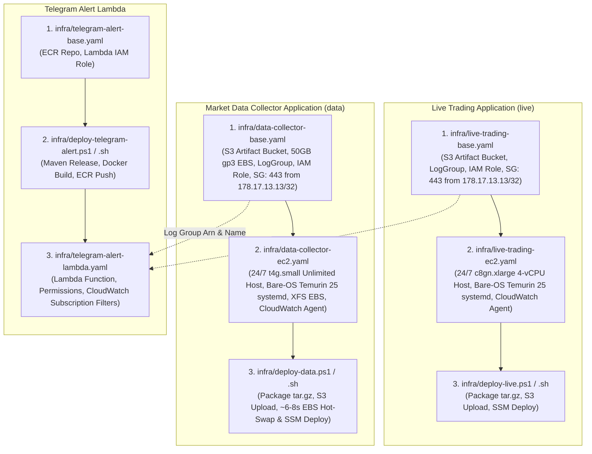

# Deployment Guide - Polymarket Bot on AWS EC2 & CloudFormation (`eu-west-1`)

This guide outlines the modular CloudFormation architecture, infrastructure provisioning, automated Maven release workflow, and **mandatory continuous execution requirements** for running the Polymarket Bot applications ([`live`](file:///c:/work/workspace-java/polymarket-bot/live), [`data`](file:///c:/work/workspace-java/polymarket-bot/data), [`paper`](file:///c:/work/workspace-java/polymarket-bot/paper)) and the Java 25 Telegram Alert Lambda in **AWS Ireland (`eu-west-1`)**.

**AWS CloudFormation is the preferred and mandatory standard** for provisioning and managing all production infrastructure in this repository. All resources are organized into decoupled, modular templates in [`infra/`](file:///c:/work/workspace-java/polymarket-bot/infra) to eliminate chicken-and-egg deployment dependencies and provide independent lifecycle management.

---

## 1. Modular Architecture Overview

The deployment architecture is split into clean, single-responsibility units for the **Live Trading Engine**, the **Market Data Collector**, and the **Telegram Alert Lambda Function**:



### Key Architectural Invariants:
1. **AWS Region**: `eu-west-1` (Ireland / Dublin) for physical proximity (~5-8 ms RTT over AWS backbone) to Polymarket CLOB in London (`eu-west-2`).
2. **Compute & Pipeline**:
   - **Live Trading (`live`)**: Dedicated, non-throttled **`c8gn.xlarge`** (4 vCPU Graviton4 ARM64, 8 GiB RAM, 30 Gbps Enhanced Networking / Nitro v5). Each of the 4 physical Neoverse-V2 cores is mapped to a dedicated lock-free thread (`clob-ws-io-reader`, `clob-book-worker`, `strategy-calculator-worker`, `order-execution-io-worker`) running under Java 25 **Generational ZGC** (`-XX:+UseZGC -XX:+AlwaysPreTouch -XX:+UseTransparentHugePages -XX:+UseThreadPriorities -Xms6g -Xmx6g`).
   - **Market Data Collector (`data`)**: **`t4g.small`** (Graviton2 ARM64, 2 vCPU, 2 GiB RAM) with **Unlimited CPU Credits** and persistent 50 GB `gp3` EBS volume (`vol-028ed5d093f87c4f8`) mounted at `/mnt/ebs/polymarket-data`, running under Java 25 **Generational ZGC** (`-XX:+UseZGC -XX:+AlwaysPreTouch -XX:+UseTransparentHugePages -XX:+UseThreadPriorities -Xms1g -Xmx1g`).
3. **Bare-OS Direct Execution (Zero Docker / Zero NAT Overhead for `live` and `data`)**:
   - Both `live` and `data` run directly on Amazon Linux 2023 via **`systemd`** (`polymarket-live.service` and `polymarket-data.service`) with `AmbientCapabilities=CAP_NET_BIND_SERVICE CAP_SYS_NICE CAP_IPC_LOCK` and `Nice=-20`—completely eliminating `dockerd`, `containerd`, `seccomp-bpf` syscall filtering, and `iptables` NAT (`nf_conntrack`).
   - Application logs are appended to `/var/log/polymarket-live/live-trading.log` and `/var/log/polymarket-data/data-collector.log` and streamed asynchronously by the Amazon CloudWatch Agent to `/polymarket-bot/polymarket-bot-live-base/live-trading` and `/polymarket-bot/polymarket-bot-data-base/data-collector`.
4. **OS-Level Network & Security**:
   - Kernel networking is tuned in `/etc/sysctl.d/99-polymarket-network.conf` (`rmem_default = 16777216`, `rmem_max = 33554432`, `tcp_rmem = 4096 16777216 33554432`, `busy_read = 50`, `busy_poll = 50`, `netdev_max_backlog = 30000`, `ip_unprivileged_port_start = 443`) paired with native Linux `epoll` transport (`quarkus.vertx.prefer-native-transport=true`).
   - Inbound port 443 (bound directly by Quarkus) access is restricted strictly to authorized IP **`178.17.13.13/32`**.
   - No public SSH (port 22) is open. Management and deployment are executed exclusively via **AWS Systems Manager (SSM)**.
5. **SemVer & Maven Release**:
   - Before deploying `live` or `data`, run `mvnw -B release:clean release:prepare` (or `mvnw -B release:clean release:prepare "-DreleaseVersion=1.2.2"`), which packages the release artifacts `.\live\target\quarkus-app\app\live-{x.y.z}.jar` and `.\data\target\quarkus-app\app\data-{x.y.z}.jar`.
   - `infra/deploy-live.ps1` / `.sh` and `infra/deploy-data.ps1` / `.sh` determine the version `{x.y.z}` directly from the built release JAR, package `quarkus-app` into `{module}-{x.y.z}.tar.gz`, upload it to the encrypted S3 artifact bucket, and deploy via SSM.

---

## 2. Live Trading Application Deployment (`live`)

### Step 2.1: Deploy Base Infrastructure Stack (`infra/live-trading-base.yaml`)
Provisions the private encrypted S3 artifact bucket (`LiveTradingArtifactBucket`), CloudWatch Logs group, IAM role with SSM/S3/SecretsManager access, and the security group allowing inbound port 443 access strictly from `178.17.13.13/32`.

#### Windows 11 (PowerShell):
```powershell
aws cloudformation deploy `
  --region eu-west-1 `
  --stack-name polymarket-bot-live-base `
  --template-file infra/live-trading-base.yaml `
  --capabilities CAPABILITY_NAMED_IAM `
  --parameter-overrides AllowedInboundCidr="178.17.13.13/32"
```

#### Linux / macOS (Bash):
```bash
aws cloudformation deploy \
  --region eu-west-1 \
  --stack-name polymarket-bot-live-base \
  --template-file infra/live-trading-base.yaml \
  --capabilities CAPABILITY_NAMED_IAM \
  --parameter-overrides AllowedInboundCidr="178.17.13.13/32"
```

---

### Step 2.2: Deploy Compute Infrastructure Stack (`infra/live-trading-ec2.yaml`)
Provisions the 24/7 `c8gn.xlarge` (4 vCPU Graviton4) EC2 instance referencing the base stack outputs. UserData installs ARM64 Eclipse Temurin 25, tunes kernel TCP receive buffers (`rmem_default = 16777216`, `rmem_max = 33554432`, `busy_read = 50`, `busy_poll = 50`, `ip_unprivileged_port_start = 443`), configures the CloudWatch Agent, and creates `/etc/systemd/system/polymarket-live.service` and `/usr/local/bin/deploy-polymarket-live.sh`.

#### Windows 11 (PowerShell):
```powershell
aws cloudformation deploy `
  --region eu-west-1 `
  --stack-name polymarket-bot-live-ec2 `
  --template-file infra/live-trading-ec2.yaml `
  --parameter-overrides BaseStackName="polymarket-bot-live-base" InstanceType="c8gn.xlarge"
```

#### Linux / macOS (Bash):
```bash
aws cloudformation deploy \
  --region eu-west-1 \
  --stack-name polymarket-bot-live-ec2 \
  --template-file infra/live-trading-ec2.yaml \
  --parameter-overrides BaseStackName="polymarket-bot-live-base" InstanceType="c8gn.xlarge"
```

---

### Step 2.3: Build & Deploy Live Trading Application
First, execute Maven release to build the release artifacts (including `.\live\target\quarkus-app\app\live-{x.y.z}.jar`), then run the deployment script to package `live-{x.y.z}.tar.gz`, upload it to S3, and trigger atomic `systemd` deployment on EC2 via AWS Systems Manager (SSM).

#### Windows 11 (PowerShell) - Primary:
```powershell
# 1. Prepare Maven release (auto-increment patch version or specify releaseVersion):
.\mvnw -B release:clean release:prepare
# or:
.\mvnw -B release:clean release:prepare "-DreleaseVersion=1.2.2"

# 2. Package archive, upload to S3, and deploy systemd service to EC2:
.\infra\deploy-live.ps1
```

#### Linux / macOS (Bash) - Alternative:
```bash
# 1. Prepare Maven release (auto-increment patch version or specify releaseVersion):
./mvnw -B release:clean release:prepare
# or:
./mvnw -B release:clean release:prepare -DreleaseVersion=1.2.2

# 2. Package archive, upload to S3, and deploy systemd service to EC2:
./infra/deploy-live.sh
```

---

## 3. Market Data Collector Application Deployment (`data`)

### Step 3.1: Deploy Base Infrastructure Stack (`infra/data-collector-base.yaml`)
Provisions the private encrypted S3 artifact bucket (`DataCollectorArtifactBucket`), CloudWatch Logs group (`/polymarket-bot/polymarket-bot-data-base/data-collector`), IAM role with SSM/S3/SecretsManager/EBS access (`polymarket-sniper/clob-credentials` and `polymarket-sniper/deribit-credentials`), security group allowing inbound port 443 strictly from `178.17.13.13/32`, and references the existing persistent 50 GB `gp3` EBS volume (`ExistingEbsVolumeId="vol-028ed5d093f87c4f8"`, or creates a new volume if left empty).

#### Windows 11 (PowerShell):
```powershell
aws cloudformation deploy `
  --region eu-west-1 `
  --stack-name polymarket-bot-data-base `
  --template-file infra/data-collector-base.yaml `
  --capabilities CAPABILITY_NAMED_IAM `
  --parameter-overrides `
      ExistingEbsVolumeId="vol-028ed5d093f87c4f8" `
      AllowedInboundCidr="178.17.13.13/32"
```

#### Linux / macOS (Bash):
```bash
aws cloudformation deploy \
  --region eu-west-1 \
  --stack-name polymarket-bot-data-base \
  --template-file infra/data-collector-base.yaml \
  --capabilities CAPABILITY_NAMED_IAM \
  --parameter-overrides \
      ExistingEbsVolumeId="vol-028ed5d093f87c4f8" \
      AllowedInboundCidr="178.17.13.13/32"
```

---

### Step 3.2: Deploy Compute Infrastructure Stack (`infra/data-collector-ec2.yaml`)
Provisions the 24/7 `t4g.small` (Graviton2 ARM64, Unlimited CPU credits) EC2 instance referencing the base stack outputs. UserData installs ARM64 Eclipse Temurin 25, tunes kernel TCP buffers and port 443 binding, configures the CloudWatch Agent, creates `/usr/local/bin/mount-polymarket-ebs.sh`, `/etc/systemd/system/polymarket-data.service`, and `/usr/local/bin/deploy-polymarket-data.sh`.
- If `vol-028ed5d093f87c4f8` is still attached to the previous EC2 instance during initial boot, `UserData` does not block—allowing the new instance to finish booting while the old instance continues recording uninterrupted until Step 3.3 executes the ~6–8s EBS Hot-Swap.

#### Windows 11 (PowerShell):
```powershell
aws cloudformation deploy `
  --region eu-west-1 `
  --stack-name polymarket-bot-data-ec2 `
  --template-file infra/data-collector-ec2.yaml `
  --parameter-overrides BaseStackName="polymarket-bot-data-base" InstanceType="t4g.small"
```

#### Linux / macOS (Bash):
```bash
aws cloudformation deploy \
  --region eu-west-1 \
  --stack-name polymarket-bot-data-ec2 \
  --template-file infra/data-collector-ec2.yaml \
  --parameter-overrides BaseStackName="polymarket-bot-data-base" InstanceType="t4g.small"
```

---

### Step 3.3: Build, Deploy & Hot-Swap EBS Volume (~6–8s Migration Outage)
First, execute Maven release to build the release artifacts (`.\data\target\quarkus-app\app\data-{x.y.z}.jar`), then run `deploy-data.ps1` / `deploy-data.sh`:
- When migrating from a previous instance (such as the legacy `polymarket-bot-data` stack), `deploy-data.ps1` / `.sh` automatically:
  1. Pre-stages the extracted release on the new EC2 instance while the old instance is still recording (`0s` outage).
  2. Triggers an online backup EBS Snapshot (`aws ec2 create-snapshot`) of `vol-028ed5d093f87c4f8`.
  3. Executes an automated **~6–8s EBS Hot-Swap**: cleanly stops the collector and unmounts `/mnt/ebs/polymarket-data` on the old instance, detaches `vol-028ed5d093f87c4f8`, attaches and mounts it on the new instance without reformatting, and starts `polymarket-data.service`—appending new Zstandard frames directly to the existing `.jsonl.zst` files.

#### Windows 11 (PowerShell) - Primary:
```powershell
# 1. Prepare Maven release (if not already prepared):
.\mvnw -B release:clean release:prepare

# 2. Package archive, upload to S3, hot-swap EBS volume (if migrating), and start polymarket-data.service:
.\infra\deploy-data.ps1

# 3. Once the new instance is running (after initial migration from legacy stack), delete the old monolithic stack:
aws cloudformation delete-stack --region eu-west-1 --stack-name polymarket-bot-data
```

#### Linux / macOS (Bash) - Alternative:
```bash
# 1. Prepare Maven release (if not already prepared):
./mvnw -B release:clean release:prepare

# 2. Package archive, upload to S3, hot-swap EBS volume (if migrating), and start polymarket-data.service:
./infra/deploy-data.sh

# 3. Once the new instance is running (after initial migration from legacy stack), delete the old monolithic stack:
aws cloudformation delete-stack --region eu-west-1 --stack-name polymarket-bot-data
```

---

## 4. Telegram Alert Lambda Deployment

### Step 4.1: Deploy Alert Base Infrastructure Stack (`infra/telegram-alert-base.yaml`)
Provisions the ECR repository (`polymarket-bot-alert-base-telegram-alert-repo`) and least-privilege IAM execution role (`TelegramAlertRole`) with Secrets Manager access for `polymarket-sniper/telegram-credentials`.

#### Windows 11 (PowerShell):
```powershell
aws cloudformation deploy `
  --region eu-west-1 `
  --stack-name polymarket-bot-alert-base `
  --template-file infra/telegram-alert-base.yaml `
  --capabilities CAPABILITY_NAMED_IAM
```

#### Linux / macOS (Bash):
```bash
aws cloudformation deploy \
  --region eu-west-1 \
  --stack-name polymarket-bot-alert-base \
  --template-file infra/telegram-alert-base.yaml \
  --capabilities CAPABILITY_NAMED_IAM
```

---

### Step 4.2: Build & Upload Alert Lambda Container Image
Executes Maven release in `infra/telegram_alert`, packages the Java 25 shaded jar, builds the Docker image with SemVer and `latest` tags, and pushes to Amazon ECR.

#### Windows 11 (PowerShell) - Primary:
```powershell
# Option A: Automatic patch version increment:
.\infra\deploy-telegram-alert.ps1

# Option B: Explicit SemVer release version:
.\infra\deploy-telegram-alert.ps1 -Version "1.0.1"
```

#### Linux / macOS (Bash) - Alternative:
```bash
# Option A: Automatic patch version increment:
./infra/deploy-telegram-alert.sh

# Option B: Explicit SemVer release version:
./infra/deploy-telegram-alert.sh -v 1.0.1
```

---

### Step 4.3: Deploy Alert Lambda Function Stack (`infra/telegram-alert-lambda.yaml`)
Provisions `AWS::Lambda::Function` referencing the pushed ECR image, authorizes CloudWatch Logs invocation, and attaches `AWS::Logs::SubscriptionFilter` to both the **Live Trading** and **Data Collector** Log Groups for pattern `?WARN ?warn ?ERROR ?error ?FATAL ?fatal ?Exception ?Error`.

#### Windows 11 (PowerShell):
```powershell
aws cloudformation deploy `
  --region eu-west-1 `
  --stack-name polymarket-bot-alert-lambda `
  --template-file infra/telegram-alert-lambda.yaml `
  --parameter-overrides `
      AlertBaseStackName="polymarket-bot-alert-base" `
      LiveBaseStackName="polymarket-bot-live-base" `
      DataBaseStackName="polymarket-bot-data-base" `
      ImageTag="latest"
```

#### Linux / macOS (Bash):
```bash
aws cloudformation deploy \
  --region eu-west-1 \
  --stack-name polymarket-bot-alert-lambda \
  --template-file infra/telegram-alert-lambda.yaml \
  --parameter-overrides \
      AlertBaseStackName="polymarket-bot-alert-base" \
      LiveBaseStackName="polymarket-bot-live-base" \
      DataBaseStackName="polymarket-bot-data-base" \
      ImageTag="latest"
```

---

## 5. Application Update Lifecycle (Updates & Maintenance)

Once base infrastructure is provisioned, you **never** need to recreate EC2 instances or CloudFormation stacks for standard code updates:

### Updating the Live Trading Engine (`live`) or Market Data Collector (`data`):
First, prepare the Maven release, and then run the corresponding deployment script:
```powershell
# Windows 11:
.\mvnw -B release:clean release:prepare
# or with explicit release version:
.\mvnw -B release:clean release:prepare "-DreleaseVersion=1.2.2"

# Deploy Live Trading:
.\infra\deploy-live.ps1

# Deploy Data Collector:
.\infra\deploy-data.ps1

# Linux:
./mvnw -B release:clean release:prepare
# or with explicit release version:
./mvnw -B release:clean release:prepare -DreleaseVersion=1.2.2

./infra/deploy-live.sh
./infra/deploy-data.sh
```
Each deployment script determines the release version from the built JAR, packages `target\quarkus-app` into `{module}-{x.y.z}.tar.gz`, uploads it to the encrypted S3 artifact bucket, and instructs the running EC2 instance via AWS SSM (`/usr/local/bin/deploy-polymarket-live.sh` or `/usr/local/bin/deploy-polymarket-data.sh`) to extract the release and restart the `systemd` service within seconds—without downtime of the underlying server.

### Updating the Telegram Alert Lambda:
Simply run the alert deployment script:
```powershell
# Windows 11:
.\infra\deploy-telegram-alert.ps1 -Version "1.0.2"

# Linux:
./infra/deploy-telegram-alert.sh -v 1.0.2
```
If the Lambda function is already deployed, the script automatically updates the function code via `aws lambda update-function-code`.

---

## 6. Operational Verification, Logs & Data Sync

### 6.1 Accessing the Web Dashboard, Telemetry & Collector Status APIs
Because inbound port 443 is strictly whitelisted for IP `178.17.13.13/32`:
- **Live Trading**: Open `http://<Live-EC2-Public-IP>:443` directly from your authorized IP (`178.17.13.13`), or query `/api/live/telemetry` and `/api/live/status`.
- **Data Collector**: Query `http://<Data-EC2-Public-IP>:443/api/collector/status` directly from `178.17.13.13`.
- Or use secure AWS Systems Manager Port Forwarding from any authorized developer workstation without exposing ports:
  ```powershell
  # Live Trading (port 443 -> localhost:8080):
  $LiveInstanceId = (aws cloudformation describe-stacks --stack-name polymarket-bot-live-ec2 --region eu-west-1 --query "Stacks[0].Outputs[?OutputKey=='InstanceId'].OutputValue" --output text)
  aws ssm start-session `
    --target $LiveInstanceId `
    --region eu-west-1 `
    --document-name AWS-StartPortForwardingSession `
    --parameters "portNumber=443,localPortNumber=8080"

  # Data Collector (port 443 -> localhost:8084):
  $DataInstanceId = (aws cloudformation describe-stacks --stack-name polymarket-bot-data-ec2 --region eu-west-1 --query "Stacks[0].Outputs[?OutputKey=='InstanceId'].OutputValue" --output text)
  aws ssm start-session `
    --target $DataInstanceId `
    --region eu-west-1 `
    --document-name AWS-StartPortForwardingSession `
    --parameters "portNumber=443,localPortNumber=8084"
  ```

### 6.2 Verifying CloudWatch Logs
Tail live application logs directly from CloudWatch:
```powershell
# Live Trading logs:
aws logs tail "/polymarket-bot/polymarket-bot-live-base/live-trading" --region eu-west-1 --follow

# Data Collector logs:
aws logs tail "/polymarket-bot/polymarket-bot-data-base/data-collector" --region eu-west-1 --follow
```
Any `WARN`, `ERROR`, `FATAL`, or exception log entry in either log group will automatically trigger the Telegram Alert Lambda and deliver a formatted notification to your configured Telegram chat.

### 6.3 Downloading & Cleaning Up Recorded `.jsonl.zst` Market Streams
To download rotated `.jsonl.zst` market stream files from `/mnt/ebs/polymarket-data/collector` on the Data Collector EC2 instance to local disk:
```powershell
# Preview files for a UTC date without downloading:
.\scripts\download-collector-data.ps1 -Date 2026-11-08 -DryRun

# Download, verify byte sizes, and delete verified files from EC2 EBS volume:
.\scripts\download-collector-data.ps1 -Date 2026-11-08
```
