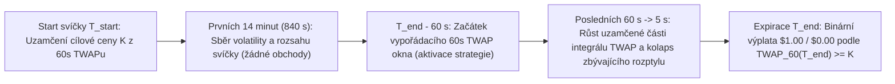
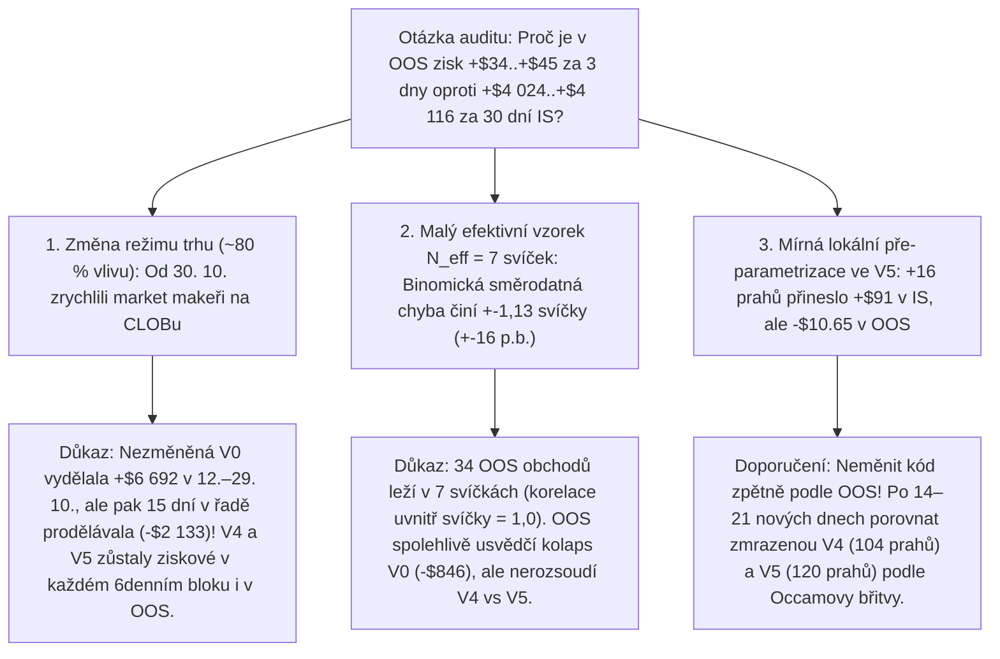

# Teorie a chronologický rozbor optimalizace strategie `UtterParameciumStrategy` (`V0` → `V5`)

Tento dokument slouží jako ucelený studijní průvodce kvantitativní a statistickou optimalizací strategie `UtterParameciumStrategy` pro 15minutové binární trhy **Polymarket BTC Up/Down**. Je psán pro zkušeného Java vývojáře, který detailně zná architekturu aplikace i základní úskalí backtestingu (*look-ahead bias*, *overfitting*), ale dosud se nesetkal se statistikou, stochastickými procesy a kvantitativním modelováním trhů.

Při čtení narazíte u každého nově zavedeného statistického pojmu, odhadu nebo principu na přímý odkaz do samostatné hloubkové kapitoly ve složce `docs/theory/` (viz [přehledová mapa v sekci 1.3](#13-mapa-teoretických-kapitol-ve-složce-docstheory)), kde je dané téma vysvětleno od formální matematické definice přes lidskou intuici až po konkrétní výpočet z naší Java implementace.

---

## Obsah

1. [Doménová mechanika trhu, cíl optimalizace a mapa teoretických kapitol](#1-doménová-mechanika-trhu-cíl-optimalizace-a-mapa-teoretických-kapitol)
2. [Referenční verze `V0` (`UtterParameciumStrategyV0`) — jak funguje a proč krvácela](#2-referenční-verze-v0-utterparameciumstrategyv0--jak-funguje-a-proč-krvácela)
3. [Fáze 1 (`V1` → `V2` → `V3`) — Chirurgické odstranění ztrát a OOS kontrola](#3-fáze-1-v1--v2--v3--chirurgické-odstranění-ztrát-a-oos-kontrola)
   - [3.1 Iterace 1 (`V1`): Omezení katastrofálních chvostových ztrát a mikrostruktura knihy](#31-iterace-1-v1-omezení-katastrofálních-chvostových-ztrát-a-mikrostruktura-knihy)
   - [3.2 Iterace 2 (`V2`): Milisekundový integrál TWAPu, bázově zarovnaný `onCalculatedSpotTwap` a Stop-Add](#32-iterace-2-v2-milisekundový-integrál-twapu-bázově-zarovnaný-oncalculatedspottwap-a-stop-add)
   - [3.3 Iterace 3 (`V3`): Orákulový čas volatility, Parkinsonova vlnová podlaha a 1. OOS ověření](#33-iterace-3-v3-orákulový-čas-volatility-parkinsonova-vlnová-podlaha-a-1-oos-ověření)
4. [Fáze 2 (`V4` → `V5`) — Selektivní expanze na propásnuté příležitosti](#4-fáze-2-v4--v5--selektivní-expanze-na-propásnuté-příležitosti)
   - [4.1 Iterace 4 (`V4`): Matematické uzamčení TWAPu, předoknový vstup a obousměrný `onCalculatedSpotTwap`](#41-iterace-4-v4-matematické-uzamčení-twapu-předoknový-vstup-a-obousměrný-oncalculatedspottwap)
   - [4.2 Iterace 5 (`V5`): Jemné doladění hran a zastavení optimalizace před overfittingem](#42-iterace-5-v5-jemné-doladění-hran-a-zastavení-optimalizace-před-overfittingem)
5. [Rozšířený 3denní Out-of-Sample (`11.–13. 11. 2026`) a kritický statistický audit overfittingu](#5-rozšířený-3denní-out-of-sample-1113-11-2026-a-kritický-statistický-audit-overfittingu)
6. [Souhrnná srovnávací matice evoluce `V0` → `V5`](#6-souhrnná-srovnávací-matice-evoluce-v0--v5)

---

## 1. Doménová mechanika trhu, cíl optimalizace a mapa teoretických kapitol

### 1.1 Jak přesně se vypořádává 15minutový trh Polymarket BTC Up/Down?

Každých 15 minut (`900 000 ms`) se otevírá a uzavírá nezávislý predikční trh se dvěma komplementárními tokeny: **`BTC-UP`** a **`BTC-DOWN`**. Při expiraci v čase $T_{\text{end}}$ vyplatí vítězný token přesně **`1,00 USD`** za akcii a poražený token **`0,00 USD`**.

Klíčem k celé strategii je **přesné pravidlo orákulového vypořádání** přes streamy PolyBolt (`price.crypto` a `price.crypto.twap` ze sítě Chainlink):
1. **Cílová cena svíčky $K$ (`targetPriceCents`)**: Uzamkne se na začátku svíčky $T_{\text{start}}$ jako hodnota 60sekundového časově váženého průměru ceny (**60s TWAP**) za poslední minutu předchozí svíčky $[T_{\text{start}} - 60\text{ s}, T_{\text{start}}]$.
2. **Vypořádací cena svíčky $\text{TWAP}_{60}(T_{\text{end}})$**: Není poslední spotová cena v sekundě $T_{\text{end}}$, nýbrž **60sekundový časově vážený průměr publikovaných cen Chainlinku na intervalu posledních 60 sekund svíčky $[T_{\text{end}} - 60\text{ s}, T_{\text{end}}]$**.
3. Platí-li $\text{TWAP}_{60}(T_{\text{end}}) \ge K$, vyhrává `BTC-UP`; je-li přísně nižší, vyhrává `BTC-DOWN`.

### 1.2 Proč v posledních 60 sekundách vzniká obchodovatelná statistická neefektivita?

Během prvních 14 minut svíčky nemá minulá trajektorie ceny na konečný 60s TWAP žádný přímý paměťový vliv — cokoliv se stane ve 3. minutě, vypadne z 60sekundového klouzavého okna dávno před koncem svíčky.
Jakmile však do konce svíčky zbývá $\tau < 60\text{ s}$, nastává **strukturální asymetrie**:
- Část finálního průměru o délce $60 - \tau$ sekund **už proběhla a nelze ji změnit**.
- Zbývajících $\tau$ sekund má v konečném průměru pouze váhu $\tau / 60$ a jejich náhodné výkyvy se mezi sebou částečně vyruší.
- Řada účastníků na knize objednávek (*CLOB*) však intuitivně sleduje spotový graf Bitcoinu místo integrálu 60s TWAPu, anebo v rychlých pohybech nestihne včas přecenit své kotace.

### 1.3 Mapa teoretických kapitol ve složce `docs/theory/`

Aby byl tento hlavní dokument plynulým příběhem optimalizace a zároveň vám neunikl žádný matematický základ, je veškerá statistická teorie rozpracována v **10 samostatných kapitolách**:

| Kapitola | Co v ní najdete (formální definice + lidské vysvětlení + příklad z kódu) | Poprvé použito |
| :--- | :--- | :---: |
| [01 — Binární opce, EV a poplatky](../theory/01-binarni-opce-stredni-hodnota-a-poplatky.md) | Bernoulliho veličina, střední hodnota $\text{EV}$, asymetrie ztráty ku zisku, parabolický poplatek Polymarketu, tick `floor`/`ceil` | `V0` |
| [02 — Integrál TWAP a náhodná procházka](../theory/02-twap-integral-nahodna-prochazka-a-rozptyl.md) | Schodovitý integrál TWAPu, bezdriftová náhodná procházka, odvození vah zbývající odchylky `TWAP_REM_WEIGHT_BPS`, `oracleLagMs` | `V0` / `V1` / `V2` |
| [03 — Normální rozdělení, Z-skóre a tlusté chvosty](../theory/03-normalni-rozdeleni-z-skore-a-tluste-chvosty.md) | Gaussovo rozdělení, Z-skóre, interpolace $\Phi(z)$, špičatost (*kurtosis*) a proč tlusté chvosty BTC vyžadují `maxModelProbMc` a Z-křivku | `V0` / `V1` / `V2` |
| [04 — Odhad volatility pomocí MAD a $\sqrt{\Delta t}$](../theory/04-odhad-volatility-mad-a-casove-skalovani.md) | Robustní střední absolutní odchylka (*MAD*), původ faktoru `1,253` ($\sqrt{\pi/2}$), časové škálování, vícehorizontní okna a orákulový čas | `V0` / `V1` / `V3` |
| [05 — Výkonnostní metriky a Brierovo skóre](../theory/05-vykonnostni-metriky-a-brier-skore.md) | *Profit Factor*, *Win Rate* (obchodní vs. tržní), *Max Drawdown*, *Sharpe*, proč u binárních opcí exploduje *Sortino*, *Brier Score* | Hodnocení `V0..V5` |
| [06 — Mikrostruktura CLOBu a EMA báze](../theory/06-mikrostruktura-clob-nepriznivy-vyber-a-ema-baze.md) | Nepříznivý výběr (*toxic flow*), 1s minimum-bucket kotací, *Lead-Lag* vztah burz a Chainlinku, celočíselné EMA ($\alpha = 1/16$) s Huber clampem | `V1` / `V2` / `V4` |
| [07 — Řízení pozice a dynamické limity](../theory/07-rizeni-pozice-kellyho-princip-a-dynamicke-limity.md) | Kellyho princip pro binární opce, zákaz otáčení směru, časová rampa inventáře, cenová pásma rizika, *Locked Debt* a *Stop-Add* pojistky | `V1` / `V2` / `V3` |
| [08 — Autokorelace a Parkinsonův rozsah](../theory/08-autokorelace-vlnovy-rozsah-a-parkinsonuv-odhad.md) | Proč `1s` přírůstky selhávají při hladkých vlnách, původ konstanty `1.595769` ($\sqrt{8/\pi}$), 14m rozsahová podlaha a *Whipsaw Excursion* | `V3` / `V5` |
| [09 — Matematické uzamčení TWAPu](../theory/09-matematicke-uzamceni-twap-a-imunita-vuci-padu.md) | Deterministický příspěvek $C_{\text{locked}}$, kritická hloubka pádu a dvoustupňové uzamčení pro bezpečný nákup drahých opcí do `0,92 USD` | `V4` |
| [10 — Statistická inference a audit overfittingu](../theory/10-statisticka-inference-efektivni-vzorek-nestacionarita-a-overfitting.md) | Efektivní velikost vzorku $N_{\text{eff}}$ (korelace dávek ve svíčce), binomická směrodatná chyba, změna režimu CLOBu, stupně volnosti a Occamova břitva | OOS & Audit |

---

## 2. Referenční verze `V0` (`UtterParameciumStrategyV0`) — jak funguje a proč krvácela

Než se pustíme do jakékoliv úpravy, musíme do posledního šroubku rozebrat výchozí referenční implementaci `UtterParameciumStrategyV0` (34 laditelných parametrů a konstant). Všechny výpočty na horké cestě v ní probíhají bez alokací na haldě v celočíselné aritmetice: ceny Bitcoinu v **centech USD (`long`, `100 = 1,00 USD`)** a ceny opcí i pravděpodobnosti v **milicentech (`int`, `1 000 mc = 1,00 USD = 100,0 %`)**.

### 2.1 Matematický řetězec rozhodování ve `V0` (krok za krokem)

Při každém příchodu kotace knihy objednávek (`onOrderBookQuote`) nebo nového tiku Chainlinku (`onPolymarketCryptoPrice`) v okně $5\,000\text{ ms} \le \tau \le 61\,000\text{ ms}$ provede `V0` šest výpočetních kroků:

1. **Projekce konečného 60s TWAPu** (👉 podrobná teorie v [02 — Integrál TWAP a náhodná procházka](../theory/02-twap-integral-nahodna-prochazka-a-rozptyl.md)):
   Z kruhového bufferu `ChainlinkTwapBuffer` spočítá průměr dosud přijatých tiků v okně $M_{\text{locked}}$ a spojí jej se současnou spotovou cenou $S_t$:

$$
\widehat{\text{TWAP}} = \frac{(60\,000 - \tau_{\text{ms}})\,M_{\text{locked}} + \tau_{\text{ms}}\,S_t}{60\,000}.
$$

2. **Odhad jednosekundové volatility $\sigma_{1s}$ a zbývající nejistoty TWAPu $\sigma_{\text{rem}}(\tau)$** (👉 podrobná teorie v [04 — Odhad volatility pomocí MAD](../theory/04-odhad-volatility-mad-a-casove-skalovani.md)):
   `SpotVolatilityBuffer` průměruje posledních až 64 absolutních rozdílů po sobě jdoucích cen $|S_i - S_{i-1}|$ (pokud přišly v rozmezí `800..2 500 ms`), násobí je Gaussovým koeficientem konzistence $\sqrt{\pi/2} \approx 1{,}253$, ořízne do intervalu `[80, 3500]` centů (`0,80 USD/s` až `35,00 USD/s`) a vynásobí předpočítanou vahou zbývajícího okna $W(\tau)$ z pole `TWAP_REM_WEIGHT_BPS`:

$$
\hat{\sigma}_{1s} = \text{clamp}\!\left(1{,}253 \cdot \frac{1}{n}\sum_{i=1}^{n} |\Delta S_i|,\; 80,\; 3500\right), \qquad \sigma_{\text{rem}}(\tau) = \max\!\left(40,\; \hat{\sigma}_{1s} \cdot W(\tau)\right).
$$

3. **Efektivní polštář nad cílovou cenou $K$**:
   Pro kandidátní stranu (např. `UP`, kde $d_{\text{proj}} = \widehat{\text{TWAP}} - K$ a $d_{\text{spot}} = S_t - K$) vezme menší z obou náskoků $d_{\text{eff}} = \min(d_{\text{proj}}, d_{\text{spot}})$ (s jedinou výjimkou pro $\tau \le 25\text{ s}$ a $d_{\text{proj}} \ge 12{,}00\text{ USD}$, kde povolí i mírně záporný spot $d_{\text{eff}} = d_{\text{proj}} + d_{\text{spot}} > 6{,}00\text{ USD}$) a vyžaduje alespoň $d_{\text{eff}} \ge 2{,}00\text{ USD}$ (`200` centů).

4. **Převod polštáře na Z-skóre a modelovou pravděpodobnost $\Phi(z)$** (👉 podrobná teorie v [03 — Normální rozdělení, Z-skóre a tlusté chvosty](../theory/03-normalni-rozdeleni-z-skore-a-tluste-chvosty.md)):

$$
z = \frac{d_{\text{eff}}}{\sigma_{\text{rem}}(\tau)}, \qquad p_{\text{model}} = \Phi(z) \quad (\text{interpolováno z } \texttt{NORMAL\_CDF\_HALF\_TABLE\_MC}).
$$

   Pro drahé opce platí jen dva skokové prahy: při $a \ge 0{,}80\text{ USD}$ musí být $z \ge 2{,}50\sigma$ a při $a \ge 0{,}90\text{ USD}$ musí být $z \ge 2{,}70\sigma$; pod `0,80 USD` stačí $p_{\text{model}} \ge 65{,}0\,\%$ ($z \ge 0{,}39\sigma$).

5. **Výpočet parabolického poplatku a čisté hrany (*Net Edge*)** (👉 podrobná teorie v [01 — Binární opce, EV a poplatky](../theory/01-binarni-opce-stredni-hodnota-a-poplatky.md)):
   Kotace knihy se konzervativně zaokrouhlí (`Bid` dolů, `Ask` nahoru na `10 mc` = `0,01 USD`), ověří se rozpětí `spread <= 80 mc` (`0,08 USD`), cena v pásmu `[380, 970] mc` (`0,38–0,97 USD`) a spočítá se čistá očekávaná hodnota na akcii po započtení parabolického poplatku $f(a) = 0{,}07 \cdot a(1 - a)$:

$$
e_{\text{mc}} = p_{\text{model}} - a_{\text{mc}} - f_{\text{mc}}(a_{\text{mc}}).
$$

6. **Dávkování příkazu**:
   Překročí-li $e_{\text{mc}}$ minimální požadovanou hranu `minEdgeMc = 25 mc` (`+0,025 USD` na akcii), vyšle strategie každých `250 ms` (*cooldown*) nákupní příkaz o velikosti `5` až `30` akcií (první výstřel při $\tau \ge 55\text{ s}$ je fixních `15` akcií) až do celkového limitu `maxInventorySharesPerSide = 600` akcií na každou stranu.

### 2.2 Výsledky `V0` na celém 30denním In-Sample (`12. 10. – 10. 11. 2026`)

Spuštění Java modulu `backtest` nad všemi `2 842` historickými 15minutovými trhy přineslo pro `V0` tato výchozí čísla (👉 přesné vzorce a interpretaci všech ukazatelů najdete v [05 — Výkonnostní metriky a Brierovo skóre](../theory/05-vykonnostni-metriky-a-brier-skore.md)):

| Metrika (`V0` Baseline, 30 dní IS) | Hodnota | Co nám toto číslo signalizuje? |
| :--- | :---: | :--- |
| **Obchodované trhy / Tržní Win Rate** | `634` (`541 V / 93 P` = `85,3 %`) | Vysoká četnost, ale v 93 svíčkách došlo ke ztrátě |
| **Celkem obchodů / Obchodní Win Rate** | `12 012` (`86,54 %`) | Průměrně **19 dávkových příkazů** v jedné svíčce! |
| **Hrubý zisk (`GP`) / Hrubá ztráta (`GL`)** | `+$32,284.31` / **`-$26,879.53`** | **83,3 % veškerého hrubého zisku spolkly ztráty!** |
| **Zaplacené poplatky / Čistý zisk (`NetPnL`)** | `$2,180.12` / `+$5,404.78` | Poplatky ukrojily obrovskou část tenké marže |
| **Profit Factor (`PF`) / EV na obchod** | **`1.201`** / **`+$0.45`** | Nebezpečně křehká hrana — malý posun trhu znamená ztrátu |
| **Maximální propad (`Max Drawdown`)** | **`$4,649.17` (`26,05 %`)** | Nepřijatelný propad — v listopadu navíc propad stále rostl |

### 2.3 Diagnostika 5 systémových statistických vad `V0` (rozbor Top 10 ztrát)

Detailní rozbor 10 nejztrátovějších svíček `V0` (kde jednotlivé svíčky prodělávaly `-450 USD` až `-680 USD`!) odhalil pět přesných příčin, proč zdánlivě rozumný matematický model ztratil téměř `27 000 USD`:

1. **Gaussova iluze jistoty v tlustých chvostech a nákupy za `0,85–0,97 USD`**:
   Při $z = 2{,}8\sigma$ hlásila tabulka `normalCdfMc` pravděpodobnost výhry `99,7 %`. Strategie proto ochotně kupovala `600` akcií po `0,94 USD` (v sázce `565 USD` pro potenciální zisk `34 USD`!). Jak vysvětluje [kapitola 03](../theory/03-normalni-rozdeleni-z-skore-a-tluste-chvosty.md), na Bitcoinu přicházejí likvidační skoky mnohonásobně častěji než v Gaussově rozdělení — jediný takový obrat vymazal 17 vítězných svíček.
2. **Sebevražedné otáčení pozice v téže svíčce (*Direction Flipping / Whipsaw Double-Loss*)**:
   `V0` sledovala `netSharesUp` a `netSharesDown` nezávisle. V kmitajících svíčkách nakoupila v čase $\tau = 52\text{ s}$ `400` akcií `BTC-UP`, a když cena v $\tau = 25\text{ s}$ spadla pod $K$, nakoupila ještě `350` akcií `BTC-DOWN` — zaplatila dvojí spread i poplatky a garantovala si těžkou ztrátu bez ohledu na výsledek!
3. **Slepá a nenormalizovaná volatilita + ignorování zpoždění orákula**:
   `SpotVolatilityBuffer` ve `V0` nenormalizoval přírůstky pomocí $\sqrt{1000/\Delta t}$, měl jen 64s paměť a dovolil pád $\sigma_{1s}$ až na `0,80 USD/s`. Když si trh uprostřed divoké svíčky na 30 sekund oddechl, klesla odhadnutá odchylka na polovinu, Z-skóre uměle vyskočilo na dvojnásobek a `V0` nakoupila plný inventář těsně před dalším výbuchem volatility. Navíc ignorovala, že poslední tik Chainlinku je již `1–2 sekundy` starý (`priceTimestampMs`).
4. **Nákup přímo do toxického toku (*Adverse Selection* na CLOBu)**:
   Když se Bitcoin na Binance prudce propadl, market makeři na CLOBu během `100 ms` srazili Ask `BTC-UP` z `0,80 USD` na `0,65 USD`. Protože Chainlink publikoval novou nižší cenu až o `1,2 s` později, viděla `V0` po celých 1,2 sekundy „starou vysokou pravděpodobnost `85 %` a zázračně levný Ask `0,65 USD`“ — a vychrlila 4 maximální nákupní dávky přímo do rukou informovaných prodejců!
5. **Plné riziko `600` akcií v nulté sekundě okna a zkreslený průměr tiků**:
   V čase $\tau = 60\text{ s}$ (kdy je uzamčeno `0 %` TWAPu) sázela `V0` stejných `600` akcií jako v $\tau = 20\text{ s}$, a `meanCentsInWindow` počítalo prostý průměr zpráv `sum / count` místo časového integrálu.

---

## 3. Fáze 1 (`V1` → `V2` → `V3`) — Chirurgické odstranění ztrát a OOS kontrola

Podle zadání jsme se v první fázi soustředili **výhradně na eliminaci ztrátových trhů a zvýšení statistické kvality obchodů**, než vůbec začneme řešit propásnuté příležitosti.

---

### 3.1 Iterace 1 (`V1`): Omezení katastrofálních chvostových ztrát a mikrostruktura knihy

#### Co jsme v Iteraci 1 zavedli a proč:
1. **Striktní zákaz otáčení pozice v téže svíčce (`allowDirectionFlip = false`)** (👉 [07 — Řízení pozice](../theory/07-rizeni-pozice-kellyho-princip-a-dynamicke-limity.md)):
   Jakmile strategie v dané 15m svíčce nakoupí první akcii `UP`, je strana `DOWN` až do expirace zablokována (a naopak). Tím okamžitě zmizely dvojité whipsaw ztráty.
2. **Časově odstupňovaný limit inventáře (`computeTimeStagedMaxInventory`)** (👉 [07 — Řízení pozice](../theory/07-rizeni-pozice-kellyho-princip-a-dynamicke-limity.md)):
   Na začátku okna ($\tau = 60\text{ s}$) smí strategie držet nejvýše `55 %` maximální pozice (`earlyInventoryCapBps = 5500`, tj. `330` akcií) a plných `600` akcií se lineárně odemyká až do $\tau = 35\text{ s}$ (`fullInventoryTauMs = 35000`), kdy už je téměř polovina 60s TWAPu uzamčena.
3. **Strop modelové pravděpodobnosti pro tlusté chvosty (`maxModelProbMc = 975`) a snížení stropu ceny (`maxEntryPriceMc = 880`)** (👉 [01 — Binární opce](../theory/01-binarni-opce-stredni-hodnota-a-poplatky.md), [03 — Tlusté chvosty](../theory/03-normalni-rozdeleni-z-skore-a-tluste-chvosty.md)):
   Modelová pravděpodobnost nesmí nikdy překročit `97,5 %` a strategie nikdy nekupuje opce dražší než `0,88 USD`.
4. **Kompenzace zpoždění orákula (`oracleLagMs`)** (👉 [02 — Rozptyl TWAPu](../theory/02-twap-integral-nahodna-prochazka-a-rozptyl.md)):
   Rozdíl `nowMs - priceTimestampMs` (oříznutý na `0..4 000 ms`) se přičítá ke zbývajícímu času $\tau_{\text{eff}} = \tau + \Delta t_{\text{lag}}$ při čtení z `TWAP_REM_WEIGHT_BPS`.
5. **Tříhorizontní časově škálovaná MAD volatilita** (👉 [04 — Odhad volatility pomocí MAD](../theory/04-odhad-volatility-mad-a-casove-skalovani.md)):
   Každý přírůstek je normalizován výrazem $|\Delta S|\sqrt{1000/\Delta t_{\text{ms}}}$, podlaha `minSigma1sCents` stoupla z `80` na `105` centů (`1,05 USD/s`) a `SpotVolatilityBuffer` kombinuje okamžitý `1s burst` (16 vzorků), `1s short` (64 vzorků) a `5s regime` (128 vzorků ≈ 10,7 minuty), takže si pamatuje neklid svíčky i přes 30sekundové zklidnění.
6. **Ochrana před nepříznivým výběrem (`RecentQuoteBuffer` + 5s/10s drift blok)** (👉 [06 — Mikrostruktura CLOBu](../theory/06-mikrostruktura-clob-nepriznivy-vyber-a-ema-baze.md)):
   Před uzamčením TWAPu ($\tau > 25\text{ s}$) blokujeme vstup, pokud se Chainlink za 10 s pohnul proti nám o $\ge 9{,}50\text{ USD}$ (nebo za 5 s o $\ge 5{,}93\text{ USD}$), anebo pokud udržitelná 1s-minimum kotace na CLOBu za posledních 8 sekund spadla na Asku o $\ge 100\text{ mc}$ (`0,10 USD`) a současně na Bidu o $\ge 75\text{ mc}$.

#### Dopad Iterace 1 (`V0` → `V1` na 30 dnech IS):

| Metrika | `V0` (Baseline) | **`V1` (Iterace 1)** | Změna |
| :--- | :---: | :---: | :---: |
| **Obchodované trhy / Obchody** | `634` / `12 012` | **`245` / `1 871`** | Odfiltrováno 84 % šumových/toxických exekucí |
| **Hrubá ztráta (`Gross Loss`)** | `-$26,879.53` | **`-$4,845.77`** | **Pokles ztrát o -82,0 % (`+$22,034` ušetřeno!)** |
| **Čistý zisk (`Net PnL`)** | `+$5,404.78` | **`+$4,660.89`** | Zachováno **86 %** čistého zisku s pětinovým rizikem |
| **Profit Factor / EV na obchod** | `1.201` / `+$0.45` | **`1.962` / `+$2.49`** | **5,5× vyšší očekávaný zisk na exekuci** |
| **Max Drawdown** | `$4,649.17` (`26,05 %`) | **`$1,533.30` (`10,08 %`)** | Propad snížen téměř **na třetinu** |

---

### 3.2 Iterace 2 (`V2`): Milisekundový integrál TWAPu, bázově zarovnaný `onCalculatedSpotTwap` a Stop-Add

#### Co ukázala analýza 10 největších ztrát `V1`:
1. Ve ztrátových svíčkách se záhy ukázalo, že prostý průměr tiků `sum / count` v `ChainlinkTwapBuffer` se při nerovnoměrné kadenci Chainlinku lišil od skutečného časového integrálu o **5 až 15 USD**!
2. I když `RecentQuoteBuffer` chytil velké pády knihy, při rychlém obratu Bitcoinu na spotových burzách měl interní stream `onCalculatedSpotTwap` náskok **1 až 1,5 sekundy** před Chainlinkem, který `V1` vůbec nevyužívala.
3. Mezi `0,72 USD` a `0,79 USD` stále chyběl jakýkoliv požadavek na minimální Z-skóre (`requiredMinZCenti` skákalo z `0` na `250` až na `0,80 USD`) a strategie nakupovala plný počet akcií i u drahých opcí kolem `0,78–0,84 USD`.
4. Pokud trh v úvodu minuty vytvořil pěkný polštář (`+14 USD`), nakoupil `200` akcií, a pak se polštář začal rozpadat (`+14 → +8 → +4 USD`), `V1` při každém zlevnění opce „ředila“ pozici dalšími nákupy až do prohry.

#### Co jsme v Iteraci 2 zavedli:
1. **Exaktní milisekundový schodovitý integrál TWAPu (*Zero-Order Hold*)** (👉 [02 — Integrál TWAP](../theory/02-twap-integral-nahodna-prochazka-a-rozptyl.md)):
   `ChainlinkTwapBuffer.meanCentsInWindow` váží každou cenu přesnou dobou její platnosti `dt = ts - cursorMs` v milisekundách a kotví levý okraj okna $T_{\text{end}} - 60\text{ s}$ poslední cenou před začátkem minuty.
2. **Bázově zarovnaný ochranný signál `onCalculatedSpotTwap`** (👉 [06 — Lead-Lag a EMA báze](../theory/06-mikrostruktura-clob-nepriznivy-vyber-a-ema-baze.md)):
   Zaveden `CalcSpotBuffer` (500ms koše) a online odhad pomalé strukturální báze $\hat{\beta}_t$ mezi burzovním košem a Chainlinkem pomocí **celočíselného EMA ($\alpha = 1/16$, `CALC_BASIS_EMA_SCALE = 16`) s Huberovým ořezáním inovací `±15 USD`**. Pokud se bázově zarovnaný spot odchýlí proti našemu směru nad pásmo šumu (`4,00 USD` deadband), srazí efektivní spotovou cenu o `60 %` předstihu (`calcLeadWeightBps = 6000`), a překročí-li nepříznivý předstih `8,50 USD` nebo 4s pád `12,50 USD`, okamžitě zablokuje vstup dříve, než pád dorazí do Chainlinku!
3. **Spojitá po částech lineární křivka `requiredMinZCenti(askMc)` a strop `0,84 USD`** (👉 [03 — Z-skóre a tlusté chvosty](../theory/03-normalni-rozdeleni-z-skore-a-tluste-chvosty.md)):
   Odstraněna propast pod `0,80 USD` — požadované Z-skóre plynule stoupá od `1,05 σ` při `0,72 USD` přes `1,60 σ` (`0,76 USD`) až na `2,50 σ` (`0,80 USD`), maximální cena klesla na `840 mc` (`0,84 USD`) a opce $\ge 0{,}80\text{ USD}$ jsou povoleny až při $\tau \le 38\text{ s}$.
4. **Dynamické krácení inventáře podle ceny opce (`riskTierBps`), `Locked TWAP Debt` a pojistky `Stop-Add`** (👉 [07 — Řízení pozice](../theory/07-rizeni-pozice-kellyho-princip-a-dynamicke-limity.md)):
   Nad `0,72 USD` klesá maximální povolený inventář na `65 %` → `40 %` → `30 %`; záporný uzamčený průměr z úvodu minuty aktivuje filtr `Locked Debt`; a pokles polštáře pod polovinu dosaženého maxima (`Cushion Decay`) nebo pokles Bidu o `0,10 USD` (`Bid Drawdown`) okamžitě zastaví další přikupování.

#### Dopad Iterace 2 (`V1` → `V2` na 30 dnech IS):

| Metrika | `V1` (Iterace 1) | **`V2` (Iterace 2)** | Změna |
| :--- | :---: | :---: | :---: |
| **Obchodované trhy / Tržní Win Rate** | `245` (`75,5 %`) | **`128` (`79,7 %`)** | **+4,2 p.b.** tržní úspěšnosti |
| **Hrubá ztráta (`Gross Loss`)** | `-$4,845.77` | **`-$1,806.22`** | **Další pokles ztrát o -62,7 %!** |
| **Čistý zisk (`Net PnL`)** | `+$4,660.89` | **`+$4,246.12`** | Udrženo přes `+4 246 USD` čistého zisku |
| **Profit Factor / EV na obchod** | `1.962` / `+$2.49` | **`3.351` / `+$4.60`** | Skok Profit Factoru z `1,96` na **`3,35`** |
| **Max Drawdown** | `$1,533.30` (`10,08 %`) | **`$408.42` (`3,05 %`)** | Propad stlačen pod **3,1 %** účtu! |

---

### 3.3 Iterace 3 (`V3`): Orákulový čas volatility, Parkinsonova vlnová podlaha a 1. OOS ověření

#### Co ukázala analýza zbylých Top 10 ztrát `V2`:
Ve `V2` už nezůstala jediná obří „hloupá“ ztráta, ale v zbývajících 26 ztrátových svíčkách dominoval jeden sofistikovaný jev: **hladké autokorelované dvouminutové vlny**. Bitcoin v prvních 14 minutách opsal plynulé vlny o rozsahu `140–220 USD`, ale protože se každou vteřinu posouval hladce bez cukání, hlásil `1s` i `5s` MAD klamně nízkou volatilitu `1,20–1,40 USD/s` (navíc občas zašuměnou síťovým jitterem WebSocket razítka `timestampMs`).

#### Co jsme v Iteraci 3 zavedli:
1. **Hodinování `SpotVolatilityBuffer` čistě podle orákulového `priceTimestampMs` a 14m Parkinsonova vlnová podlaha** (👉 [04 — Orákulový čas](../theory/04-odhad-volatility-mad-a-casove-skalovani.md), [08 — Autokorelace a Parkinsonův odhad](../theory/08-autokorelace-vlnovy-rozsah-a-parkinsonuv-odhad.md)):
   Eliminován síťový jitter časů doručení. V prvních 14 minutách svíčky sbírá buffer vnitrosvíčkové maximum a minimum ($H - L$) a pomocí nestranného Fellerova/Parkinsonova koeficientu $\sqrt{8/\pi} = 1{,}595769$ počítá rozsahovou volatilitu $\hat{\sigma}_{\text{range}} = \frac{H - L}{1{,}595769\sqrt{\Delta T}}$. Překročí-li `2,20 USD/s`, vytvoří pevnou vlnovou podlahu $0{,}55\,\hat{\sigma}_{\text{short}} + 0{,}45\,\hat{\sigma}_{\text{range}}$.
2. **Prodloužení spojité Z-křivky až do `0,67 USD` a faktor přesvědčení `convictionBps`** (👉 [03 — Z-křivka](../theory/03-normalni-rozdeleni-z-skore-a-tluste-chvosty.md), [07 — Přesvědčení pozice](../theory/07-rizeni-pozice-kellyho-princip-a-dynamicke-limity.md)):
   `requiredMinZCenti` plynule začíná už na `0,67 USD` (`0,70 σ`) a před uzamčením ($\tau > 38\text{ s}$) krátí `convictionBps` maximální pozici u mělkých signálů ($z < 0{,}85\sigma$) až na `40 %`.
3. **Ochrana proti vnitrookennímu překmitu (`Whipsaw Excursion`) a citlivější `onCalculatedSpotTwap`** (👉 [08 — Whipsaw](../theory/08-autokorelace-vlnovy-rozsah-a-parkinsonuv-odhad.md)):
   Pokud cena uvnitř samotného 60s okna již klesla na opačnou stranu cíle $K$ o $\ge 5{,}00\text{ USD}$, smí nakoupit odraz jen při silném průrazu; srážka `onCalculatedSpotTwap` zesílila na `70 %` (deadband `3,20 USD`, veto při `6,50 USD` leadu / `9,50 USD` 4s driftu).

#### Dopad Iterace 3 (`V2` → `V3` na 30 dnech IS):

| Metrika | `V2` (Iterace 2) | **`V3` (Iterace 3)** | Změna (a srovnání s `V0`) |
| :--- | :---: | :---: | :--- |
| **Obchodované trhy / Obchodní WR** | `128` / `86,15 %` | **`97` / `90,76 %`** | Přes **90,7 %** vítězných exekucí! |
| **Hrubá ztráta (`Gross Loss`)** | `-$1,806.22` | **`-$920.29`** | **Ztráty sníženy o -96,6 % oproti `V0` (`-$26,880`)!** |
| **Čistý zisk (`Net PnL`)** | `+$4,246.12` | **`+$3,570.58`** | Ultra-čisté jádro ziskových svíček |
| **Profit Factor / EV na obchod** | `3.351` / `+$4.60` | **`4.880` / `+$5.89`** | **4× vyšší Profit Factor než `V0` (`1,201`)** |
| **Max Drawdown** | `$408.42` (`3,05 %`) | **`$151.63` (`1,21 %`)** | **30× nižší propad než `V0` (`$4,649`)!** |

#### První Out-of-Sample kontrola (`11.–12. 11. 2026`, `192` svíček) před zahájením Fáze 2:
Před vstupem do Fáze 2 jsme z git historie vytáhli zmrazené třídy `UtterParameciumStrategyV0` až `V3` a spustili backtest na **dvou zcela neviděných dnech `2026-11-11` a `2026-11-12`**:
- Původní **`V0`** na těchto 2 dnech utrpěla drtivou ztrátu **`-590,41 USD`** (`PF = 0,81`, `MaxDD = 793 USD`)!
- **`V1`** a **`V2`** redukovaly ztrátu na `-66,46 USD` resp. `-37,63 USD`.
- **`V3`** skončila prakticky na nule (**`-13,44 USD`** na pouhých 4 trzích s miniaturním propadem `132 USD` = `1,3 %`) — perfektně ochránila účet v těžkém listopadovém trhu, ale zároveň ukázala, že příliš přísná defenziva propouští ziskové příležitosti. Tím byl potvrzen ideální základ pro **Fázi 2**.

---

## 4. Fáze 2 (`V4` → `V5`) — Selektivní expanze na propásnuté příležitosti

V druhé fázi jsme otočili optiku: analyzovali jsme **nejlepší neobchodované (nebo nízce zobchodované) trhy verze `V3`**, kde existoval silný a bezpečný pohyb, ale defenzivní filtry Fáze 1 jej zbytečně zamítly nebo přiškrtily.

---

### 4.1 Iterace 4 (`V4`): Matematické uzamčení TWAPu, předoknový vstup a obousměrný `onCalculatedSpotTwap`

#### Co odhalila analýza Top 10 propásnutých příležitostí `V3`:
1. **Zahozené „betonově uzamčené“ konce svíček (`0,85–0,92 USD`)**: V desítkách svíček měl 60s TWAP v posledních `15–30 sekundách` tak velký nasbíraný integrál nad cílem $K$, že by Bitcoin musel okamžitě spadnout o `40–90 USD`, aby strana prohrála, zatímco CLOB stále nabízel akcie za `0,85–0,91 USD`. Plošný strop `840 mc` z `V2`/`V3` tyto čisté arbitráže zahazoval!
2. **Pozdní nástup v 60. sekundě**: V silných trendech stála opce v čase $\tau = 63\text{ s}$ ještě přijatelných `0,66 USD`, ale než odbila `60. sekunda` (a než přišel další tik Chainlinku), vyskočil CLOB na `0,78 USD`.
3. **Jednosměrnost `onCalculatedSpotTwap`**: Interní spotový stream jsme dosud používali jen jako brzdu proti ztrátám, nikoliv k rychlejšímu zachycení potvrzeného průrazu o 1–1,5 sekundy dříve.
4. **Zbytečné zablokování zdravých korekcí v hlubokém trendu**: Když Bitcoin vyletěl o `+28 USD` nad cíl $K$ a pak udělal zdravý 10sekundový oddech o `-11 USD` (stále `+17 USD` nad cílem!), zablokoval jej obecný filtr `adverseDrift10s >= $9.50`.

#### Co jsme v Iteraci 4 zavedli:
1. **Dvoustupňové matematické uzamčení TWAPu (`crashImmuneLockedIn` a `trulyLockedIn`)** (👉 podrobný důkaz v [09 — Matematické uzamčení TWAPu](../theory/09-matematicke-uzamceni-twap-a-imunita-vuci-padu.md)):
   Exaktně počítáme již uzamčený dolarový příspěvek k finálnímu průměru $C_{\text{locked}} = \frac{60\text{s} - \tau}{60\text{s}}(M_{\text{locked}} - K)$.
   - Při $\tau \le 25\text{ s}$ a $C_{\text{locked}} \ge 12{,}00\text{ USD}$ nastává `crashImmuneLockedIn` (imunita vůči pádu).
   - Při $\tau \le 30\text{ s}$, $C_{\text{locked}} \ge 5{,}50\text{ USD}$, $d_{\text{proj}} \ge 7{,}50\text{ USD}$ a $d_{\text{spot}} \ge 4{,}00\text{ USD}$ nastává `trulyLockedIn`, které přepíná $d_{\text{eff}} = d_{\text{proj}}$, odemyká cenový strop z `0,84 USD` až na **`0,92 USD`** (`maxEntryPriceMc = 920`, `maxModelProbMc = 985`) a zvyšuje `riskTierBps` na `80–95 %`! Pro všechny **neuzamčené** situace přitom zůstává v platnosti přísný strop `0,84 USD`.
2. **Chráněná předoknová aktivace `60s < tau <= 64s`** (👉 [02 — Předoknový rozptyl](../theory/02-twap-integral-nahodna-prochazka-a-rozptyl.md)):
   `maxTauMs` posunuto na `64 000 ms` a tabulka `TWAP_REM_WEIGHT_BPS` rozšířena na `0..66 s`. Před 60. sekundou smí strategie nakoupit pouze opatrnou průzkumnou pozici max. **`60` akcií** v pásmu `0,56–0,74 USD`, při silném polštáři $\ge 6{,}50\text{ USD}$ ($z \ge 1{,}10\sigma$) a nulovém nepříznivém driftu.
3. **Obousměrný bázově zarovnaný `onCalculatedSpotTwap`** (👉 [06 — Obousměrný Lead-Lag](../theory/06-mikrostruktura-clob-nepriznivy-vyber-a-ema-baze.md)):
   Pokud samotný Chainlink již leží na vítězné straně cílové ceny $K$ a `onCalculatedSpotTwap` zrychluje týmž směrem nad deadband ($\Delta_{4s} \ge 4{,}50\text{ USD}$), vyvolá okamžité přehodnocení (max. jednou za `200 ms`) a přidá konzervativní `40%` potvrzovací bonus (strop `+8,00 USD`).
4. **Výjimka pro hluboký potvrzený pullback (`confirmedDeepPullback`) a přesvědčením řízené dávky (`maxOrderShares = 45`, boost `60`)**:
   Drží-li trh hluboký polštář ($\ge 14{,}00\text{ USD}$ s $z \ge 1{,}30\sigma$, resp. $\ge 10{,}00\text{ USD}$ s $z \ge 1{,}50\sigma$) a `onCalculatedSpotTwap` potvrzuje, že korekce již skončila, nepříznivý 10s drift Chainlinku obchod nezablokuje.

#### Dopad Iterace 4 (`V3` → `V4` na 30 dnech IS):

| Metrika | `V3` (Fáze 1c) | **`V4` (Fáze 2a)** | Změna |
| :--- | :---: | :---: | :---: |
| **Obchodované trhy / Obchody** | `97` / `606` | **`133` / `804`** | **+37 % více obchodovaných trhů!** |
| **Čistý zisk (`Net PnL`)** | `+$3,570.58` | **`+$4,024.45`** | **Nárůst čistého zisku o `+$453.87` (+12,7 %)** |
| **Profit Factor / EV na obchod** | `4.880` / `+$5.89` | **`3.505` / `+$5.01`** | Stále špičkový `PF > 3,5` a `EV > $5` |
| **Max Drawdown** | `$151.63` (`1,21 %`) | **`$177.96` (`1,34 %`)** | Propad zůstal prakticky totožný (`1,34 %`) |

---

### 4.2 Iterace 5 (`V5`): Jemné doladění hran a zastavení optimalizace před overfittingem

Podle vašeho pokynu byla **Iterace 5 předem stanovena jako poslední**, aby opakované procházení stejné 30denní historie nesklouzlo k přeoptimalizaci (*overfittingu*).

#### Čtyři cílené úpravy v Iteraci 5 (`V5`):
1. **Plynulá 3sekundová úvodní rampa `60s -> 57s` (`OPENING_WINDOW_BASE_SHARES = 180`)**:
   Mezi předoknovým stropem `60` akcií ($\tau > 60\text{ s}$) a `300` akciemi v $\tau = 60\text{ s}$ byl ostrý skok. Pro středně drahé opce ($a \ge 0{,}62\text{ USD}$) se středním $z < 1{,}10\sigma$ nyní strop v prvních 3 sekundách okna plynule nabíhá ze `180` na `300` akcií.
2. **Ochrana proti kontraritnímu CLOB Asku v úvodu okna (`52s < tau <= 60s`, `ask <= 500 mc`)**:
   Pokud náš model v prvních 8 sekundách okna tvrdí `UP`, ale celý CLOB oceňuje `BTC-UP` na $\le 0{,}50\text{ USD}$ (trh věří v opak!), vyžadujeme buď silný 4s průraz na `onCalculatedSpotTwap`, nebo pevný Bid bez poklesu ($\Delta b < 30\text{ mc}$).
3. **Úzké odemčení drahých opcí `0,80–0,84 USD` v pásmu `38s < tau <= 46s`**:
   Povoleno výhradně při extrémním polštáři $d_{\text{eff}} \ge 11{,}50\text{ USD}$, $z \ge 2{,}25\sigma$, kladném uzamčeném průměru a potvrzení z `onCalculatedSpotTwap`.
4. **Tlumení mírné Parkinsonovy vlny při klidném konci svíčky (*Calm-Tail Moderate Wave Damping*)**:
   Pokud 14m rozsah ukazoval jen mírnou vlnu ($\hat{\sigma}_{\text{range}} < 3{,}40\text{ USD/s}$) a závěr svíčky zcela utichl ($\hat{\sigma}_{\text{short}} \le 1{,}12\text{ USD/s}$), klesne váha rozsahu ze `45 %` na `35 %` (doplněno pojistkou `CALM_TAIL_CONTRARIAN_MIN_Z_CENTI = 50` pro kontraritní ask $\le 0{,}50\text{ USD}$).

#### Dopad Iterace 5 (`V4` → `V5` na 30 dnech IS):
Čistý zisk v 30denním In-Sample mírně vzrostl z `+4 024,45 USD` na **`+4 115,93 USD`** (`+91,48 USD`), Profit Factor stoupl z `3,505` na **`3,652`**, hrubá ztráta klesla o `54,67 USD` a Max Drawdown klesl na **`1,30 %`**. V tomto bodě byl vývoj kódu definitivně zmrazen.

---

## 5. Rozšířený 3denní Out-of-Sample (`11.–13. 11. 2026`) a kritický statistický audit overfittingu

Po úplném ukončení vývoje přibyly čerstvé tržní nahrávky ze dne **`13. 11. 2026` (`96` nových 15m svíček)**. Spustili jsme proto Java `backtest` pro všech 6 historických verzí (`V0` až `V5`) jak na samotném dni `13. 11. 2026`, tak na celém **3denním slepém Out-of-Sample období `11. 11. – 13. 11. 2026` (`288` svíček)** a podrobili celý proces přísnému statistickému auditu (👉 kompletní matematiku auditu najdete v [10 — Statistická inference, efektivní vzorek, nestacionarita a audit overfittingu](../theory/10-statisticka-inference-efektivni-vzorek-nestacionarita-a-overfitting.md)).

### 5.1 Kompletní výsledky na slepém dni `13. 11. 2026` a celém 3denním OOS (`11.–13. 11. 2026`)

| Verze strategie | Samotný slepý den `13. 11. 2026` (`96` svíček) | **Celé 3denní OOS `11.–13. 11. 2026` (`288` svíček)** | OOS Profit Factor | OOS Max Drawdown | OOS EV / obchod |
| :--- | :---: | :---: | :---: | :---: | :---: |
| **`V0` (Původní)** | `24 m` (`19V/5P`), **`-$256.00`** | `65 m` (`53V/12P`, `1 206` tr), **`-$846.41`** | `0.809` | `$1,206.20` (`11,72 %`) | `-$0.70` |
| **`V1` (Iterace 1)** | `10 m` (`8V/2P`), **`+$123.20`** | `26 m` (`18V/8P`, `196` tr), **`+$56.74`** | `1.064` | `$501.13` (`4,93 %`) | `+$0.29` |
| **`V2` (Iterace 2)** | `2 m` (`1V/1P`), `+$2.44` | `9 m` (`4V/5P`, `61` tr), `-$35.19` | `0.904` | `$268.16` (`2,62 %`) | `-$0.58` |
| **`V3` (Iterace 3)** | `1 m` (`1V/0P`), `+$9.12` | `5 m` (`2V/3P`, `29` tr), `-$4.32` | `0.969` | `$141.12` (`1,39 %`) | `-$0.15` |
| **`V4` (Iterace 4)** | **`2 m` (`1V/1P`), `+$15.65`** | **`7 m` (`3V/4P`, `34` tr), `+$44.75`** | **`1.309`** | **`$135.31` (`1,33 %`)** | **`+$1.32`** |
| **`V5` (Iterace 5)** | **`2 m` (`1V/1P`), `+$15.65`** | **`7 m` (`3V/4P`, `34` tr), `+$34.10`** | **`1.219`** | **`$145.80` (`1,43 %`)** | **`+$1.00`** |

### 5.2 Tři klíčová zjištění statistického auditu

1. **Jádro optimalizace (`V0 → V3 → V4`) zachytilo skutečnou tržní fyziku, nikoliv šum**:
   - Rozdělení všech 33 dní na šest časových bloků ([kapitola 10, tabulka 4.1](../theory/10-statisticka-inference-efektivni-vzorek-nestacionarita-a-overfitting.md)) odhalilo, že **původní nedotčená `V0` prodělávala nepřetržitě 15 dní v řadě od `30. 10.` do `13. 11. 2026` (celkem `-2 133 USD`)**, protože market makeři na CLOBu koncem října výrazně zrychlili stahování kotací.
   - Naopak **`V4` a `V5` skončily v čistém zisku ve všech 6 časových blocích bez jediné výjimky** — a v 9denním listopadovém režimu (`05.–13. 11.`) dosáhly nejlepšího výsledku ze všech verzí (`+424,36 USD`, `PF = 1,88` u `V4`).
   - Navíc na **9 neladěných dnech uvnitř In-Sample** (které nebyly spouštěny během dílčích sub-iterací Fáze 2) zvedl přechod `V3 → V4` zisk o **`+16,9 %`** (`+937,70 USD → +1 095,85 USD`) a na slepém 3denním OOS o **`+49,07 USD`** (`-4,32 USD → +44,75 USD`). Na zcela slepém dni `13. 11.` pak Parkinsonova vlnová podlaha uchránila `V3..V5` před ztrátou `-413 USD` na vlnící se svíčce `1794589200`, kde `V0` zkrachovala.

2. **Poslední krok (`V4 → V5`) vykazuje mírnou lokální pře-parametrizaci (*over-parametrization*)**:
   - Počet laditelných prahových konstant narostl ze `104` (`V4`) na `120` (`V5`) při `N_eff = 135` nezávislých obchodovaných svíčkách v IS (`~1,1` svíčky na práh oproti doporučovaným `>= 10`).
   - Úzké podmínky přidané ve `V5` — například sedmičlenné odemčení `EARLY_HIGH_PRICE_*` (`38s..46s`), které za 30 dní zabralo na jediném trhu (`+4,96 USD`), nebo *calm-tail* tlumení Parkinsonovy podlahy se sekundární záplatou `CALM_TAIL_CONTRARIAN_MIN_Z_CENTI = 50`, které na OOS trhu `1794458700` zvětšilo ztrátovou dávku z `9` na `25` akcií (`-10,65 USD`) — již vykazují klesající mezní užitek a přizpůsobování lokálním okrajovým případům.

3. **Jak naložit s `V4` a `V5` při nasazení do `paper` / `live` provozu**:
   - **Zásadně nyní neupravovat kód podle OOS výsledků** (tím by došlo ke kontaminaci hold-out vzorku).
   - Protože v repozitáři zůstávají uložené obě zmrazené třídy (`UtterParameciumStrategyV4` i produkční `UtterParameciumStrategy` odpovídající `V5`), je nejčistším kvantitativním postupem vyhodnotit obě verze po nasbírání dalších **14–21 dní nových dat** (`~60–90` nezávislých obchodovaných svíček) a při shodném výkonu upřednostnit úspornější **`V4`** podle principu **Occamovy břitvy**.
   - Pro živé obchodování je třeba počítat s parametry současného efektivnějšího listopadového trhu (**`PF ~ 1,3–1,9`**, **`~3–4` obchodované svíčky denně**, **`MaxDD < 2 %`**), nikoliv s neopakovatelným říjnovým průměrem neefektivního CLOBu.

---

## 6. Souhrnná srovnávací matice evoluce `V0` → `V5`

### 6.1 Evoluce klíčových parametrů a architektonických mechanismů

| Mechanismus / Parametr | `V0` (Baseline) | `V1` (Fáze 1a) | `V2` (Fáze 1b) | `V3` (Fáze 1c) | `V4` (Fáze 2a) | `V5` (Fáze 2b) |
| :--- | :---: | :---: | :---: | :---: | :---: | :---: |
| **Časové okno `tau` (`s`)** | `5..61 s` | `5..61 s` | `5..60 s` | `5..60 s` | **`5..64 s`** | **`5..64 s`** |
| **Integrace 60s TWAPu** | Prostý průměr zpráv | Prostý průměr zpráv | **Ms schodovitý integrál** | Ms schodovitý integrál | Ms schodovitý integrál | Ms schodovitý integrál |
| **Kompenzace `oracleLagMs`** | Ne | **Ano (`0..4 s`)** | Ano (`0..4 s`) | Ano (`0..4 s`) | Ano (`0..4 s`) | Ano (`0..4 s`) |
| **Model volatility BTC** | 64-tik MAD bez $\sqrt{\Delta t}$, podlaha `$0.80/s` | **3-horizontní MAD (`1s/5s`) + $\sqrt{\Delta t}$, `$1.05/s`** | 3-horizontní MAD (`1s/5s`), `$1.05/s` | **Orákulový čas + 14m Parkinson vlna** | Orákulový čas + 14m Parkinson vlna | **+ Calm-tail tlumení (`65/35`)** |
| **Strop ceny `maxEntryPriceMc`** | `970 mc` (`$0.97`) | `880 mc` (`$0.88`) | `840 mc` (`$0.84`) | `840 mc` (`$0.84`) | **`840` / `920 mc` (uzamčeno)** | **`840` / `920 mc` (uzamčeno)** |
| **Fat-tail strop `maxModelProbMc`** | Bez stropu (`999`) | **`975 mc` (`97,5 %`)** | `975 mc` | `975 mc` | **`985 mc` (`98,5 %`)** | **`985 mc` (`98,5 %`)** |
| **Křivka `requiredMinZCenti`** | Skok až na `$0.80` | Skok až na `$0.80` | **Spojitá od `$0.72`** | **Spojitá od `$0.67`** | **Rekalibrovaná `$0.67..$0.92`** | Rekalibrovaná `$0.67..$0.92` |
| **Stream `onCalculatedSpotTwap`** | Nepoužito | Nepoužito | **Ochranná EMA báze (60 % srážka + veto)** | **Zpřísněná ochrana (70 % srážka + veto)** | **Obousměrný (ochrana + 40 % průraz)** | Obousměrný + kontraritní filtr |
| **Otáčení směru ve svíčce** | Povoleno (chyba!) | **Zakázáno (`false`)** | Zakázáno | Zakázáno | Zakázáno | Zakázáno |
| **Řízení inventáře a dávek** | Fixní `600 sh` od 60s, dávka `5..30` | **Časová rampa `55->100 %`** | **+ Cenové `riskTierBps` a `Stop-Add`** | **+ `convictionBps` a `Whipsaw` filtr** | **+ Uzamčené odemčení, dávka `5..45/60`** | **+ Úvodní rampa `60->57s` a `38..46s` unlock** |
| **Celkem laditelných prahů** | `34` | `40` | `59` | `73` | `104` | `120` |

### 6.2 Finální srovnání výkonnosti všech verzí (`30` dní IS + `3` dny OOS)

| Verze | IS Trhy (`WR_mkt`) | IS Hrubý zisk | IS Hrubá ztráta | **IS Čistý zisk** | **IS PF** | **IS MaxDD** | **OOS 3d Čistý zisk** | **OOS 3d PF** |
| :--- | :---: | :---: | :---: | :---: | :---: | :---: | :---: | :---: |
| **`V0`** | `634` (`85,3 %`) | `+$32,284.31` | `-$26,879.53` | `+$5,404.78` | `1.201` | `$4,649.17` (`26,05 %`) | **`-$846.41`** | `0.809` |
| **`V1`** | `245` (`75,5 %`) | `+$9,506.66` | `-$4,845.77` | `+$4,660.89` | `1.962` | `$1,533.30` (`10,08 %`) | **`+$56.74`** | `1.064` |
| **`V2`** | `128` (`79,7 %`) | `+$6,052.34` | `-$1,806.22` | `+$4,246.12` | `3.351` | `$408.42` (`3,05 %`) | `-$35.19` | `0.904` |
| **`V3`** | `97` (`77,3 %`) | `+$4,490.87` | `-$920.29` | `+$3,570.58` | **`4.880`** | **`$151.63` (`1,21 %`)** | `-$4.32` | `0.969` |
| **`V4`** | `133` (`75,9 %`) | `+$5,631.20` | `-$1,606.75` | `+$4,024.45` | `3.505` | `$177.96` (`1,34 %`) | **`+$44.75`** | **`1.309`** |
| **`V5`** | `135` (`77,0 %`) | `+$5,668.01` | `-$1,552.08` | **`+$4,115.93`** | `3.652` | `$177.96` (`1,30 %`) | **`+$34.10`** | **`1.219`** |
