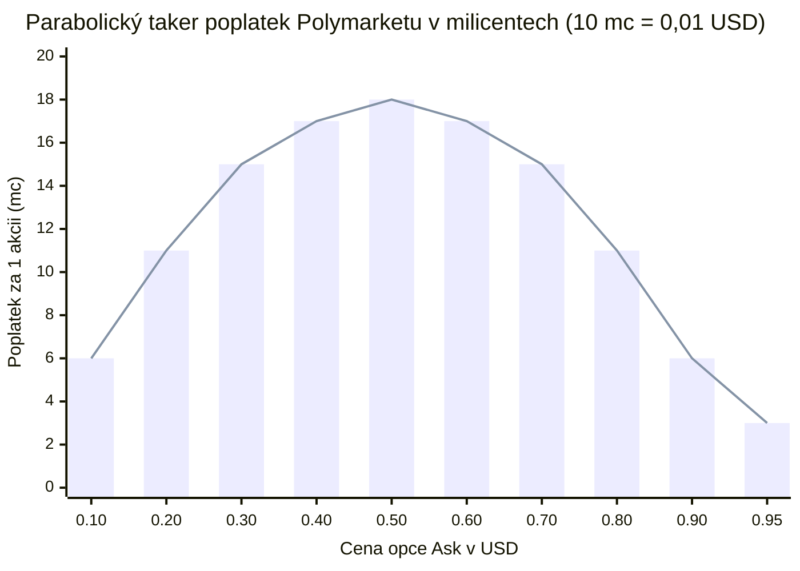

# 01 — Binární opce, střední hodnota (EV), asymetrie rizika a parabolické poplatky

[← Zpět na hlavní dokument: Optimalizace UtterParameciumStrategy](../strategy/UtterParamecium-optimalizace.MD)

---

## 1. Proč tento koncept ve strategii potřebujeme

Strategie `UtterParameciumStrategy` neobchoduje samotný Bitcoin, ale **krátkodobé 15minutové binární (digitální) opce** na predikčním trhu Polymarket (`BTC-UP` a `BTC-DOWN`). Zatímco u běžného spotového obchodu s BTC znamená pohyb ceny o `0,05 %` nepatrný zisk nebo ztrátu `0,05 %` kapitálu, u binární opce v posledních 60 sekundách před expirací znamená rozdíl jediného centu na vypořádací ceně rozdíl mezi **100% výhrou (`1,00 USD` za akcii)** a **úplnou ztrátou celé investované částky (`0,00 USD` za akcii)**.

Bez pochopení pravděpodobnostního modelu binární výplaty, střední hodnoty (*Expected Value*) a nelineární struktury poplatků nelze pochopit, proč může mít strategie 85% úspěšnost obchodů (*Win Rate*), a přesto v novějším tržním režimu prodělávat peníze (přesně to se stalo referenční verzi `V0`).

---

## 2. Formální matematická definice

### 2.1 Bernoulliho náhodná veličina a výplata binární opce

Nechť $Y \in \{0, 1\}$ je **Bernoulliho náhodná veličina** reprezentující výsledek vypořádání 15minutové svíčky pro zvolený směr (např. `UP`):

$$
Y =
\begin{cases}
1 & \text{pokud } \text{TWAP}_{60}(T_{\text{end}}) \ge K \quad (\text{s neznámou skutečnou pravděpodobností } p \in [0, 1]), \\
0 & \text{pokud } \text{TWAP}_{60}(T_{\text{end}}) < K \quad (\text{s pravděpodobností } 1 - p),
\end{cases}
$$

kde:
- $K$ je cílová cena svíčky (*target price*, v kódu `targetPriceCents`), uzamčená z 60s Chainlink TWAPu v okamžiku $T_{\text{start}}$,
- $\text{TWAP}_{60}(T_{\text{end}})$ je 60sekundový časově vážený průměr ceny Chainlink za poslední minutu svíčky $[T_{\text{end}} - 60\text{ s}, T_{\text{end}}]$,
- $p = \mathbb{P}(Y = 1)$ je objektivní podmíněná pravděpodobnost výhry v okamžiku rozhodnutí $t = T_{\text{end}} - \tau$.

Pro Bernoulliho veličinu $Y \sim \text{Bernoulli}(p)$ platí pro **střední hodnotu** $\mathbb{E}[Y]$ a **rozptyl** $\text{Var}(Y)$:

$$
\mathbb{E}[Y] = 1 \cdot p + 0 \cdot (1 - p) = p, \qquad \text{Var}(Y) = p(1 - p).
$$

### 2.2 Čistý zisk jednoho kontraktu a střední hodnota obchodu (*Expected Value — EV*)

Kupujeme-li jako *taker* 1 akcii (*share*) opce za nabídkovou cenu v knize objednávek $a \in (0, 1)$ (v USD) a platíme-li burzovní poplatek $f(a)$ za akcii, jsou celkové pořizovací náklady $c = a + f(a)$. Náhodná veličina čistého zisku $\Pi$ na jednu akcii má rozdělení:

$$
\Pi = Y - c =
\begin{cases}
+(1 - a - f(a)) & \text{s pravděpodobností } p \quad (\text{výhra: vyplacen } 1\text{ USD}), \\
-(a + f(a)) & \text{s pravděpodobností } 1 - p \quad (\text{prohra: akcie vyexpiruje bezcenná}).
\end{cases}
$$

**Střední hodnota čistého zisku na jednu akcii** (označovaná jako *Expected Value*, $\text{EV}$, nebo **čistá hrana** — *Net Edge* $e$) je pak:

$$
\text{EV} = \mathbb{E}[\Pi] = p \cdot (1 - a - f(a)) - (1 - p) \cdot (a + f(a)) = p - a - f(a).
$$

Pro dávkový nákup o velikosti $Q$ akcií platí z linearity střední hodnoty:

$$
\mathbb{E}[\Pi_Q] = Q \cdot (p - a - f(a)).
$$

### 2.3 Parabolický taker poplatek Polymarketu

Na 15minutových krypto trzích Polymarket není taker poplatek konstantním procentem z objemu, ale **parabolickou funkcí ceny opce** $a \in (0, 1)$:

$$
f(a) = r \cdot a \cdot (1 - a),
$$

kde $r = 0{,}07$ (`takerFeeRateBps = 700`, tedy základ $7{,}00\,\%$).

### 2.4 Bod zvratu (*Break-Even Probability*) a asymetrický poměr ztráty ku zisku

Aby byl nákup za cenu $a$ dlouhodobě neztrátový ($\text{EV} \ge 0$), musí skutečná pravděpodobnost výhry přesáhnout **bod zvratu** $p_{\text{BE}}(a)$:

$$
p_{\text{BE}}(a) = a + f(a) = a + r \cdot a(1 - a).
$$

Poměr ztráty při neúspěchu ku čistému zisku při úspěchu (*Downside-to-Upside Asymmetry Ratio*) je:

$$
A(a) = \frac{\text{Ztráta při } Y=0}{\text{Čistý zisk při } Y=1} = \frac{a + f(a)}{1 - a - f(a)}.
$$

---

## 3. Vysvětlení pro člověka bez znalosti statistiky

### Co je střední hodnota ($\text{EV}$) v praxi?
Představte si v Javě nekonečnou smyčku `for (int i = 0; i < 1_000_000; i++)`, ve které pokaždé vstoupíte do identické tržní situace a vsadíte na `UP`. V některých iteracích vyhrajete malou částku, v jiných ztratíte vklad. **Střední hodnota $\text{EV}$ je přesný průměrný výdělek na jednu iteraci této smyčky, když počet opakování roste do nekonečna** (tomuto faktu se ve statistice říká *zákon velkých čísel*).

Vzorec $\text{EV} = p - a - f(a)$ přitom nese klíčové poselství:
- **Cena binární opce $a$ na CLOBu je přímo trhem implikovaná pravděpodobnost.** Prodává-li tvůrce trhu (*market maker*) opci `BTC-UP` za `0,75 USD` (`750 mc`), říká tím: *„Věřím, že šance na výhru je nejvýše 75 %.“*
- Náš statistický model spočítá vlastní odhad pravděpodobnosti $p_{\text{model}}$ (např. `82,0 %` = `820 mc`).
- Po odečtení poplatku $f(0{,}75) \approx 0{,}013\text{ USD}$ (`13 mc`) nám zbývá čistá hrana $e = 0{,}820 - 0{,}750 - 0{,}013 = +0{,}057\text{ USD}$ (`+57 mc`, tedy `5,7 centu` očekávaného zisku na každou koupenou akcii).

### Proč je poplatek parabolický a ne pevný?
Kdyby si burza účtovala fixní poplatek třeba `0,02 USD` za akcii, pak u opce stojící `0,99 USD` by nákup stál `1,01 USD` — což je víc než maximální možná výplata `1,00 USD`! Obchodování u krajů (`0,05 USD` nebo `0,95 USD`) by úplně zamrzlo. Výraz $a(1 - a)$ je nejvyšší uprostřed při $a = 0{,}50$ (kde panuje maximální nejistota a $0{,}50 \times 0{,}50 = 0{,}25$) a směrem k `0,00` i `1,00` plynule klesá k nule.

### Past vysoké úspěšnosti (*Win-Rate Trap*) u drahých opcí
Programátoři intuitivně vnímají úspěšnost `90 %` jako skvělý výsledek. Jenže u opce nakoupené za `0,94 USD` (jak běžně dělala verze `V0` se stropem `maxEntryPriceMc = 970`):
- Při výhře vyděláte zhruba `+0,056 USD` na akcii.
- Při prohře proděláte `-0,944 USD` na akcii!
- **Jediná prohra vymaže zisk z `16,8` předchozích výher!** Pokud si váš model myslí, že má šanci `98 %`, ale kvůli občasnému bleskovému skoku Bitcoinu vyhraje „jen“ v `91 %` případů, máte na papíře úžasný *Win Rate* `91 %`, ale na účtu **jistý bankrot** ($\text{EV} = 0{,}91 - 0{,}944 = -0{,}034\text{ USD}$ na akcii).

### Konzervativní zaokrouhlování na ticky (`floor` vs. `ceil`)
Kniha objednávek na Polymarketu obchoduje po krocích (*ticích*) `0,01 USD` (`10 mc`). Aby strategie v pevné řádové čárce nikdy nepřecenila likviditu ani nepodcenila nákupní náklad:
- **Best Bid** (nejlepší kupní cena) se zaokrouhluje vždy **dolů** (`fromMcFloorTick`),
- **Best Ask** (nejlepší prodejní cena, za kterou nakupujeme jako taker) se zaokrouhluje vždy **nahoru** (`fromMcCeilTick`).

---

## 4. Konkrétní číselný příklad z `UtterParameciumStrategy`

V kódu strategie nepoužíváme `double` na horké cestě (*hot path*), ale **milicenty (`mc`)**, kde `1 000 mc = 1,00 USD` a `10 mc = 0,01 USD` (jeden centový tick).

Předpokládejme situaci v čase $\tau = 32\text{ s}$ do konce svíčky:
1. Kniha objednávek nabízí `BTC-UP` za `bestAskUp = 0.72` → `askMc = 720`.
2. Sazba poplatku je `takerFeeRateBps = 700` ($7{,}00\,\%$). Metoda `takerFeeMc(720, 700)` počítá v `long` aritmetice se zaokrouhlením na nejbližší celé číslo (`+ 5_000_000L` před dělením `10_000_000L`):

$$
f_{\text{mc}} = \left\lfloor \frac{700 \times 720 \times (1000 - 720) + 5\,000\,000}{10\,000\,000} \right\rfloor = \left\lfloor \frac{141\,120\,000 + 5\,000\,000}{10\,000\,000} \right\rfloor = 14\text{ mc} \quad (0{,}014\text{ USD}).
$$

3. Bod zvratu je $p_{\text{BE}} = 720 + 14 = 734\text{ mc}$ (`73,4 %`).
4. Náš statistický model spočítá pravděpodobnost $p_{\text{model}} = 795\text{ mc}$ (`79,5 %`).
5. Čistá hrana (*Net Edge*) je:

$$
e_{\text{mc}} = p_{\text{model}} - a_{\text{mc}} - f_{\text{mc}} = 795 - 720 - 14 = +61\text{ mc} \quad (+0{,}061\text{ USD na akcii}).
$$

6. Protože $61\text{ mc} \ge \text{minEdgeMc}$ (`25 mc`), signál projde. Při nákupu dávky $Q = 30$ akcií zaplatíme $30 \times 0{,}734 = 22{,}02\text{ USD}$ a střední hodnota čistého zisku této jedné dávky činí $30 \times 0{,}061 = +1{,}83\text{ USD}$.
7. Strategie navíc v `computeEdgePreservingLimitPriceMc` zkontroluje, o kolik centových ticků nad `720 mc` může zvýšit limitní cenu příkazu (nejvýše o `maxSlippageMc = 50 mc`), aniž by čistá hrana klesla pod `minEdgeMc = 25 mc`:
   - Při `750 mc` ($f = 13\text{ mc}$): $e = 795 - 750 - 13 = 32\text{ mc} \ge 25\text{ mc}$ (stále ziskové).
   - Při `760 mc` ($f = 13\text{ mc}$): $e = 795 - 760 - 13 = 22\text{ mc} < 25\text{ mc}$ (stop!).
   - Výsledná limitní cena příkazu je tedy `750 mc` (`0,75 USD`) — příkaz může projet mělkou první úrovní knihy až do `0,75 USD`, ale nikdy nenakoupí dráž, než kde má garantovanou minimální statistickou hranu `2,5 centu` na akcii.

---

## 5. Vizualizace

### 5.1 Parabolická křivka poplatku $f(a)$ a bod zvratu

### 5.2 Nelineární exploze asymetrie rizika s rostoucí cenou opce

| Cena Ask (`mc` / `USD`) | Poplatek $f(a)$ (`mc`) | Celkový náklad = ztráta při prohře | Čistý zisk při výhře | Poměr ztráta : zisk $A(a)$ | Kolik výher vymaže 1 prohra |
| :---: | :---: | :---: | :---: | :---: | :---: |
| `500 mc` (`0,50 USD`) | `18 mc` | `0,518 USD` | `+0,482 USD` | **1,07 : 1** | **1,1 výhry** |
| `670 mc` (`0,67 USD`) | `15 mc` | `0,685 USD` | `+0,315 USD` | **2,17 : 1** | **2,2 výhry** |
| `760 mc` (`0,76 USD`) | `13 mc` | `0,773 USD` | `+0,227 USD` | **3,41 : 1** | **3,4 výhry** |
| `840 mc` (`0,84 USD`) | `9 mc` | `0,849 USD` | `+0,151 USD` | **5,62 : 1** | **5,6 výhry** |
| `920 mc` (`0,92 USD`) | `5 mc` | `0,925 USD` | `+0,075 USD` | **12,33 : 1** | **12,3 výhry** |
| `970 mc` (`0,97 USD`, strop `V0`) | `2 mc` | `0,972 USD` | `+0,028 USD` | **34,71 : 1** | **34,7 výher!** |

---

## 6. Jak se tento princip vyvíjel napříč verzemi `V0` → `V5`

- **`V0` (Referenční verze)**: Povolovala nákupy až do `maxEntryPriceMc = 970` (`0,97 USD`), kde jediná chybná predikce zničila téměř 35 vítězných obchodů. Právě nákupy v pásmu `0,85–0,97 USD` tvořily největší část z hrubé ztráty `-26 879,53 USD`.
- **`V1` (Iterace 1)**: Snížila strop na `880 mc` (`0,88 USD`) a přidala pravděpodobnostní strop `maxModelProbMc = 975` (`97,5 %`), čímž okamžitě odřízla obchody s nejextrémnější asymetrií.
- **`V2` & `V3` (Iterace 2–3)**: Stáhly maximální cenu v běžném režimu na `840 mc` (`0,84 USD`, poměr ztráty ku zisku max. `5,6 : 1`) a odstupňovaly maximální povolený počet akcií podle cenového pásma (`riskTierBps`).
- **`V4` & `V5` (Iterace 4–5)**: Ponechaly `840 mc` pro běžné situace, ale selektivně otevřely pásmo `850–920 mc` **výhradně tehdy**, když je 60s TWAP již matematicky uzamčený ($\tau \le 30\text{ s}$, viz [09 — Matematické uzamčení TWAPu](09-matematicke-uzamceni-twap-a-imunita-vuci-padu.md)) a pravděpodobnost kolapsu se blíží nule.

---

**Navazující kapitoly teorie:**
- [02 — Integrál 60s TWAP, náhodná procházka a rozptyl zbývajícího okna →](02-twap-integral-nahodna-prochazka-a-rozptyl.md)
- [07 — Řízení pozice, Kellyho princip a dynamické limity inventáře →](07-rizeni-pozice-kellyho-princip-a-dynamicke-limity.md)
