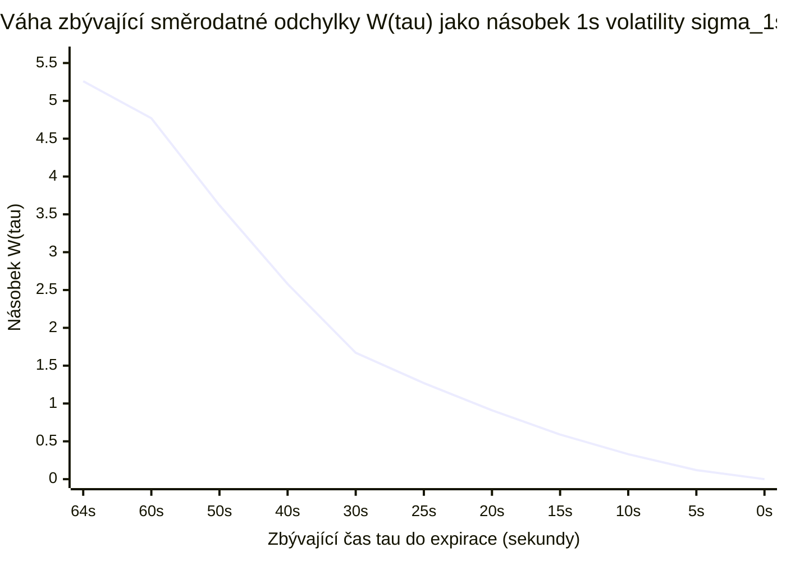
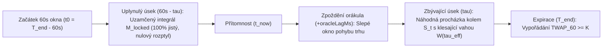

# 02 — Integrál 60s TWAP, náhodná procházka a rozptyl zbývajícího okna

[← Zpět na hlavní dokument: Optimalizace UtterParameciumStrategy](../strategy/UtterParamecium-optimalizace.MD)

---

## 1. Proč tento koncept ve strategii potřebujeme

Celá existence a statistická výhoda (*alfa*) strategie `UtterParameciumStrategy` stojí na jediné strukturální vlastnosti 15minutových krypto trhů na Polymarketu: **trh se nevypořádává podle poslední spotové ceny v sekundě expirace, ale podle 60sekundového časově váženého průměru ceny (*TWAP — Time-Weighted Average Price*) orákula Chainlink za poslední minutu svíčky**.

Jakmile se svíčka přehoupne do posledních 60 sekund ($\tau < 60\text{ s}$):
1. Část vypořádacího průměru už **proběhla v minulosti a je nezvratně uzamčena**.
2. Zbývající část průměru v budoucnosti má díky průměrování **mnohem menší rozptyl (nejistotu)** než samotná koncová cena Bitcoinu, a tato nejistota nelineárně klesá k nule s rychlostí $\tau^{3/2}$.

Tento dokument odvozuje přesnou matematiku projekce TWAPu i tabulky vah zbývající nejistoty `TWAP_REM_WEIGHT_BPS`.

---

## 2. Formální matematická definice

### 2.1 Časově vážený průměr ceny (TWAP) jako integrál skokové funkce

Nechť $[t_0, t_1]$ je poslední minuta 15minutové svíčky o délce $T = t_1 - t_0 = 60\,000\text{ ms}$ ($60\text{ s}$), kde $t_1 = T_{\text{end}}$ je okamžik expirace. Spojitý časově vážený průměr trajektorie ceny $S(u)$ na intervalu $[t_0, t_1]$ je definován určitým integrálem:

$$
\text{TWAP}_{60}(t_1) = \frac{1}{T} \int_{t_0}^{t_1} S(u)\,du.
$$

Protože proud dat `price.crypto` z orákula přichází v diskrétních časových okamžicích $u_0 \le t_0 < u_1 < u_2 < \dots < u_m \le t$, platí v každém mezičase $[u_k, u_{k+1})$ naposledy publikovaná cena $S(u_k)$ (tzv. **Zero-Order Hold** — schodovitá funkce konstantní po částech). Přesný integrál na dosud uplynulém úseku $[t_0, t]$ (kde $t = t_1 - \tau$ a uplynulý čas je $e = T - \tau$) má pak tvar váženého průměru délek trvání jednotlivých cenových schodů $\Delta u_k = u_{k+1} - u_k$:

$$
M_{\text{locked}}(t) = \frac{1}{t - t_0} \int_{t_0}^{t} S(u)\,du = \frac{\sum_{k} S(u_k)\,\Delta u_k}{\sum_{k} \Delta u_k}.
$$

### 2.2 Rozklad konečného TWAPu na deterministickou minulost a náhodnou budoucnost

V rozhodovacím okamžiku $t \in [t_0, t_1]$, kdy do konce svíčky zbývá čas $\tau = t_1 - t \in [0, T]$ a v okně již uplynul čas $e = T - \tau$, se integrál rozpadá na dva sčítance:

$$
\text{TWAP}_{60}(t_1) = \underbrace{\frac{T - \tau}{T}\,M_{\text{locked}}(t)}_{\text{100\% známá (uzamčená) minulost}} + \underbrace{\frac{1}{T} \int_{t}^{t_1} S(u)\,du}_{\text{neznámá (náhodná) budoucnost}}.
$$

### 2.3 Aritmetická náhodná procházka (bezdriftová martingalová projekce)

Na horizontu jednotek až desítek sekund modelujeme budoucí cenu Bitcoinu jako **diskrétní aritmetickou náhodnou procházku bez driftu** (*Arithmetic Random Walk / Brownian Motion*) s krokem $1\text{ s}$. Je-li $S_t$ aktuální cena v čase $t$ a zbývá-li $\tau \in \{1, 2, \dots, 60\}$ sekund, pak v $k$-té budoucí sekundě ($k = 1, \dots, \tau$) platí:

$$
S_{t+k} = S_t + \sum_{j=1}^{k} \varepsilon_j,
$$

kde přírůstky $\varepsilon_1, \varepsilon_2, \dots, \varepsilon_\tau$ jsou nezávislé a stejně rozdělené náhodné veličiny (*i.i.d.*) s nulovou střední hodnotou $\mathbb{E}[\varepsilon_j] = 0$ a konečným jednosekundovým rozptylem $\text{Var}(\varepsilon_j) = \sigma_{1s}^2$.

Protože $\mathbb{E}[S_{t+k} \mid S_t] = S_t$ pro každé $k \ge 1$ (**martingalová vlastnost**: nejlepší nestrannou předpovědí budoucí ceny bez další informace je dnešní cena), je podmíněná střední hodnota konečného TWAPu (v kódu `projectedTwapCents`):

$$
\widehat{\text{TWAP}}(t) = \mathbb{E}\!\left[\text{TWAP}_{60}(t_1) \,\middle|\, \mathcal{F}_t\right] = \frac{(T - \tau)\,M_{\text{locked}}(t) + \tau\,S_t}{T}.
$$

### 2.4 Odvození rozptylu a směrodatné odchylky zbývající části TWAPu (`TWAP_REM_WEIGHT_BPS`)

Chceme spočítat směrodatnou odchylku chyby naší projekce $\sigma_{\text{rem}}(\tau) = \sqrt{\text{Var}(\text{TWAP}_{60}(t_1) \mid \mathcal{F}_t)}$.
Vyjádřeme součet budoucích $\tau$ jednosekundových cen a přeskupme sčítání podle jednotlivých náhodných šoků $\varepsilon_j$:

$$
\sum_{k=1}^{\tau} S_{t+k} = \tau S_t + \sum_{k=1}^{\tau} \sum_{j=1}^{k} \varepsilon_j = \tau S_t + \sum_{j=1}^{\tau} (\tau - j + 1)\,\varepsilon_j.
$$

Všimněte si klíčového jevu:
- První náhodný šok $\varepsilon_1$ (v nejbližší sekundě) posune cenu na všech $\tau$ zbývajících sekundách — má váhu $\tau$.
- Druhý šok $\varepsilon_2$ ovlivní $\tau - 1$ sekund.
- Poslední šok $\varepsilon_\tau$ těsně před expirací ovlivní už jen $1$ sekundu z 60!

Protože jsou šoky $\varepsilon_j$ nezávislé, rozptyl součtu je roven součtu rozptylů ($\text{Var}(c X) = c^2 \text{Var}(X)$). Použitím známého součtového vzorce pro druhé mocniny přirozených čísel $\sum_{m=1}^{\tau} m^2 = \frac{\tau(\tau+1)(2\tau+1)}{6}$ dostáváme:

$$
\text{Var}\!\left(\frac{1}{60}\sum_{k=1}^{\tau} S_{t+k} \,\middle|\, \mathcal{F}_t\right) = \frac{\sigma_{1s}^2}{60^2} \sum_{m=1}^{\tau} m^2 = \sigma_{1s}^2 \cdot \frac{\tau(\tau+1)(2\tau+1)}{6 \cdot 3600}.
$$

Odmocněním získáváme přesnou směrodatnou odchylku zbývajícího TWAPu:

$$
\sigma_{\text{rem}}(\tau) = \sigma_{1s} \cdot W(\tau), \qquad \text{kde } W(\tau) = \frac{1}{60}\sqrt{\frac{\tau(\tau+1)(2\tau+1)}{6}}.
$$

Pro časy **před začátkem 60s okna** ($\tau = 60 + u$ sekund, kde $u > 0$, zavedeno ve `V4` pro $\tau \le 64\text{ s}$) posouvá každý jednosekundový šok během úvodních $u$ sekund počáteční hladinu celého 60sekundového okna (s plnou vahou $60/60 = 1$), takže rozptyl roste o $u \cdot \sigma_{1s}^2$:

$$
W(60 + u) = \sqrt{u + W(60)^2}.
$$

### 2.5 Inflace nejistoty zpožděním orákula (*Oracle Observation Lag*)

Pokud má poslední známá cena Chainlinku $S^{\text{CL}}$ časové razítko skutečného pozorování na burze $t_{\text{obs}} < t_{\text{now}}$, uplynula již doba $\Delta t_{\text{lag}} = \text{clamp}(t_{\text{now}} - t_{\text{obs}}, 0, 4000\text{ ms})$, po kterou se skutečný trh hýbal „naslepo“ mimo náš poslední vzorek. Efektivní horizont nejistoty proto od verze `V1` prodlužujeme o toto zpoždění:

$$
\tau_{\text{eff}} = \text{round}\!\left(\frac{\tau_{\text{ms}} + \Delta t_{\text{lag,ms}}}{1000}\right), \qquad \sigma_{\text{rem}} = \max\!\left(\sigma_{\text{min}}, \sigma_{1s} \cdot W(\tau_{\text{eff}})\right).
$$

---

## 3. Vysvětlení pro člověka bez znalosti statistiky

### Analogie s průměrnou rychlostí auta na měřeném úseku
Představte si úsekové měření rychlosti na dálnici dlouhé přesně **60 sekund** s limitem **100 km/h** (naše cílová cena $K$).
1. **Prvních 45 sekund** jedete tempomatem **108 km/h** ($M_{\text{locked}}$).
2. Do konce měřeného úseku zbývá už jen **$\tau = 15$ sekund**.
3. Aby vaše celková průměrná rychlost za celých 60 sekund klesla pod 100 km/h, museli byste v posledních 15 sekundách okamžitě dupnout na brzdu a jet průměrně pod $76\text{ km/h}$!
4. A co když zbývají už jen **$\tau = 5$ sekund**? Pak by vám ani okamžité zastavení auta na `0 km/h` nestačilo k tomu, aby průměr klesl pod limit — pokuta (nebo v našem případě výhra `BTC-UP`) je již fyzikálně uzamčená!

### Proč nejistota TWAPu klesá mnohem rychleji než u běžné opce?
U klasické binární opce vypořádané poslední cenou klesá směrodatná odchylka s odmocninou času $\sqrt{\tau}$:
- V $\tau = 60\text{ s}$ je faktor $\sqrt{60} \approx 7{,}75$.
- V $\tau = 6\text{ s}$ (desetina času) je faktor $\sqrt{6} \approx 2{,}45$ (stále třetina původní nejistoty!).

U **60s TWAP opce** však působí dvojí tlumení současně: zbývá méně sekund ($\sqrt{\tau}$) **A ZÁROVEŇ** zbývající sekundy tvoří jen zlomek $\tau / 60$ celkového průměru! Spojitá aproximace váhy $W(\tau)$ pro $\tau \le 60$ je:

$$
W(\tau) \approx \frac{1}{60}\sqrt{\frac{\tau^3}{3}} = \frac{\tau^{3/2}}{60\sqrt{3}}.
$$

- V $\tau = 60\text{ s}$ je teoretická váha $W(60) \approx 4{,}53$ (v předpočítané tabulce `TWAP_REM_WEIGHT_BPS[60] = 47730` bps = `4,773`, s mírným ~5% konzervativním polštářem na horním okraji okna).
- V $\tau = 30\text{ s}$ (polovina minuty) klesá váha na `1,673` — nejistota už spadla téměř **na třetinu**!
- V $\tau = 10\text{ s}$ je váha jen `0,328` (**14× menší** než na začátku minuty!).
- V $\tau = 5\text{ s}$ je váha pouhých `0,124` (**38× menší** než na začátku minuty!).

### Proč v `V2` nahradil prostý průměr tiků přesný milisekundový integrál?
Ve `V0` a `V1` počítala metoda `meanCentsInWindow` obyčejný aritmetický průměr přijatých zpráv `sum / count`. Jenže Chainlink publikuje častěji, když cena prudce skáče, a méně často, když cena stojí na místě! Pokud byla cena 10 sekund klidně na `68 000 USD` (2 tiky) a pak na 2 sekundy vyskočila na `68 030 USD` (8 rychlých tiků), naivní průměr tiků spočítal `(2 * 68000 + 8 * 68030) / 10 = 68 024 USD`, zatímco skutečný časově vážený průměr byl `(10 * 68000 + 2 * 68030) / 12 = 68 005 USD` — chyba **19 dolarů**! Od verze `V2` proto `ChainlinkTwapBuffer` násobí každou cenu přesným počtem milisekund `dt = ts - cursorMs`, po které platila, včetně ukotvení poslední známé ceny na levém okraji okna $t_0$.

---

## 4. Konkrétní číselný příklad z `UtterParameciumStrategy`

Nechť cílová cena svíčky je $K = 68\,000{,}00\text{ USD}$ (`targetPriceCents = 6_800_000L`).
Nacházíme se v čase $\tau_{\text{ms}} = 20\,000\text{ ms}$ ($20\text{ s}$ do expirace, tedy $40\text{ s}$ okna již uplynulo):
1. Uzamčený milisekundový integrál prvních 40 sekund v `ChainlinkTwapBuffer` je $M_{\text{locked}} = 68\,009{,}00\text{ USD}$ (`6_800_900` centů).
2. Aktuální spotová cena Chainlinku je $S_t = 68\,003{,}00\text{ USD}$ (`6_800_300` centů).
3. Projekce konečného 60s TWAPu (`projectTwapCents`):

$$
\widehat{\text{TWAP}} = \frac{40\,000 \times 6\,800\,900 + 20\,000 \times 6\,800\,300}{60\,000} = 6\,800\,700\text{ centů} \quad (68\,007{,}00\text{ USD}).
$$

4. Zpoždění posledního orákulového tiku je $\Delta t_{\text{lag}} = 1\,200\text{ ms}$ (`oracleLagMs = 1200`).
5. Efektivní zbývající čas pro nejistotu je:

$$
\tau_{\text{eff}} = \left\lfloor \frac{20\,000 + 1\,200 + 500}{1\,000} \right\rfloor = 21\text{ s}.
$$

6. V poli `TWAP_REM_WEIGHT_BPS[21]` najdeme váhu `9788` bps ($0{,}9788$). Je-li odhad jednosekundové volatility Bitcoinu $\sigma_{1s} = 2{,}50\text{ USD}$ (`250` centů):

$$
\sigma_{\text{rem}} = \max\!\left(40, \frac{250 \times 9\,788}{10\,000}\right) = 244\text{ centů} \quad (2{,}44\text{ USD}).
$$

Kdyby nebylo zpoždění orákula započteno ($\tau = 20\text{ s}$, váha `9100` bps), vyšlo by $\sigma_{\text{rem}} = 2{,}27\text{ USD}$ — započtení `oracleLagMs` tedy realisticky navýšilo směrodatnou odchylku zbývajícího průměru o `7,5 %`.

---

## 5. Vizualizace

### 5.1 Prudký kolaps zbývající nejistoty $W(\tau)$ během poslední minuty

### 5.2 Rozklad 60sekundového vypořádacího okna v čase $t = T_{\text{end}} - \tau$

---

## 6. Jak se tento princip vyvíjel napříč verzemi `V0` → `V5`

- **`V0`**: Zavedla základní rozklad projekce TWAPu a tabulku `TWAP_REM_WEIGHT_BPS[0..61]`, ale počítala `lockedMeanCents` prostým průměrem zpráv (nikoliv integrálem podle času) a ignorovala zpoždění orákula (`priceTimestampMs`).
- **`V1`**: Přidala měření `oracleLagMs = nowMs - priceTimestampMs` a posunula index v tabulce z $\tau$ na $\tau_{\text{eff}} = \tau + \Delta t_{\text{lag}}$.
- **`V2`**: Přepsala `ChainlinkTwapBuffer.meanCentsInWindow` na exaktní milisekundový schodovitý integrál (*Zero-Order Hold*) včetně ukotvení ceny na hranici $t_0$.
- **`V4` & `V5`**: Rozšířily pole `TWAP_REM_WEIGHT_BPS` až na `0..66 s`, čímž umožnily konzistentně ocenit nejistotu i při opatrném předoknovém vstupu v intervalu $60\text{ s} < \tau \le 64\text{ s}$.

---

**Navazující kapitoly teorie:**
- [← 01 — Binární opce, střední hodnota (EV) a poplatky](01-binarni-opce-stredni-hodnota-a-poplatky.md)
- [03 — Normální rozdělení, Z-skóre a tlusté chvosty (Fat Tails) →](03-normalni-rozdeleni-z-skore-a-tluste-chvosty.md)
- [09 — Matematické uzamčení TWAPu a imunita vůči bleskovému pádu →](09-matematicke-uzamceni-twap-a-imunita-vuci-padu.md)
