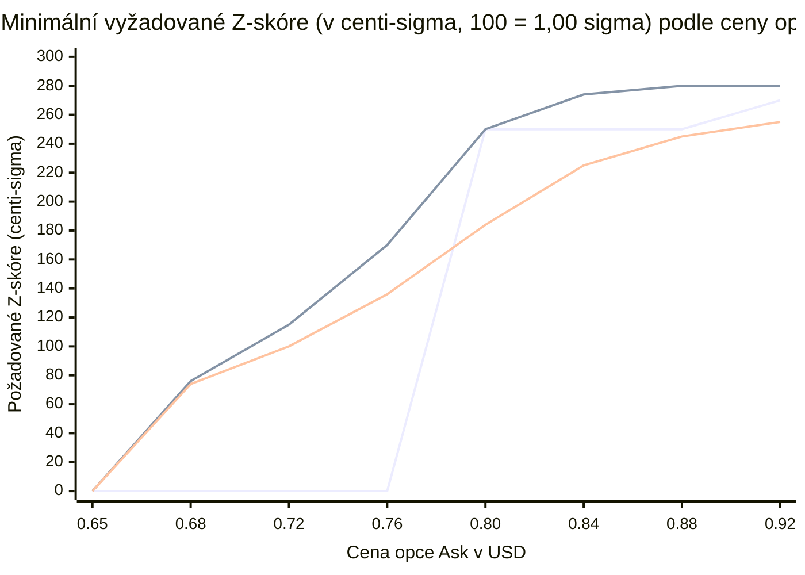

# 03 — Normální rozdělení, Z-skóre, distribuční funkce $\Phi(z)$ a tlusté chvosty

[← Zpět na hlavní dokument: Optimalizace UtterParameciumStrategy](../strategy/UtterParamecium-optimalizace.MD)

---

## 1. Proč tento koncept ve strategii potřebujeme

V předchozí kapitole jsme spočítali dvě veličiny v dolarech:
1. O kolik dolarů leží očekávaný konečný TWAP nad cílovou cenou $K$ (náskok $\Delta = \widehat{\text{TWAP}} - K$).
2. Jak velká je zbývající směrodatná odchylka tohoto průměru $\sigma_{\text{rem}}(\tau_{\text{eff}})$.

Samotný náskok `+8,00 USD` nám ale nic neříká bez měřítka nejistoty: v klidné noci se zbývající odchylkou `2,00 USD` je `+8,00 USD` téměř jistá výhra, zatímco při makrozprávě se zbývající odchylkou `20,00 USD` je `+8,00 USD` skoro hod mincí! Potřebujeme proto převést dolarový náskok a dolarovou nejistotu na **pravděpodobnost výhry $p_{\text{model}} \in (0, 1)$**, kterou lze přímo porovnat s cenou opce v knize objednávek. K tomu slouží **Z-skóre**, **normální rozdělení** a korekce na **tlusté chvosty kryptoměn**.

---

## 2. Formální matematická definice

### 2.1 Normální (Gaussovo) rozdělení a centrální limitní věta

Náhodná veličina $X$ má **normální rozdělení** se střední hodnotou $\mu$ a rozptylem $\sigma^2$, značíme $X \sim \mathcal{N}(\mu, \sigma^2)$, pokud je její hustota pravděpodobnosti (*PDF — Probability Density Function*) dána zvonovou křivkou:

$$
\varphi_{\mu, \sigma^2}(x) = \frac{1}{\sigma\sqrt{2\pi}} \exp\!\left(-\frac{(x - \mu)^2}{2\sigma^2}\right), \qquad x \in \mathbb{R}.
$$

Podle **centrální limitní věty (CLV)** konverguje součet (a tedy i průměr) velkého počtu nezávislých náhodných přírůstků s konečným rozptylem k normálnímu rozdělení. Protože zbývající část 60s TWAPu je váženým součtem desítek budoucích přírůstků ceny, je aproximace $\text{TWAP}_{60}(t_1) \mid \mathcal{F}_t \approx \mathcal{N}\!\left(\widehat{\text{TWAP}}, \sigma_{\text{rem}}^2\right)$ v běžném difuzním režimu prvním přirozeným modelem.

### 2.2 Standardizace na Z-skóre a distribuční funkce $\Phi(z)$

Chceme-li spočítat pravděpodobnost, že konečný TWAP skončí nad cílovou cenou $K$, převedeme náhodnou veličinu na **standardizované normální rozdělení** $Z \sim \mathcal{N}(0, 1)$ pomocí **Z-skóre**:

$$
z = \frac{d_{\text{eff}}}{\sigma_{\text{rem}}},
$$

kde $d_{\text{eff}}$ je efektivní dolarový polštář zvoleného směru nad cílovou cenou $K$ (v kódu `effectiveDistCents`, konzervativně definovaný jako $\min(\text{distProj}, \text{distSpot})$, dokud není TWAP matematicky uzamčen).

Pravděpodobnost výhry v Gaussově modelu je pak hodnota **kumulativní distribuční funkce (*CDF*)** $\Phi(z)$:

$$
p_{\text{Gauss}}(z) = \mathbb{P}(Z \le z) = \Phi(z) = \int_{-\infty}^{z} \frac{1}{\sqrt{2\pi}} e^{-u^2/2}\,du.
$$

Pro záporná $z$ platí ze symetrie hustoty kolem nuly vztah $\Phi(-z) = 1 - \Phi(z)$.

### 2.3 Špičatost (*Kurtosis*), leptokurtické rozdělení a tlusté chvosty (*Fat Tails*)

Čtvrtý standardizovaný moment náhodné veličiny $X$ se nazývá **špičatost (*kurtosis*)**:

$$
\kappa = \frac{\mathbb{E}\!\left[(X - \mu)^4\right]}{\sigma^4}, \qquad \text{nadměrná špičatost (excess kurtosis): } \kappa_{\text{ex}} = \kappa - 3.
$$

- Pro normální rozdělení platí přesně $\kappa = 3$ ($\kappa_{\text{ex}} = 0$). Jeho chvosty klesají k nule extrémně rychle jako $e^{-z^2/2}$.
- Krátkodobé výnosy Bitcoinu (1s až 60s) mají empiricky $\kappa \gg 3$ (často $\kappa \in [10, 50]$): jsou **leptokurtické** (*tlustochvosté*). Většinu času se cena chová klidně kolem středu, ale občas přijde kaskáda likvidací nebo velký tržní příkaz, který způsobí skok o $4\sigma$ až $8\sigma$!

V důsledku tlustých chvostů platí pro skutečnou pravděpodobnost přežití $p_{\text{real}}(z)$ ve vzdálených chvostech ($z \ge 1{,}5$):

$$
p_{\text{real}}(z) < \Phi(z), \qquad \text{tj. } 1 - p_{\text{real}}(z) \gg 1 - \Phi(z).
$$

Aby model nepodléhal iluzi 99,9% jistoty, uplatňuje strategie dvojí ochranu proti tlustým chvostům:
1. **Tvrdý strop pravděpodobnosti (`maxModelProbMc`)**:

$$
p_{\text{model}}(z) = \min\!\left(p_{\max},\; \Phi(z)\right).
$$

2. **Spojitou po částech lineární křivku minimálního vyžadovaného Z-skóre `requiredMinZCenti(askMc)`**: čím vyšší je cena opce $a$ (a tedy nepříznivější asymetrie ztráty ku zisku z [kapitoly 01](01-binarni-opce-stredni-hodnota-a-poplatky.md)), tím vyšší násobek směrodatné odchylky $z_{\min}(a)$ musí polštář překonat bez ohledu na prostý Gaussův vzorec.

---

## 3. Vysvětlení pro člověka bez znalosti statistiky

### Co vlastně vyjadřuje Z-skóre?
Z-skóre odpovídá na jedinou prostou otázku: **„Kolik běžných výkyvů ($\sigma_{\text{rem}}$) musím dostat přímo proti sobě, abych o svůj aktuální náskok přišel a prohrál?“**
- $z = 0{,}0$: Cena leží přesně na cílové čáře $K$ → čistý hod mincí (`50,0 %`).
- $z = +1{,}0$: Máme polštář o velikosti jedné směrodatné odchylky → v Gaussově světě vyhráváme v `84,1 %` případů.
- $z = +2{,}0$: Máme polštář o velikosti dvou směrodatných odchylek → v Gaussově světě vyhráváme v `97,7 %` případů.
- $z = +3{,}0$: V učebnicové Gaussově křivce vyhráváme v `99,87 %` případů (prohra jen 1,3× z tisíce).

### Proč Gaussova křivka na Bitcoinu v chvostech nebezpečně lže?
Představte si, že měříte výšku dospělých mužů v populaci (klasické normální rozdělení se středem `180 cm` a odchylkou `7 cm`). Člověk vysoký `250 cm` ($z = +10\sigma$) prakticky neexistuje.
Nyní si ale představte jednosekundové změny ceny Bitcoinu: minutu se cena posouvá o `±1,50 USD` za sekundu ($\sigma_{1s} = 1{,}50\text{ USD}$), a pak jediný velký fond prodá na Binance 300 BTC market příkazem — cena během dvou sekund spadne o `45 USD` ($30\sigma$!).
V krypto trzích nejsou extrémní pohyby výsledkem součtu třiceti nezávislých hodů mincí ve stejném směru, ale **diskrétního skoku likvidity**. Tam, kde Gaussova tabulka `NORMAL_CDF_HALF_TABLE_MC` hlásí při $z = 2{,}8\sigma$ pravděpodobnost prohry `0,26 %`, nastane na reálném Bitcoinu bleskový obrat klidně ve `3 %` až `5 %` případů — tedy **10× až 15× častěji**!

### Proč používáme konzervativní vzdálenost $\min(\text{distProj}, \text{distSpot})$?
Představte si, že v prvních 35 sekundách okna byla cena vysoko nad $K$, takže projektovaný TWAP je stále `+9 USD` nad cílem, ale samotná spotová cena právě teď klesla už jen `+2 USD` nad cíl (a padá). Kdybychom do Z-skóre dosadili `+9 USD`, model by slepě nakupoval uprostřed obratu! Použití $d_{\text{eff}} = \min(\text{distProj}, \text{distSpot})$ říká: *„Dokud není TWAP matematicky uzamčený, věřím jen menšímu z obou polštářů — jak celkovému průměru, tak okamžité spotové ceně.“*

---

## 4. Konkrétní číselný příklad z `UtterParameciumStrategy`

### 4.1 Celočíselná interpolace $\Phi(z)$ v `normalCdfMc(long zCenti)`
Integrál $\Phi(z)$ nemá elementární analytický vzorec a volání `Math.erf` na horké cestě by bylo zbytečné. Strategie proto drží pole `NORMAL_CDF_HALF_TABLE_MC` se 41 hodnotami v milicentech pro $z = 0{,}00, 0{,}10, 0{,}20, \dots, 4{,}00\sigma$ a mezi sousedními uzly počítá **po částech lineární interpolaci** v `int`/`long` aritmetice se zaokrouhlením (`+ 5` před `/ 10`).

Nechť efektivní polštář je $d_{\text{eff}} = 380\text{ centů}$ (`3,80 USD`) a zbývající nejistota $\sigma_{\text{rem}} = 244\text{ centů}$ (`2,44 USD`):
1. Z-skóre v setinách směrodatné odchylky (`zCenti`):

$$
z_{\text{centi}} = \left\lfloor \frac{100 \times 380}{244} \right\rfloor = 155 \quad (z = +1{,}55\sigma).
$$

2. V `normalCdfMc(155)`:
   - Index dolního uzlu `idx = 155 / 10 = 15` ($z = 1{,}50\sigma \rightarrow y_0 = 933\text{ mc}$).
   - Horní uzel `idx + 1 = 16` ($z = 1{,}60\sigma \rightarrow y_1 = 945\text{ mc}$).
   - Zbytek `rem = 155 % 10 = 5`.
   - Interpolace:

$$
p_{\text{Gauss}} = 933 + \left\lfloor \frac{(945 - 933) \times 5 + 5}{10} \right\rfloor = 933 + 6 = 939\text{ mc} \quad (93{,}9\,\%).
$$

### 4.2 Aplikace ochrany proti tlustým chvostům (`requiredMinZCenti`)
Předpokládejme, že opce `BTC-UP` se v knize objednávek prodává za `askMc = 780` (`0,78 USD`):
- Podle čistého Gausse máme obrovskou hranu: $939 - 780 - 12\text{ (fee)} = +147\text{ mc}$ (`+0,147 USD`)!
- Jenže u ceny `0,78 USD` platí ve `V4`/`V5` požadavek z křivky `requiredMinZCenti(780)`:

$$
z_{\min}(780) = 136 + \left\lfloor \frac{(780 - 760) \times 48}{40} \right\rfloor = 136 + 24 = 160\text{ centi-}\sigma \quad (1{,}60\sigma).
$$

- Protože naše $z_{\text{centi}} = 155 < 160$, strategie obchod za `0,78 USD` **odmítne** (nebo nakoupí jen pokud ask klesne např. na `0,76 USD`, kde stačí $z_{\min}(760) = 136$). Tím je v praxi kompenzována skutečnost, že reálný chvost Bitcoinu je tlustší než teoretických `93,9 %` z Gaussovy tabulky.

---

## 5. Vizualizace

### 5.1 Gaussova distribuční funkce $\Phi(z)$ vs. zastropovaná pravděpodobnost a reálný tlustý chvost

| Z-skóre ($z$) | Gaussova $\Phi(z)$ (`normalCdfMc`) | Gaussova šance prohry $1 - \Phi(z)$ | Zastropovaná $p_{\text{model}}$ (`V1..V3`: `975 mc` / `V4..V5`: `985 mc`) | Typická reálná šance bleskového obratu BTC |
| :---: | :---: | :---: | :---: | :---: |
| `+0,50 σ` | `691 mc` (`69,1 %`) | `30,9 %` | `691 mc` | `~31 %` (blízko Gausse) |
| `+1,00 σ` | `841 mc` (`84,1 %`) | `15,9 %` | `841 mc` | `~17 %` |
| `+1,50 σ` | `933 mc` (`93,3 %`) | `6,7 %` | `933 mc` | `~9–11 %` |
| `+2,00 σ` | `977 mc` (`97,7 %`) | `2,3 %` | `975 mc` / `977 mc` | `~5–7 %` (**2–3× častější!**) |
| `+2,50 σ` | `994 mc` (`99,4 %`) | `0,6 %` | `975 mc` / `985 mc` | `~3–4 %` (**5–6× častější!**) |
| `+3,00 σ` | `999 mc` (`99,9 %`) | `0,1 %` | `975 mc` / `985 mc` | `~1,5–2,5 %` (**15–20× častější!**) |

### 5.2 Srovnání křivky vyžadovaného minimálního Z-skóre `requiredMinZCenti(askMc)` napříč verzemi

*(1. křivka = schodová propast ve `V0`/`V1` s nulovým filtrem pod `0,80 USD`; 2. křivka = přísná spojitá křivka ve `V3`; 3. křivka = rekalibrovaná spojitá křivka ve `V4`/`V5` po zpřesnění vlnové volatility.)*

---

## 6. Jak se tento princip vyvíjel napříč verzemi `V0` → `V5`

- **`V0`**: Neměla žádný strop `maxModelProbMc` (model věřil v `99,9 %` výhry při $z \ge 3{,}0$) a pod cenou `0,80 USD` nevyžadovala žádné explicitní minimální Z-skóre (stačilo `pModel >= 650 mc`, tj. $z \ge 0{,}39\sigma$). Mezi `0,79 USD` ($z_{\min} = 0$) a `0,80 USD` ($z_{\min} = 2{,}50\sigma$) tak zela obří skoková propast — strategie v pásmu `0,72–0,79 USD` masivně nakupovala slabé signály.
- **`V1`**: Zavedla fat-tail strop `maxModelProbMc = 975` (`97,5 %`), takže žádný obchod nemohl spoléhat na Gaussovu iluzi 99,9% jistoty.
- **`V2` & `V3`**: Nahradily skok na `0,80 USD` spojitou po částech lineární funkcí `requiredMinZCenti(askMc)` začínající již od `720 mc` (`V2`) a následně od `670 mc` (`V3`).
- **`V4` & `V5`**: Protože multi-horizontní a Parkinsonův odhad volatility (zavedený ve `V3`) již sám realisticky navýšil jmenovatel $\sigma_{\text{rem}}$ během vlnobití, mírně rekalibrovaly sklon `requiredMinZCenti(askMc)` a posunuly `maxModelProbMc` na `985` (`98,5 %`), aby umožnily vstup u matematicky uzamčených opcí do `0,92 USD`.

---

**Navazující kapitoly teorie:**
- [← 02 — Integrál 60s TWAP, náhodná procházka a rozptyl zbývajícího okna](02-twap-integral-nahodna-prochazka-a-rozptyl.md)
- [04 — Odhad volatility pomocí MAD, časové škálování a orákulový čas →](04-odhad-volatility-mad-a-casove-skalovani.md)
