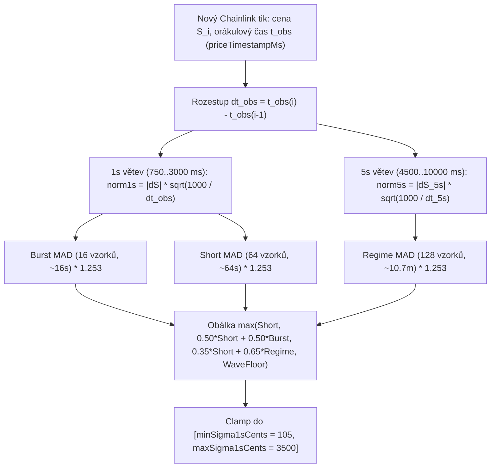

# 04 — Odhad volatility pomocí MAD, časové škálování $\sqrt{\Delta t}$ a orákulový čas

[← Zpět na hlavní dokument: Optimalizace UtterParameciumStrategy](../strategy/UtterParamecium-optimalizace.MD)

---

## 1. Proč tento koncept ve strategii potřebujeme

Celý výpočet Z-skóre $z = d_{\text{eff}} / \sigma_{\text{rem}}$ stojí a padá s tím, jak přesně dokážeme v reálném čase změřit **aktuální jednosekundovou volatilitu Bitcoinu $\sigma_{1s}$** (v centech USD za sekundu).
- Pokud $\sigma_{1s}$ **podceníme** (např. si myslíme, že se trh hýbe o `1,10 USD/s`, ale ve skutečnosti kmitá o `3,50 USD/s`), naše vypočtené Z-skóre bude **3× nafouknuté**! Model uvidí falešnou statistickou hranu a nakoupí drahou opci těsně předtím, než běžná tržní vlna smaže polštář nad cílovou cenou $K$.
- Pokud naopak $\sigma_{1s}$ **přestřelíme** kvůli jedinému osamocenému datovému glitche nebo síťové prodlevě, strategie zamrzne a propásne čisté ziskové příležitosti.

V `UtterParameciumStrategy` proto místo klasické výběrové směrodatné odchylky používáme **robustní střední absolutní odchylku (*MAD*)**, doplněnou o **časové škálování $\sqrt{\Delta t}$**, **vícehorizontní paměť volatility** a **hodinování podle orákulového času pozorování (`priceTimestampMs`)**.

---

## 2. Formální matematická definice

### 2.1 Klasická směrodatná odchylka vs. Střední absolutní odchylka (*Mean Absolute Deviation — MAD*)

Nechť $\Delta S_1, \Delta S_2, \dots, \Delta S_n$ jsou pozorované jednosekundové změny ceny s nulovým středem ($\mu \approx 0$).
- **Klasický odhad směrodatné odchylky** (*Root Mean Square*) umocňuje každou odchylku na druhou:

$$
\hat{\sigma}_{\text{RMS}} = \sqrt{\frac{1}{n}\sum_{i=1}^{n} (\Delta S_i)^2}.
$$

- **Střední absolutní odchylka (*MAD*)** průměruje prosté absolutní hodnoty přírůstků:

$$
\widehat{\text{MAD}} = \frac{1}{n}\sum_{i=1}^{n} |\Delta S_i|.
$$

### 2.2 Odvození konstanty konzistence $\sqrt{\pi / 2} \approx 1{,}2533$ (`1_253 / 1_000`)

Pozor: samotné $\widehat{\text{MAD}}$ není přímo rovno směrodatné odchylce $\sigma$, je systematicky menší! Spočítáme-li střední hodnotu $|X|$ pro normálně rozdělenou veličinu $X \sim \mathcal{N}(0, \sigma^2)$ (tzv. *Half-Normal distribution*), dostaneme integrací:

$$
\mathbb{E}[|X|] = 2 \int_{0}^{\infty} x \cdot \frac{1}{\sigma\sqrt{2\pi}} e^{-\frac{x^2}{2\sigma^2}}\,dx = \frac{2\sigma}{\sqrt{2\pi}} \int_{0}^{\infty} u e^{-u^2/2}\,du = \sigma \sqrt{\frac{2}{\pi}} \approx 0{,}797885\,\sigma.
$$

Abychom z $\widehat{\text{MAD}}$ získali **nestranný (*unbiased*) odhad směrodatné odchylky $\sigma$** kompatibilní s tabulkou $\Phi(z)$, musíme $\widehat{\text{MAD}}$ vynásobit převrácenou hodnotou $\sqrt{\pi / 2}$:

$$
\hat{\sigma}_{\text{MAD}} = \sqrt{\frac{\pi}{2}} \cdot \widehat{\text{MAD}} \approx 1{,}253314 \cdot \frac{1}{n}\sum_{i=1}^{n} |\Delta S_i|.
$$

Přesně odtud pochází v kódu `SpotVolatilityBuffer` celočíselná konstanta `1_253L / 1_000L`!

### 2.3 Časové škálování $\sqrt{\Delta t}$ (*Square-Root-of-Time Law*)

V náhodné procházce s nezávislými přírůstky roste **rozptyl lineárně s časem** ($\text{Var}(S_{t+\Delta t} - S_t) = \sigma_{1s}^2 \cdot \Delta t$), a proto **směrodatná odchylka i očekávaná absolutní změna rostou s druhou odmocninou času $\sqrt{\Delta t}$**:

$$
\mathbb{E}\!\left[|S_{t+\Delta t} - S_t|\right] \propto \sigma_{1s} \sqrt{\Delta t}.
$$

Přicházejí-li tiky v nepravidelných intervalech $\Delta t_{\text{ms}}$ (např. `850 ms` nebo `2 200 ms`, popř. v 5sekundovém okně `5 000 ms`), musíme každý pozorovaný přírůstek $|\Delta S|$ před uložením do kruhového bufferu **normalizovat na jednosekundové měřítko**:

$$
|\Delta S|_{\text{norm, 1s}} = |\Delta S| \cdot \sqrt{\frac{1\,000}{\Delta t_{\text{ms}}}}.
$$

### 2.4 Shlukování volatility (*Volatility Clustering*) a vícehorizontní obálka

Finanční časové řady vykazují silnou heteroskedasticitu (proměnlivou volatilitu v čase, známou z modelů ARCH/GARCH): bouřlivá období se shlukují s bouřlivými, přičemž uprostřed divoké 15minutové svíčky často nastane krátké **20–40sekundové „oko hurikánu“** (dočasné zklidnění před dalším výpadem).

Od verze `V1` proto `SpotVolatilityBuffer` udržuje souběžně tři horizonty a бере konzervativní maximum jejich kombinací:
1. **Krátkodobý základní horizont (`short1s`, 64 vzorků, ~64 s)**: $\hat{\sigma}_{\text{short}}$.
2. **Okamžitý nárazový horizont (`burst1s`, 16 vzorků, ~16 s)** pro bleskovou reakci na čerstvý skok volatility: $\hat{\sigma}_{\text{burst}}$.
3. **Střednědobý režimový horizont (`regime5s`, 128 vzorků po ~5 s, tj. ~10,7 minuty)**, který si pamatuje neklid celé svíčky i přes krátké 30s utišení: $\hat{\sigma}_{\text{regime}}$.

Výsledná difuzní volatilita je (před započtením vlnového rozsahu z [kapitoly 08](08-autokorelace-vlnovy-rozsah-a-parkinsonuv-odhad.md)):

$$
\hat{\sigma}_{1s} = \text{clamp}\!\left(\max\!\left\{\hat{\sigma}_{\text{short}},\; 0{,}35\,\hat{\sigma}_{\text{short}} + 0{,}65\,\hat{\sigma}_{\text{regime}},\; 0{,}50\,\hat{\sigma}_{\text{short}} + 0{,}50\,\hat{\sigma}_{\text{burst}}\right\},\; \sigma_{\min},\; \sigma_{\max}\right).
$$

### 2.5 Zkreslení síťovým jitterem (*Arrival-Time Jitter Bias*) vs. Orákulový čas (`priceTimestampMs`)

Každá zpráva z PolyBolt streamu `price.crypto` nese **dvě různá časová razítka**:
- $t_{\text{arr}}$ (`timestampMs`): okamžik doručení paketu přes WebSocket k našemu botovi,
- $t_{\text{obs}}$ (`priceTimestampMs`): okamžik, kdy orákulum Chainlink skutečně odečetlo cenu.

Platí $t_{\text{arr}, i} = t_{\text{obs}, i} + \ell_i$, kde $\ell_i \ge 0$ je proměnlivá síťová a reléová latence. Pokud se dva tiky vzdálené u zdroje přesně $\Delta t_{\text{obs}} = 1\,000\text{ ms}$ potkají na síti tak, že první se opozdí o `220 ms` a druhý dorazí rychle za `20 ms`, zdánlivý rozdíl časů doručení je $\Delta t_{\text{arr}} = 800\text{ ms}$ (nebo dokonce `< 800 ms`, takže vzorek úplně propadne filtrem!). Škálování $\sqrt{1000 / \Delta t_{\text{arr}}}$ pak vnáší do odhadu umělý šum z Wi-Fi/TCP front místo tržní fyziky.

Od verze `V3` proto `SpotVolatilityBuffer` měří $\Delta t_{\text{ms}}$ **výhradně z orákulového času pozorování** $\Delta t_{\text{obs}} = t_{\text{obs}, i} - t_{\text{obs}, i-1}$ (s oknem přijetí `[750 ms, 3 000 ms]`).

---

## 3. Vysvětlení pro člověka bez znalosti statistiky

### Proč MAD místo klasické směrodatné odchylky se čtverci?
Představte si, že měříte typickou odezvu mikroslužby: 9 požadavků trvá `10 ms` a desátý trvá `200 ms` kvůli GC pauze.
- Průměr absolutních hodnot (**MAD**) dá `(9*10 + 200) / 10 = 29 ms` — rozumně zvýšené číslo.
- Kvadratický průměr (**RMS**) umocní `200` na `40 000`, takže jediné číslo přebije devět ostatních (`sqrt((9*100 + 40000)/10) = 64 ms`) a pak po 64 sekundách v kruhovém bufferu najednou skokově vypadne z paměti (tzv. *ghosting effect*).
**MAD je robustní vůči osamoceným extrémům**, počítá se triviálně v celých číslech (`runningSum += absDiff`, žádné přetečení `long` při kvadrátech) a přitom po vynásobení `1,253` dává v běžném provozu identickou hodnotu $\sigma$ jako klasická směrodatná odchylka!

### Proč ve `V0` selhalo nenormalizované počítání přírůstků?
Podívejte se do `UtterParameciumStrategyV0.SpotVolatilityBuffer`: verze `V0` přijímala každý pár tiků s rozestupem `800 ms <= dtMs <= 2 500 ms` a brala prosté `Math.abs(priceCents - lastSamplePriceCents)` **bez jakéhokoliv dělení $\sqrt{\Delta t}$**!
Pokud Chainlink posílal aktualizace jednou za `2,2 s` místo jednou za `1,0 s`, `V0` zaměnila dvousekundový pohyb za jednosekundový (nadhodnotila volatilitu o $\sqrt{2{,}2} \approx +48\,\%$). Naopak po 30sekundovém utišení uprostřed divoké svíčky klesla 64sekundová paměť `V0` až na podlahu `minSigma1sCents = 80` (`0,80 USD/s`), což způsobilo nejtěžší ztráty v celém In-Sample testu!

---

## 4. Konkrétní číselný příklad z `UtterParameciumStrategy`

Sledujme v `SpotVolatilityBuffer` tři po sobě jdoucí tiky Chainlinku:
1. Tik 1: $t_{\text{obs}} = 10\,000\text{ ms}$, cena `68 000,00 USD` (`6_800_000` centů).
2. Tik 2: $t_{\text{obs}} = 12\,000\text{ ms}$ ($\Delta t_{\text{obs}} = 2\,000\text{ ms}$), cena `68 004,24 USD` (`6_800_424` centů, $|\Delta S| = 424$ centů).
   - Protože Tik 2 pokryl 2 sekundy místo jedné, normalizujeme přírůstek odmocninou z času:

$$
|\Delta S|_{\text{norm, 1s}} = \text{round}\!\left(424 \times \sqrt{\frac{1\,000}{2\,000}}\right) = \text{round}(424 \times 0{,}7071) = 300\text{ centů}.
$$

3. Nechť v krátkém 64vzorkovém okně leží průměr normalizovaných přírůstků `200 centů`, ale v posledních 16 sekundách (`burst`) vyskočil průměr na `380 centů`:
   - $\hat{\sigma}_{\text{short}} = (200 \times 1\,253) / 1\,000 = 250\text{ centů}$ (`2,50 USD/s`).
   - $\hat{\sigma}_{\text{burst}} = (380 \times 1\,253) / 1\,000 = 476\text{ centů}$ (`4,76 USD/s`).
   - Smíšená burst obálka je $(250 + 476) / 2 = 363\text{ centů}$ (`3,63 USD/s`).
   - `SpotVolatilityBuffer` okamžitě zvedne $\hat{\sigma}_{1s}$ z `2,50 USD/s` na **`3,63 USD/s`**, aniž by čekal celou minutu, než se naplní 64vzorkové okno!

---

## 5. Vizualizace

---

## 6. Jak se tento princip vyvíjel napříč verzemi `V0` → `V5`

- **`V0`**: Jediné 64vzorkové okno nad časem doručení `timestampMs`, **bez normalizace $\sqrt{1000/\Delta t}$** a s nebezpečně nízkou podlahou `minSigma1sCents = 80` (`0,80 USD/s`).
- **`V1`**: Zavedla normalizaci $\sqrt{1000/\Delta t_{\text{ms}}}$, tříhorizontní obálku (`burst1s` 16 vzorků + `short1s` 64 vzorků + `regime5s` 128 vzorků) a zvedla podlahu `minSigma1sCents` z `80` na `105` centů (`1,05 USD/s`).
- **`V3`–`V5`**: Přepnuly měření $\Delta t$ v `SpotVolatilityBuffer` z času doručení paketu `timestampMs` na čistý orákulový čas pozorování `priceTimestampMs` a doplnily čtvrtou složku — vnitrosvíčkový 14minutový rozsahový odhad pro zachycení autokorelovaných trendových vln (podrobně v [kapitole 08](08-autokorelace-vlnovy-rozsah-a-parkinsonuv-odhad.md)).

---

**Navazující kapitoly teorie:**
- [← 03 — Normální rozdělení, Z-skóre a tlusté chvosty](03-normalni-rozdeleni-z-skore-a-tluste-chvosty.md)
- [05 — Výkonnostní metriky backtestu a Brierovo skóre →](05-vykonnostni-metriky-a-brier-skore.md)
- [08 — Autokorelace výnosů, vlnový rozsah a Parkinsonův odhad →](08-autokorelace-vlnovy-rozsah-a-parkinsonuv-odhad.md)
