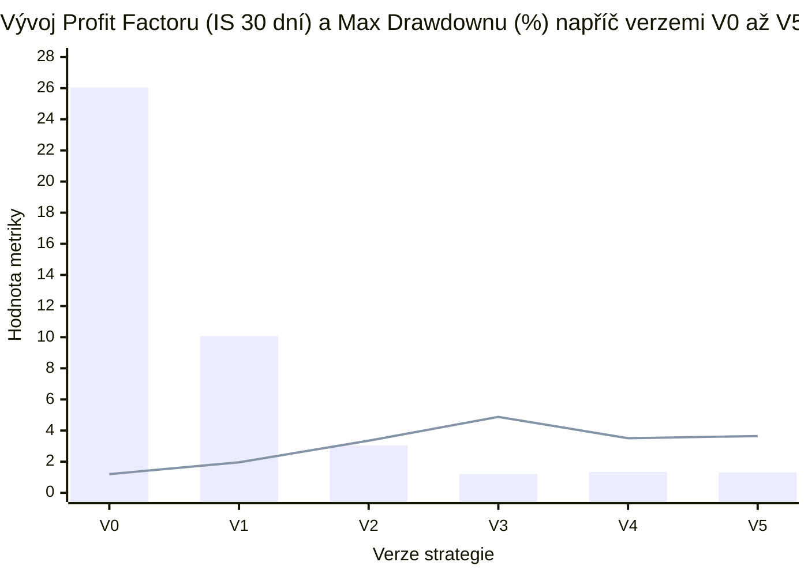

# 05 — Výkonnostní metriky backtestu a Brierovo skóre kalibrace

[← Zpět na hlavní dokument: Optimalizace UtterParameciumStrategy](../strategy/UtterParamecium-optimalizace.MD)

---

## 1. Proč tento koncept ve strategii potřebujeme

Samotný konečný čistý zisk (*Net PnL*) je při hodnocení obchodní strategie zrádný ukazatel: strategie `V0` vydělala za 30 dní `+5 404,78 USD`, ale cestou utrpěla propad kapitálu `-4 649,17 USD` (`26,05 %`) a v následujících třech dnech mimo vzorek ztratila `-846,41 USD`. Abychom dokázali objektivně porovnat kvalitu verzí `V0` až `V5`, počítá modul `backtest` (třída `PerformanceMetricsCalculator` a `BacktestEngine`) ucelenou sadu statistických metrik měřících **efektivitu zisku vůči ztrátám**, **riziko propadu kapitálu**, **poměr výnosu k rozptylu** i **přesnost pravděpodobnostních odhadů modelu**.

---

## 2. Formální matematická definice

Nechť $N$ je celkový počet zrealizovaných dávkových obchodů (*trades*) s čistými dolarovými výsledky $\pi_1, \pi_2, \dots, \pi_N$ (po odečtení poplatků $f_i$), investovanými objemy $s_i > 0$ a počátečním kapitálem $C_0 = 10\,000\text{ USD}$. Nechť $\mathcal{W} = \{i : \pi_i > 0\}$ je množina vítězných obchodů a $\mathcal{L} = \{i : \pi_i \le 0\}$ množina ztrátových obchodů.

### 2.1 Úspěšnost (*Win Rate*) — obchodní vs. tržní
- **Úspěšnost na úrovni jednotlivých obchodů (*Trade Win Rate*)**:

$$
\text{WR}_{\text{trade}} = \frac{|\mathcal{W}|}{N} \times 100\,\%.
$$

- **Úspěšnost na úrovni nezávislých 15m trhů (*Market Win Rate*)** — podíl obchodovaných svíček $m \in \{1, \dots, M_{\text{traded}}\}$, jejichž souhrnný čistý výsledek $\Pi_m = \sum_{i \in m} \pi_i > 0$:

$$
\text{WR}_{\text{market}} = \frac{|\{m : \Pi_m > 0\}|}{M_{\text{traded}}} \times 100\,\%.
$$

### 2.2 Hrubý zisk, hrubá ztráta, čistý zisk a *Profit Factor* ($PF$)

$$
\text{GP} = \sum_{i \in \mathcal{W}} \pi_i, \qquad \text{GL} = \sum_{i \in \mathcal{L}} |\pi_i|, \qquad \text{NetPnL} = \text{GP} - \text{GL},
$$

$$
\text{PF} = \frac{\text{GP}}{\text{GL}}.
$$

- $\text{PF} = 1{,}00$: strategie je přesně na nule (každý prodělaný dolar je vyvážen jedním vydělaným dolarem).
- $\text{PF} < 1{,}00$: ztrátová strategie.
- $\text{PF} > 2{,}00$: silná převaha součtu výher nad součtem proher.

### 2.3 Výběrový odhad očekávané hodnoty na obchod (*EV per Trade*)

$$
\widehat{\text{EV}} = \frac{1}{N}\sum_{i=1}^{N} \pi_i = \frac{\text{NetPnL}}{N}.
$$

### 2.4 Maximální propad kapitálu (*Maximum Drawdown — MaxDD*)

Nechť $B_k = C_0 + \sum_{i=1}^{k} \pi_i$ je stav účtu po $k$-tém obchodě ($B_0 = C_0$) a $P_k = \max_{0 \le j \le k} B_j$ je dosavadní historické maximum účtu (*High-Water Mark*). Pak maximální dolarový a procentní propad jsou:

$$
\text{MaxDD}_{\text{USD}} = \max_{1 \le k \le N} (P_k - B_k), \qquad \text{MaxDD}_{\%} = \max_{1 \le k \le N} \left(\frac{P_k - B_k}{P_k} \times 100\,\%\right).
$$

### 2.5 Anualizovaný Sharpeův poměr (*Sharpe Ratio*)

Pro každý obchod definujeme relativní výnos vůči vsazené částce $r_i = \pi_i / \max(s_i, 1)$. Označme výběrový průměr výnosů $\bar{r}$ a výběrovou směrodatnou odchylku výnosů $s_r$ (s Besselovou korekcí $N - 1$ ve jmenovateli, která odstraňuje zkreslení u konečného vzorku):

$$
\bar{r} = \frac{1}{N}\sum_{i=1}^{N} r_i, \qquad s_r = \sqrt{\frac{1}{N - 1}\sum_{i=1}^{N} (r_i - \bar{r})^2}.
$$

Je-li testované období dlouhé $D$ dní, je odhadovaný roční počet obchodů $N_{\text{year}} = N \cdot \frac{365{,}25}{D}$ a anualizovaný Sharpeův poměr (při nulové bezrizikové sazbě na sekundovém horizontu) je:

$$
\text{Sharpe} = \frac{\bar{r}}{s_r} \cdot \sqrt{N_{\text{year}}}.
$$

### 2.6 Sortinův poměr (*Sortino Ratio*) — učebnicový vs. implementační detail

Smyslem Sortinova poměru je nepenalizovat kladné výstřelky zisku nahoru, ale měřit pouze volatilitu ztrát (*downside risk*).
- **Standardní kvantitativní definice** počítá druhý moment záporných odchylek od nuly přes všechny obchody $N$:

$$
\sigma_{\text{down, std}} = \sqrt{\frac{1}{N}\sum_{i=1}^{N} \min(0, r_i)^2}.
$$

- **Implementace v `PerformanceMetricsCalculator`** počítá výběrovou směrodatnou odchylku pouze uvnitř podmnožiny záporných obchodů $\mathcal{L}$ kolem jejich vlastního průměru $\bar{r}_{-}$:

$$
s_{\text{down, impl}} = \sqrt{\frac{1}{|\mathcal{L}| - 1}\sum_{i \in \mathcal{L}} (r_i - \bar{r}_{-})^2}, \qquad \text{Sortino} = \frac{\bar{r}}{s_{\text{down, impl}}} \cdot \sqrt{N_{\text{year}}}.
$$

### 2.7 Brierovo skóre (*Brier Score*) — kalibrace pravděpodobností

Zatímco výše uvedené metriky hodnotí obchody, **Brierovo skóre** hodnotí **přesnost samotného pravděpodobnostního modelu** napříč všemi $M$ vyhodnocenými 15minutovými svíčkami (včetně neobchodovaných!). Pro každou svíčku $m \in \{1, \dots, M\}$ porovná poslední modelovou pravděpodobnost růstu $p_m \in [0, 1]$ se skutečným výsledkem $y_m \in \{0, 1\}$:

$$
\text{BS} = \frac{1}{M}\sum_{m=1}^{M} (p_m - y_m)^2.
$$

- $\text{BS} = 0{,}00$: dokonalý jasnovidec ($p_m = 1$ vždy, když nastane `UP`, a $p_m = 0$, když nastane `DOWN`).
- $\text{BS} = 0{,}25$: slepý model bez informace, který vždy tipuje `50 %` ($0{,}50^2 = 0{,}25$).
- $\text{BS} = 1{,}00$: dokonale opačný model.
Brierovo skóre je tzv. **striktně vlastní skórovací pravidlo (*strictly proper scoring rule*)**: matematicky lze dokázat, že nejnižší očekávané Brierovo skóre dosáhne model právě tehdy, když hlásí skutečnou objektivní pravděpodobnost jevu (nelze ho „ošidit“ přeháněním ani podceňováním jistoty).

---

## 3. Vysvětlení pro člověka bez znalosti statistiky

### Kterým číslům v JSON reportu věřit nejvíce a proč je Sortino `3 885` artefakt binárních opcí?
Jako vývojář si při pohledu na backtest JSON okamžitě všimnete dvou extrémních čísel u `V5`: `Sharpe = 47.80` a `Sortino = 3,885.66` (zatímco běžné akciové fondy mají Sharpe `1,0–2,5`). Znamená to snad chybu v backtestu? Nikoliv, je to přímý matematický důsledek dvou vlastností naší úlohy:

1. **Proč exploduje Sortino u binárních opcí držených do expirace?**
   U klasického obchodování jednou proděláte `-1 %`, podruhé `-8 %`, potřetí `-3 %` — ztráty se kolem svého průměru liší. U binární opce držené do expirace však **při každé prohře přijdete o celých 100 % ceny opce**! Relativní výnos $r_i = \pi_i / s_i$ je tak u každého prohraného obchodu prakticky totožný: kolem `-1,01` (`-100 %` vkladu minus ~1 % poplatek). Rozptyl čísel `[-1.012, -1.015, -1.009]` kolem jejich vlastního průměru `-1.012` je téměř **nula** ($s_{\text{down, impl}} \approx 0{,}004$)! Když pak kladný průměrný výnos vydělíte číslem blízkým nule, vyletí Sortino do tisíců. **Poučení:** Sortino v této implementaci měří stejnoměrnost proher, nikoliv jejich četnost — pro porovnávání verzí ho proto nepoužíváme jako primární kritérium.

2. **Proč je anualizovaný Sharpe `15–54` nadsazený shlukováním dávek?**
   Vzorec $\sqrt{N_{\text{year}}}$ předpokládá, že všech `811` obchodů jsou nezávislé hody mincí. Ve skutečnosti ale strategie v jedné 15minutové svíčce pošle průměrně `6` dávkových příkazů za sebou, které všechny sdílejí **týž konečný výsledek svíčky**. Skutečný počet nezávislých událostí je `135` svíček, nikoliv `811` příkazů, takže realistický Sharpe na úrovni svíček je zhruba $\sqrt{811/135} \approx 2{,}45\times$ nižší (stále vynikajících `~19`, ale už ne `48`; podrobně v [kapitole 10](10-statisticka-inference-efektivni-vzorek-nestacionarita-a-overfitting.md)).

### Čtyři hlavní pilíře, podle kterých jsme optimalizaci řídili
1. **Profit Factor ($\text{PF}$)**: kolik dolarů hrubého zisku vygeneruje každý dolar hrubé ztráty (`1,201` u `V0` → `3,652` u `V5`). Není zkreslen počtem dílčích dávek!
2. **Maximální propad ($\text{MaxDD}_{\text{USD}}$ a $\text{MaxDD}_{\%}$)**: nejhorší bolest, kterou by účet v reálném čase zažil (`4 649 USD / 26,05 %` u `V0` → `178 USD / 1,30 %` u `V5`).
3. **Očekávaná hodnota na obchod a na svíčku ($\widehat{\text{EV}}$)**: kolik čistého zisku po poplatcích nese průměrná exekuce (`+0,45 USD` u `V0` → `+5,08 USD` u `V5`), což udává odolnost vůči skluzu (*slippage*) v živém obchodování.
4. **Konzistence napříč časovými bloky a Out-of-Sample**: zda metrika drží nad `PF > 1,0` i mimo trénovací období.

---

## 4. Konkrétní číselný příklad z `UtterParameciumStrategy` (`V0` vs. `V5`)

Porovnejme přesná čísla 30denního In-Sample běhu (`2 842` svíček, počáteční kapitál `10 000 USD`):

- **Verze `V0`**:
  - $\text{GP} = +32\,284{,}31\text{ USD}$, $\text{GL} = 26\,879{,}53\text{ USD}$ (poplatky celkem `2 180,12 USD`).
  - $\text{NetPnL} = 32\,284{,}31 - 26\,879{,}53 = +5\,404{,}78\text{ USD}$.
  - $\text{PF} = \frac{32\,284{,}31}{26\,879{,}53} = 1{,}201$ — tenounký polštář: stačí zhoršení o 17 % a strategie je ve ztrátě (přesně to nastalo v listopadu s `PF = 0,809`!).
  - $\widehat{\text{EV}} = \frac{5\,404{,}78}{12\,012} = +0{,}45\text{ USD}$ na obchod.

- **Verze `V5`**:
  - $\text{GP} = +5\,668{,}01\text{ USD}$, $\text{GL} = 1\,552{,}08\text{ USD}$ (poplatky celkem jen `298,55 USD` — úspora `1 881,57 USD` na poplatcích!).
  - $\text{NetPnL} = 5\,668{,}01 - 1\,552{,}08 = +4\,115{,}93\text{ USD}$.
  - $\text{PF} = \frac{5\,668{,}01}{1\,552{,}08} = 3{,}652$ (**3× vyšší efektivita kapitálu**).
  - $\widehat{\text{EV}} = \frac{4\,115{,}93}{811} = +5{,}08\text{ USD}$ na obchod (**11,3× vyšší čistý zisk na exekuci**).
  - $\text{BS} = 0{,}1459$ napříč všemi `2 842` svíčkami — oproti náhodnému modelu (`0,2500`) vysvětluje model 60s TWAPu více než **41 % kvadratické nejistoty** binárního výsledku svíčky!

---

## 5. Vizualizace

*(Sloupce = `Max Drawdown %` klesající z `26,05 %` na `1,30 %`; křivka = `Profit Factor` rostoucí z `1,20` na `3,65–4,88`.)*

---

## 6. Přehled celé sady metrik napříč `V0` → `V5` (30 dní In-Sample)

| Verze | Obchodované trhy (`WR_mkt`) | Obchody (`WR_tr`) | Hrubý zisk (`GP`) | Hrubá ztráta (`GL`) | Poplatky | Čistý zisk (`NetPnL`) | **Profit Factor** | **MaxDD (`%`)** | **EV / obch.** | Brierovo skóre |
| :--- | :---: | :---: | :---: | :---: | :---: | :---: | :---: | :---: | :---: | :---: |
| **`V0`** | `634` (`85,3 %`) | `12 012` (`86,5 %`) | `+$32,284` | `-$26,880` | `$2,180` | `+$5,404.78` | **`1.201`** | **`26.05 %`** | `+$0.45` | `0.1464` |
| **`V1`** | `245` (`75,5 %`) | `1 871` (`82,8 %`) | `+$9,507` | `-$4,846` | `$557` | `+$4,660.89` | **`1.962`** | **`10.08 %`** | `+$2.49` | `0.1459` |
| **`V2`** | `128` (`79,7 %`) | `924` (`86,1 %`) | `+$6,052` | `-$1,806` | `$318` | `+$4,246.12` | **`3.351`** | **`3.05 %`** | `+$4.60` | `0.1459` |
| **`V3`** | `97` (`77,3 %`) | `606` (`90,8 %`) | `+$4,491` | `-$920` | `$223` | `+$3,570.58` | **`4.880`** | **`1.21 %`** | `+$5.89` | `0.1459` |
| **`V4`** | `133` (`75,9 %`) | `804` (`87,8 %`) | `+$5,631` | `-$1,607` | `$296` | `+$4,024.45` | **`3.505`** | **`1.34 %`** | `+$5.01` | `0.1459` |
| **`V5`** | `135` (`77,0 %`) | `811` (`88,3 %`) | `+$5,668` | `-$1,552` | `$299` | `+$4,115.93` | **`3.652`** | **`1.30 %`** | `+$5.08` | `0.1459` |

---

**Navazující kapitoly teorie:**
- [← 04 — Odhad volatility pomocí MAD, časové škálování a orákulový čas](04-odhad-volatility-mad-a-casove-skalovani.md)
- [06 — Mikrostruktura CLOBu, nepříznivý výběr, Lead-Lag a EMA zarovnání báze →](06-mikrostruktura-clob-nepriznivy-vyber-a-ema-baze.md)
- [10 — Statistická inference, efektivní vzorek, nestacionarita a overfitting →](10-statisticka-inference-efektivni-vzorek-nestacionarita-a-overfitting.md)
