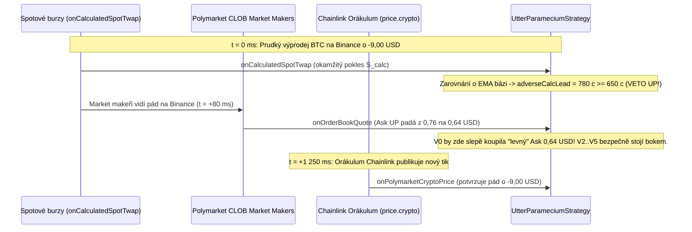

# 06 — Mikrostruktura CLOBu, nepříznivý výběr, Lead-Lag a EMA zarovnání báze

[← Zpět na hlavní dokument: Optimalizace UtterParameciumStrategy](../strategy/UtterParamecium-optimalizace.MD)

---

## 1. Proč tento koncept ve strategii potřebujeme

Kdyby se ceny na všech burzách a v orákulu Chainlink měnily v témže mikrosekundovém okamžiku, neexistovala by na CLOBu Polymarketu žádná obchodovatelná neefektivita — ale zároveň bychom nikdy nebyli „přejeti“ opožděným orákulem. V reálném světě existuje **informační hierarchie rychlosti (*Lead-Lag Hierarchy*)**:
1. **Nejrychlejší vrstva (`~0 ms`)**: primární spotové a futures burzy (Binance, Coinbase, Kraken), z nichž interní agregátor aplikace počítá proud `onCalculatedSpotTwap` (`spotPrice`).
2. **Střední vrstva (`~50–500 ms`)**: profesionální tvůrci trhu (*Market Makers*) na Polymarket CLOBu, kteří stahují a přeceňují své nabídky v knize objednávek hned, jak vidí pohyb na Binance.
3. **Nejpomalejší vrstva (`~1 000–1 500 ms` zpoždění)**: decentralizované agregované orákulum **Chainlink** (`price.crypto`), které sice se zpožděním ~1–1,5 sekundy následuje burzy, ale **jehož čísla jako jediná právoplatně rozhodují o konečném vypořádání 15m trhu!**

Tato kapitola vysvětluje statistické nástroje, jimiž strategie řeší obě strany této mikrostruktury: ochranu před **nepříznivým výběrem (*Adverse Selection*)** v knize objednávek a **exponenciální klouzavý průměr (*EMA*) s ořezáním inovací** pro bázové zarovnání předbíhajícího signálu `onCalculatedSpotTwap`.

---

## 2. Formální matematická definice

### 2.1 Nepříznivý výběr (*Adverse Selection*) v knize objednávek CLOB

Označme skutečnou (plně informovanou) pravděpodobnost výhry `UP` v čase $t$ jako $p^*(t) = \mathbb{P}(Y = 1 \mid \mathcal{F}^{\text{full}}_t)$, kde $\mathcal{F}^{\text{full}}_t$ zahrnuje i nejrychlejší spotové burzy, zatímco zpožděný model čtoucí pouze Chainlink vidí podmnožinu informací $\mathcal{F}^{\text{CL}}_t \subset \mathcal{F}^{\text{full}}_t$.

K **nepříznivému výběru** dochází tehdy, když tvůrce trhu na CLOBu již zaznamenal prudký pád Bitcoinu na Binance a zlevnil prodejní cenu `askUp` z `0,82 USD` na `0,68 USD`, zatímco poslední tik Chainlinku stále ukazuje starou vysokou cenu před pádem. Z pohledu slepého modelu $\mathcal{F}^{\text{CL}}_t$ vypadá zlevnění na `0,68 USD` jako „sleva se skvělou hranou“, ačkoliv podmíněná střední hodnota při exekuci je silně záporná:

$$
\mathbb{E}\!\left[\Pi \,\middle|\, \text{Ask prudce klesl o } \Delta a \ge \theta_{\text{drop}}\right] = p^*(t) - a - f(a) \ll 0.
$$

### 2.2 Robustní 1sekundový *Minimum-Bucket* filtr knihy (`RecentQuoteBuffer`)

Abychom rozlišili **skutečný pád tržní ceny** od neškodného přechodného vykoupení první úrovně knihy (*liquidity sweep spike*), sdružuje `RecentQuoteBuffer` příchozí kotace do diskrétních jednosekundových košů $B_k = [k\cdot 1000\text{ ms}, (k+1)\cdot 1000\text{ ms})$ a v každém koši ukládá **minimum** pozorovaného Bidu a Asku:

$$
\tilde{a}_k = \min_{t_j \in B_k} a(t_j), \qquad \tilde{b}_k = \min_{t_j \in B_k} b(t_j).
$$

Udržitelná maximální hladina knihy za posledních $8\text{ s}$ je pak maximum z těchto očištěných sekundových minim:

$$
a^{\text{sust}}_{\max}(t) = \max_{k : t_k \ge t - 8\text{s}} \tilde{a}_k, \qquad b^{\text{sust}}_{\max}(t) = \max_{k : t_k \ge t - 8\text{s}} \tilde{b}_k.
$$

Vstup před uzamčením TWAPu je zablokován, pokud současně poklesl udržitelný Ask i udržitelný Bid:

$$
a^{\text{sust}}_{\max}(t) - a(t) \ge \Delta a_{\text{block}} \quad \land \quad b^{\text{sust}}_{\max}(t) - b(t) \ge \frac{3}{4}\,\Delta a_{\text{block}}.
$$

### 2.3 Vztah *Lead-Lag*, kointegrace a stacionární báze (*Basis*)

Nechť $S^{\text{calc}}_t$ je interně počítaná agregovaná spotová cena z burz (`onCalculatedSpotTwap`) a $S^{\text{CL}}_t$ je cena Chainlinku. Ačkoliv obě řady sledují týž podkladový Bitcoin (jsou **kointegrované** — nemohou se dlouhodobě rozejít do nekonečna), kvůli odlišnému koši burz existuje mezi nimi pomalu se měnící systematický posun neboli **báze (*Basis*)** $\beta_t$:

$$
S^{\text{calc}}(t_{\text{obs}}) = S^{\text{CL}}(t_{\text{obs}}) + \beta_t + \eta_t,
$$

kde $t_{\text{obs}}$ je orákulový čas pozorování Chainlinku a $\eta_t$ je krátkodobý mikrostrukturní šum s nulovou střední hodnotou. Kdybychom odečetli surové ceny $S^{\text{calc}}_t - S^{\text{CL}}_t$ bez odhadu $\beta_t$, trvalý rozdíl košů např. `+6 USD` by falešně hlásil neustálý růstový předstih!

### 2.4 Exponenciální klouzavý průměr (*EMA*) s Huberovým ořezáním odlehlých inovací

Při každém příchodu vzorku Chainlinku spárujeme jeho $S^{\text{CL}}(t_{\text{obs}})$ s historickou hodnotou $S^{\text{calc}}$ platnou v témže čase $t_{\text{obs}}$ (uloženou v 500ms kruhovém poli `CalcSpotBuffer`). Tím porovnáváme **stejný fyzikální okamžik na obou streamech** a získáme okamžitý vzorek báze $x_n = S^{\text{calc}}(t_{\text{obs}, n}) - S^{\text{CL}}(t_{\text{obs}, n})$.

Pro hladký online odhad $\hat{\beta}_n$ používáme **exponenciální klouzavý průměr (*Exponential Moving Average — EMA*)** s koeficientem vyhlazování $\alpha = \frac{1}{16} = 0{,}0625$ a ořezáním inovace (*Huber-style clamping*) na maximální skok $M = 15{,}00\text{ USD}$ (`MAX_CALC_BASIS_INNOVATION_CENTS = 1500`):

$$
\tilde{x}_n = \text{clamp}\!\left(x_n,\; \hat{\beta}_{n-1} - M,\; \hat{\beta}_{n-1} + M\right),
$$

$$
\hat{\beta}_n = (1 - \alpha)\,\hat{\beta}_{n-1} + \alpha\,\tilde{x}_n = \hat{\beta}_{n-1} + \frac{1}{16}\left(\tilde{x}_n - \hat{\beta}_{n-1}\right).
$$

**Poločas rozpadu paměti (*Half-Life*)** filtru EMA udává, po kolika krocích $k_{1/2}$ klesne váha starého pozorování na polovinu ($(1 - \alpha)^{k_{1/2}} = 0{,}5$):

$$
k_{1/2} = \frac{\ln(0{,}5)}{\ln(1 - 1/16)} = \frac{-0{,}6931}{-0{,}0645} \approx 10{,}7\text{ tiků} \quad (\approx 11\text{ sekund}).
$$

### 2.5 Pásmo necitlivosti na šum (*Noise Deadband*) a obousměrný předstih (*Lead*)

V přítomném rozhodovacím čase $t$ zarovnáme nejnovější burzovní cenu odečtením naučené báze a spočítáme **čistý předstih (*Lead*)** burz před posledním známým tikem Chainlinku:

$$
S^{\text{calc, aligned}}_t = S^{\text{calc}}_t - \hat{\beta}_t, \qquad L_t = S^{\text{calc, aligned}}_t - S^{\text{CL}}_t.
$$

Aby mikrostrukturní šum v rozsahu několika dolarů nevyvolával falešné poplachy, aplikujeme **pásmo necitlivosti (*Deadband*)** $D = 3{,}20\text{ USD}$ (`CALC_NOISE_DEADBAND_CENTS = 320`, ve `V2` původně `400`):
- **Ochranná brzda a srážka (*Protective Haircut*, od `V2`)**: Jde-li $L_t$ proti našemu směru o více než $D$, zhoršíme efektivní spotovou cenu pro projekci TWAPu o váhu $w_{\text{adv}} = 70\,\%$ (`calcLeadWeightBps = 7000`):

$$
S^{\text{eff, UP}}_t = S^{\text{CL}}_t - w_{\text{adv}} \cdot \max(0, -L_t - D),
$$

a překročí-li nepříznivý předstih `6,50 USD` (`calcAdverseLeadBlockCents = 650`) nebo 4sekundová rychlost pádu `9,50 USD` (`calcAdverseDrift4sBlockCents = 950`), vstup okamžitě **vetujeme**.
- **Opatrné potvrzení průrazu (*Favorable Breakout Boost*, od `V4`)**: Pouze tehdy, když **samotný Chainlink již leží na správné straně cílové ceny $K$** o alespoň $d_{\min}(\tau)$ a $S^{\text{calc}}$ zároveň silně zrychluje týmž směrem ($\Delta_{4s} S^{\text{calc}} \ge 4{,}50\text{ USD}$), navýšíme efektivní spotovou cenu o konzervativních $w_{\text{fav}} = 40\,\%$ nad deadband (strop `+8,00 USD`). Nikdy tedy nevyrábíme směr proti Chainlinku!

---

## 3. Vysvětlení pro člověka bez znalosti statistiky

### Jak v Javě spočítat EMA bez jediného `double` a bez ztráty přesnosti?
Podívejte se na elegantní trik s pevnou řádovou čárkou v `recordChainlinkSample`: místo abychom ukládali $\hat{\beta}_n$ v centech (kde by celočíselné dělení `/ 16` zahazovalo zbytky menší než 16 centů), ukládáme proměnnou **`calcBasisEmaScaled` vynásobenou 16×** ($E_n = 16\,\hat{\beta}_n$)!
Aktualizační rovnice se pak zredukuje na jediné celočíselné sčítání:

$$
E_n = 16\,\hat{\beta}_{n-1} + 16 \cdot \frac{1}{16}(\tilde{x}_n - \hat{\beta}_{n-1}) = E_{n-1} + (\tilde{x}_n - \hat{\beta}_{n-1}).
$$

A proč inovaci ořezáváme na `±15 USD` (`MAX_CALC_BASIS_INNOVATION_CENTS`)? Představte si, že na Binance nastane prudký skok o `+40 USD`, zatímco Chainlink o vteřinu později dorazí ještě se starší cenou (protože měl nepřesné nebo opožděné razítko). Bez ořezání by se tento dočasný předstih omylem „zažral“ do odhadu báze $\hat{\beta}_n$ a zamaskoval by skutečný cenový skok!

### Proč v `RecentQuoteBuffer` ukládáme v každé sekundě *minimum*, a ne *maximum*?
Tohle byl jeden z nejzajímavějších mikrostrukturních objevů v Iteraci 1 (`V1`)!
Představte si klidný trh, kde `BTC-UP` stojí `Bid = 0,68 USD / Ask = 0,70 USD`. Náhle jiný agresivní trader pošle velký nákupní příkaz a na **50 milisekund** vykoupí knihu až na `Ask = 0,85 USD`, načež market makeři okamžitě doplní likviditu zpátky na `0,70 USD`.
- Kdyby náš 8sekundový buffer sledoval prosté **maximum všech tiků**, uložil by si `maxAsk = 0,85 USD`. O vteřinu později při normální ceně `0,70 USD` by si myslel: *„Pozor, Ask se právě propadl z 0,85 na 0,70 USD (`-150 mc`), trh padá, zákaz nákupu!“* — a zablokoval by ty nejlepší vítězné trhy!
- Tím, že v každém `1 000 ms` koši uložíme **nejnižší** cenu té sekundy (`Math.min`), padesátimilisekundový výstřelik na `0,85 USD` okamžitě přepíše návrat ceny na `0,70 USD`. Vysoká hodnota v `RecentQuoteBuffer` tak zůstane jen tehdy, když se kniha na `0,85 USD` **skutečně udržela celou sekundu**, a padl-li současně i Bid, jde o nefalšované přecenění trhu!

---

## 4. Konkrétní číselný příklad z `UtterParameciumStrategy`

Nechť cílová cena svíčky je $K = 68\,000{,}00\text{ USD}$ a zbývá $\tau = 42\text{ s}$:
1. Během předchozích minut se EMA báze ustálila na $\hat{\beta} = +5{,}00\text{ USD}$ (`calcBasisEmaScaled = 8000`, tj. spotový koš burz leží systematicky o `5,00 USD` výše než Chainlink).
2. Poslední tik Chainlinku hlásí $S^{\text{CL}} = 68\,006{,}00\text{ USD}$ (`+6,00 USD` nad cílem $K$ — na první pohled pěkný `UP` signál!).
3. V témže milisekundovém okamžiku ale dorazí `onCalculatedSpotTwap` se spotovou cenou z burz $S^{\text{calc}} = 68\,003{,}20\text{ USD}$!
4. Po bázovém zarovnání dostaneme ekvivalentní hladinu Chainlinku:

$$
S^{\text{calc, aligned}} = 68\,003{,}20 - 5{,}00 = 67\,998{,}20\text{ USD}.
$$

5. Předstih burz je $L_t = 67\,998{,}20 - 68\,006{,}00 = -7{,}80\text{ USD}$ (`adverseCalcLeadUpCents = 780` centů proti `UP`!).
6. Protože `780 >= calcAdverseLeadBlockCents` (`650` centů = `6,50 USD`), strategie **okamžitě zablokuje nákup `BTC-UP`** o ~1,2 sekundy dříve, než pád dorazí do streamu Chainlink! Namísto nákupu do padajícího nože na vrcholu svíčky tak účet neutrpí žádnou ztrátu.

---

## 5. Vizualizace

---

## 6. Jak se tento princip vyvíjel napříč verzemi `V0` → `V5`

- **`V0`**: Zcela ignorovala `onCalculatedSpotTwap`, neměla žádný filtr driftu Chainlinku ani žádnou paměť nedávných kotací CLOBu (`RecentQuoteBuffer`). Když market makeři srazili cenu padající opce o 15 centů před příchodem tiku Chainlinku, `V0` to vyhodnotila jako obrovský nárůst hrany a nakoupila maximální dávku přímo proti informovanému toku!
- **`V1`**: Přidala 5s/10s drift filtr Chainlinku a 1sekundový *Minimum-Bucket* `RecentQuoteBuffer` (8s okno s požadavkem souběžného pádu Asku o `100 mc` a Bidu o `75 mc`).
- **`V2`**: Poprvé zapojila `onCalculatedSpotTwap` s `CalcSpotBuffer`, bázovým EMA filtrem ($\alpha = 1/16$, Huber clamp `±15 USD`) a ochrannou srážkou / 4s drift vetem (`calcLeadWeightBps = 6000`, deadband `4,00 USD`).
- **`V3`**: Zpřesnila citlivost ochranného signálu (`calcLeadWeightBps = 7000`, deadband `3,20 USD`, veto při `6,50 USD` leadu / `9,50 USD` 4s driftu).
- **`V4` & `V5`**: Rozšířily `onCalculatedSpotTwap` na **obousměrný doplňkový senzor** — kromě ochranného veta dokáže při čerstvém průrazu (kdy už samotný Chainlink překonal $K + d_{\min}$) vyvolat okamžité přehodnocení (throttlované po `200 ms`) a přidat konzervativní 40% potvrzovací bonus, a současně povoluje dokupování ve zdravém hlubokém trendu během mírné korekce (*confirmed deep pullback*).

---

**Navazující kapitoly teorie:**
- [← 05 — Výkonnostní metriky backtestu a Brierovo skóre](05-vykonnostni-metriky-a-brier-skore.md)
- [07 — Řízení pozice, Kellyho princip a dynamické limity inventáře →](07-rizeni-pozice-kellyho-princip-a-dynamicke-limity.md)
