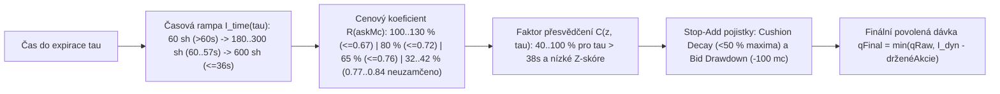

# 07 — Řízení pozice, Kellyho princip, postupné odemykání inventáře a ochrana proti rozpadu polštáře

[← Zpět na hlavní dokument: Optimalizace UtterParameciumStrategy](../strategy/UtterParamecium-optimalizace.MD)

---

## 1. Proč tento koncept ve strategii potřebujeme

Mít kladnou statistickou hranu ($\text{EV} > 0$) je pouze polovina úspěchu — druhá polovina je **kolik akcií v dané sekundě a za danou cenu koupit** (*Position Sizing & Inventory Risk Control*).
Analýza 10 nejztrátovějších trhů verze `V0` ukázala drtivý vzorec:
1. V čase $\tau = 59\text{ s}$ (kdy ze 60s TWAPu nebyla uzamčena ještě ani sekunda!) nakoupila `V0` během několika vteřin stovky akcií za `0,85 USD` a vyčerpala svůj strop `600` akcií.
2. O 20 sekund později se trh otočil na druhou stranu cílové ceny $K$ — a protože `V0` povolovala nákup obou stran v téže svíčce, nakoupila ještě stovky akcií opačného směru (**tzv. *whipsaw double-loss***), případně při slábnoucím trendu tvrdohlavě ředila ztrátovou pozici až do hořkého konce!

Tato kapitola vysvětluje matematiku dimenzování pozice u binárních opcí a vícevrstvé řízení inventáře vybudované v iteracích `V1` až `V5`.

---

## 2. Formální matematická definice

### 2.1 Kellyho kritérium pro binární opci a důvod cenového krácení pozice

V teorii optimálního růstu kapitálu (John Kelly, 1956) hledáme zlomek kapitálu $f^* \in [0, 1)$ investovaný do binární sázky s celkovým nákladem na akcii $c = a + f(a) \in (0, 1)$ a pravděpodobností výhry $p > c$, který maximalizuje střední logaritmické tempo růstu účtu:

$$
g(f) = p \ln\!\left(1 + f\,\frac{1 - c}{c}\right) + (1 - p) \ln(1 - f).
$$

Položením derivace $\frac{dg}{df} = 0$ dostaneme **přesný Kellyho zlomek kapitálu** (v dolarech) a jemu odpovídající **optimální počet akcií** $Q^* = \frac{f^* \cdot \text{Kapitál}}{c}$:

$$
f^*_{\text{USD}} = \frac{p - c}{1 - c}, \qquad Q^*_{\text{shares}} = \text{Kapitál} \cdot \frac{p - c}{c(1 - c)}.
$$

Všimněte si klíčového rozdílu při **nejistotě odhadu pravděpodobnosti** $\Delta p$ (*estimation error*):
 Derivace zlomku kapitálu podle chyby modelu je $\frac{\partial f^*_{\text{USD}}}{\partial p} = \frac{1}{1 - c}$!
- Při ceně opce $c = 0{,}50\text{ USD}$ způsobí chyba odhadu pravděpodobnosti o $5\text{ p.b.}$ chybu alokace kapitálu o $5 / 0{,}50 = 10\text{ p.b.}$
- Při ceně opce $c = 0{,}85\text{ USD}$ způsobí **tatáž chyba $5\text{ p.b.}$** chybu alokace kapitálu o $5 / 0{,}15 = 33{,}3\text{ p.b.}$ (**3,3× větší citlivost na chybu modelu**)!
Proto v reálném obchodování s nejistým parametrem $p$ (*Fractional / Robust Kelly*) musí maximální povolený počet akcií $Q_{\max}(a)$ **klesat s rostoucí cenou opce $a$**, dokud není výsledek matematicky uzamčen.

### 2.2 Zákaz otáčení směru v téže svíčce (*Single-Direction Commitment*)

Nechť $Q_{\text{UP}}(t), Q_{\text{DOWN}}(t) \ge 0$ jsou dosud nakoupené akcie v aktivní svíčce. Protože platí $Y_{\text{UP}} + Y_{\text{DOWN}} = 1$ (vypořádána na `1,00 USD` může být pouze jedna strana, zatímco na obou stranách zaplatíme spread $s_{\text{spread}}$ a dvojí taker poplatek $f(a_{\text{UP}}) + f(a_{\text{DOWN}})$), má souběžné držení $q$ párů `UP + DOWN` garantovanou deterministickou ztrátu:

$$
\Pi_{\text{pair}} = 1 - (a_{\text{UP}} + a_{\text{DOWN}}) - f(a_{\text{UP}}) - f(a_{\text{DOWN}}) < 0 \qquad (\text{neboť } a_{\text{UP}} + a_{\text{DOWN}} = 1 + s_{\text{spread}} > 1).
$$

Od verze `V1` (`allowDirectionFlip = false`) proto platí striktní invariant vzájemné výlučnosti:

$$
Q_{\text{DOWN}}(t) > 0 \implies e_{\text{UP}}(t) = -\infty, \qquad Q_{\text{UP}}(t) > 0 \implies e_{\text{DOWN}}(t) = -\infty.
$$

### 2.3 Časově odstupňovaný strop inventáře (*Time-Staged Inventory Ramp*)

Protože v čase $\tau = 60\text{ s}$ tvoří neznámá budoucnost 100 % vypořádacího TWAPu, zatímco v $\tau = 36\text{ s}$ jsou již $2/5$ okna uzamčeny a rozptyl zbývajícího průměru klesl o více než polovinu, odemyká metoda `computeTimeStagedMaxInventory(tauMs)` celkový limit pozice $I_{\max} = 600$ akcií postupně v čase od $\alpha_{\text{early}} = 50\,\%$ (`earlyInventoryCapBps = 5000`, tj. `300` akcií) na začátku okna až po `100 %` (`600` akcií) při $\tau \le \tau_{\text{full}} = 36\text{ s}$:

$$
I_{\text{time}}(\tau) =
\begin{cases}
I_{\text{early}} & \text{pro } \tau \ge 60\text{ s}, \\
I_{\text{early}} + (I_{\max} - I_{\text{early}}) \cdot \dfrac{60\text{ s} - \tau}{60\text{ s} - \tau_{\text{full}}} & \text{pro } \tau_{\text{full}} < \tau < 60\text{ s}, \\
I_{\max} & \text{pro } \tau \le \tau_{\text{full}}.
\end{cases}
$$

*(Ve `V5` navíc v prvních 3 sekundách okna $57\text{ s} < \tau \le 60\text{ s}$ nabíhá u středně drahých opcí $a \ge 0{,}62\text{ USD}$ se středním $z < 1{,}10\sigma$ plynulá rampa ze `180` na `300` akcií.)*

### 2.4 Vícefaktorový dynamický limit pozice (`computeDynamicMaxInventory`)

Časový limit $I_{\text{time}}(\tau)$ je od verzí `V2`–`V5` dále násoben dvěma koeficienty:
1. **Cenovým koeficientem asymetrie rizika** $R(a, \tau, z, e, \text{locked}) \in [0{,}32;\; 1{,}30]$ (`riskTierBps`):
   - Levné opce $a \le 0{,}67\text{ USD}$: `100 %` (a při vysokém přesvědčení $z \ge 1{,}45\sigma$, $e \ge 55\text{ mc}$, $\tau \le 36\text{ s}$ bonus `130 %` = až `780` akcií).
   - Přechodové pásmo $0{,}68\text{–}0{,}72\text{ USD}$: `80 %` (odemčeno na `110 %` při uzamčení nebo silném $z \ge 1{,}35\sigma$).
   - Střední pásmo $0{,}73\text{–}0{,}76\text{ USD}$: `65 %` (`95 %` při uzamčení).
   - Drahé neuzamčené opce $0{,}77\text{–}0{,}84\text{ USD}$: kráceno na **`42 %` resp. `32 %`**! (Pokud však dojde ke skutečnému matematickému uzamčení TWAPu, strop se odemkne na `80–90 %`.)
2. **Faktorem přesvědčení před uzamčením** $C(z, \tau) \in [0{,}40;\; 1{,}00]$ (`convictionBps`, od `V3`):
   Je-li $\tau > 38\text{ s}$ a polštář $z$ je zatím mělký ($z < 0{,}85\sigma$), škáluje se strop lineárně mezi `40 %` (při $z \le 0{,}55\sigma$) a `100 %` (při $z = 0{,}85\sigma$), aby stagnující trh s těsným náskokem nenakoupil plnou pozici.

$$
I_{\text{dyn}}(\tau, a, z, e) = \max\!\left(Q_{\min},\; I_{\text{time}}(\tau) \cdot R(a, \tau, z, e) \cdot C(z, \tau)\right).
$$

### 2.5 Velikost jednotlivé dávky (*Edge & Time-Scaled Batch Sizing*)

Velikost jedné dílčí objednávky $Q_{\text{raw}}$ roste lineárně s nadvýškou čisté hrany nad minimem $(e_{\text{mc}} - e_{\min})$ a s časovým faktorem postupu oknem:

$$
Q_{\text{raw}} = \text{clamp}\!\left(Q_{\min} + \left\lfloor \frac{k_{\text{edge}} \cdot (e_{\text{mc}} - e_{\min}) \cdot \varphi(\tau)}{100} \right\rfloor,\; Q_{\min},\; Q_{\max,\text{eff}}\right),
$$

kde ve `V4`/`V5` klesá $Q_{\max,\text{eff}}$ na opatrných `25` akcií v úvodu okna s nízkým $z$ nebo u drahých neuzamčených opcí, zatímco u uzamčených a vysoce přesvědčivých signálů stoupá z `45` až na `60` akcií (`133,34 %`).

### 2.6 Ochrana proti rozpadu polštáře (*Stop-Add: Cushion Decay & Bid Drawdown*) a *Locked Debt*

Od verze `V2` si strategie pamatuje **nejlepší dosažený polštář při předchozích nákupech** $d_{\text{peak}}$ (`peakFilledDistCents`) a **nejvyšší dosažený Bid** $b_{\text{peak}}$ (`peakFilledBidMc`) v dané svíčce:
1. **Cushion Decay Stop-Add**: Držíme-li již $\ge 150$ akcií a aktuální polštář $d_{\text{eff}}$ spadl pod $12{,}00\text{ USD}$ **a zároveň** pod $50\,\%$ svého dosavadního maxima ($d_{\text{eff}} < 0{,}50\,d_{\text{peak}}$), zakazuje se další přikupování (*žádné ředění rozpadajícího se trendu!*).
2. **Bid Drawdown Stop-Add**: Držíme-li $\ge 90$ akcií a tržní Bid naší pozice se propadl o $\ge 0{,}10\text{ USD}$ (`100 mc`) pod $b_{\text{peak}}$, rovněž zastavujeme dokupování.
3. **Uzamčený dluh TWAPu (*Locked TWAP Debt*)**: Pokud cena strávila první polovinu minuty na **opačné straně** cílové ceny $K$ ($M_{\text{locked}}$ má záporný náskok, tj. „dluh“ vůči $K$) a teprve v závěru přeskočila nad $K$, musí celková projekce $\widehat{\text{TWAP}} - K$ překonat dvojnásobek až trojnásobek tohoto dluhu (a alespoň `10–12 USD`), jinak je pozdní naskočení do obratu zablokováno.

---

## 3. Vysvětlení pro člověka bez znalosti statistiky

### Proč rozdělovat nákup do dávek po `300 ms` místo jediného obřího příkazu?
V programování bychom nejraději udělali jediné čisté volání `buy(600)`. Na predikčním trhu s 60s TWAPem má však dávkování (*micro-batching* s `cooldownMs = 300 ms`) dvě obrovské výhody:
1. **Ochrana před vykoupením mělkého orderbooku**: Na nejlepší ceně `0,68 USD` často leží jen `30–50` akcií. Kdybychom poslali příkaz na `600` akcií najednou, projeli bychom prázdnou knihou a nakoupili za průměrných `0,73 USD`. Menší dávka `25–45` akcií vezme horní vrstvu a za `300 ms` dá market makerům čas kotaci obnovit (nebo ustoupit, pokud mezitím zmizela hrana).
2. **Průběžné vyhodnocování pravdivosti hypotézy (*Sequential Bayesian Updating*)**: V sekundě `58 s` koupíme opatrnou průzkumnou dávku. Pokud trend skutečně drží a uzamčený integrál TWAPu každou vteřinou narůstá, systém postupně přikupuje do sílící jistoty. Pokud šlo jen o falešný výstřelik a polštář začne tát (*Cushion Decay*), zůstaneme jen s malou počáteční pozicí místo katastrofální plné ztráty `600` akcií!

---

## 4. Konkrétní číselný příklad z `UtterParameciumStrategy`

Porovnejme chování `V0` a `V5` ve zrádném trhu, kde v čase $\tau = 50\text{ s}$ vyskočí opce `BTC-UP` na `askMc = 810` (`0,81 USD`) při mírném náskoku $z = 2{,}52\sigma$, ale v čase $\tau = 28\text{ s}$ se polštář začne drolit:
- **Verze `V0`**:
  - Nemá časový strop inventáře ani krácení podle ceny → okamžitě má odemčeno plných **`600` akcií** za `0,81 USD` (v sázce přes **`490 USD`** na jedinou neuzamčenou svíčku!).
  - Když cena v $\tau = 28\text{ s}$ oslabí a opce zlevní na `0,66 USD`, vidí `V0` „levnější Ask“ a dokoupí zbytek do `600` akcií. Při obratu v posledních 15 sekundách prodělá účet téměř `-500 USD` v jediné svíčce!
- **Verze `V5`**:
  - V $\tau = 50\text{ s}$ je opce za `0,81 USD` neuzamčená a $\tau > 46\text{ s}$ → nákup takto drahé opce tak brzy je **zcela zakázán**.
  - I kdyby šlo o čas $\tau = 37\text{ s}$ (kde je časový limit $I_{\text{time}}(37\text{ s}) \approx 587$ akcií), cenové pásmo `810 mc` aplikuje `riskTierBps = 3200` (`32 %`), takže maximální možná expozice na neuzamčené drahé opci je seříznuta na $587 \times 0{,}32 = \mathbf{187\text{ akcií}}$ (**3,2× menší riziko**).
  - A jakmile polštář klesne pod polovinu maxima (`Cushion Decay`), `Stop-Add` okamžitě zmrazí jakékoliv další přikupování.

---

## 5. Vizualizace

---

## 6. Jak se tento princip vyvíjel napříč verzemi `V0` → `V5`

- **`V0`**: Statický limit `600` akcií od první milisekundy okna bez ohledu na cenu opce, povolené otáčení pozice `UP <-> DOWN` v téže svíčce, žádné `Stop-Add` brzdy.
- **`V1`**: Zákaz otáčení směru (`allowDirectionFlip = false`) a lineární časová rampa `computeTimeStagedMaxInventory` (`55 %` v 60 s → `100 %` v 35 s).
- **`V2`**: Zavedení cenových pásem `riskTierBps`, ochrany proti uzamčenému dluhu TWAPu (`Locked Debt`) a pojistek `Cushion Decay` + `Bid Drawdown Stop-Add`.
- **`V3`**: Přidání spojitého faktoru přesvědčení `convictionBps` (`40 %..100 %`) proti hromadění akcií ve stagnujících trzích před uzamčením.
- **`V4` & `V5`**: Propojení dynamické velikosti dávky (`maxOrderShares = 45`, boost až `60` sh vs. opatrný strop `25` sh) se skutečným matematickým uzamčením TWAPu (`trulyLockedIn`) a plynulou 3sekundovou úvodní rampou `60s -> 57s` ve `V5`.

---

**Navazující kapitoly teorie:**
- [← 06 — Mikrostruktura CLOBu, nepříznivý výběr, Lead-Lag a EMA zarovnání báze](06-mikrostruktura-clob-nepriznivy-vyber-a-ema-baze.md)
- [08 — Autokorelace výnosů, vlnový rozsah a Parkinsonův odhad →](08-autokorelace-vlnovy-rozsah-a-parkinsonuv-odhad.md)
