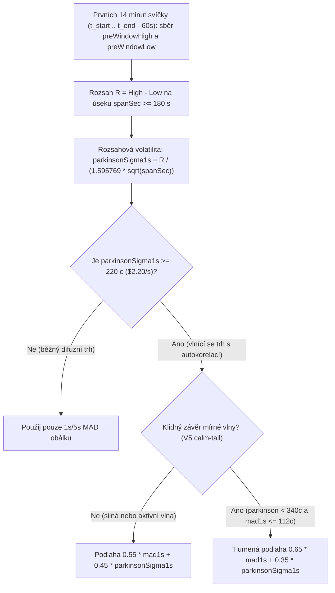

# 08 — Autokorelace výnosů, vlnový rozsah, Parkinsonův odhad a ochrana proti Whipsaw

[← Zpět na hlavní dokument: Optimalizace UtterParameciumStrategy](../strategy/UtterParamecium-optimalizace.MD)

---

## 1. Proč tento koncept ve strategii potřebujeme

Po zavedení vícehorizontní MAD volatility (`1s` a `5s` přírůstky) ve verzích `V1` a `V2` klesla hrubá ztráta dramaticky z `-26 880 USD` na `-1 806 USD`. Při detailní pitvě zbývajících 10 nejztrátovějších trhů v Iteraci 3 (`V3`) se však vynořil fascinující statistický paradox:
**V několika těžce ztrátových svíčkách opisoval Bitcoin obrovské plynulé dvouminutové vlny nahoru a dolů o `±35 USD`, ale jednosekundová i pětisekundová MAD volatilita hlásila nízké, klidné číslo `~1,30 USD/s`!**

Proč? Protože cena neskákala divoce nahoru-dolů každou vteřinu, ale posouvala se **hladce po malých krůčcích `1,00 USD/s` dvacet sekund jedním směrem a pak dvacet sekund opačným směrem**! Takový proces porušuje předpoklad nezávislosti přírůstků — má **kladnou autokorelaci** (*setrvačné vlnění*), kvůli níž krátkodobý přírůstkový odhad podcení 60sekundové riziko dvojnásobně až trojnásobně. K vyřešení tohoto jevu zavedla verze `V3` **odhad volatility z vnitrosvíčkového cenového rozsahu (*High-Low Range / Parkinsonův princip*)** a detekci **vnitrookenního překmitu (*Whipsaw Excursion*)**.

---

## 2. Formální matematická definice

### 2.1 Autokorelace přírůstků a selhání prostého $\sqrt{T}$ škálování

Nechť jednosekundové přírůstky ceny $\varepsilon_1, \varepsilon_2, \dots, \varepsilon_m$ mají nulovou střední hodnotu a jednosekundový rozptyl $\sigma_{1s}^2$, ale **nejsou nezávislé** — nechť mají korelaci se zpožděním $k$ (*lag-$k$ autocorrelation*) $\rho_k = \text{Corr}(\varepsilon_t, \varepsilon_{t+k})$.

Obecný vzorec pro rozptyl součtu $m$ přírůstků pak obsahuje kromě součtu rozptylů i **všechny kovarianční členy** (tzv. *Bienaymého identita* / *Variance Ratio*, Lo & MacKinlay 1988):

$$
\text{Var}\!\left(\sum_{i=1}^{m} \varepsilon_i\right) = \sum_{i=1}^{m} \text{Var}(\varepsilon_i) + 2 \sum_{1 \le i < j \le m} \text{Cov}(\varepsilon_i, \varepsilon_j) = m\,\sigma_{1s}^2 \left[1 + 2 \sum_{k=1}^{m-1} \left(1 - \frac{k}{m}\right) \rho_k \right].
$$

- Jsou-li přírůstky nezávislé ($\rho_k = 0$), hranatá závorka je rovna $1$ a platí klasické $\sigma_m = \sigma_{1s}\sqrt{m}$.
- Při **hladkých směrových vlnách** jsou sousední vteřiny kladně korelované ($\rho_k > 0$, např. $\rho_1 = 0{,}4, \rho_2 = 0{,}3, \dots$). Hranatá závorka vyskočí na $3$ až $5$, takže skutečné minutové rozpětí pohybu je **$\sqrt{3}\times$ až $\sqrt{5}\times$ větší**, než kolik predikuje `1s` nebo `5s` MAD!

### 2.2 Očekávaný rozsah Brownova pohybu a původ konstanty `1.595769` ($\sqrt{8 / \pi}$)

Abychom zachytili skutečnou amplitudu těchto vln bez ohledu na to, jak hladce po sekundách vznikly, sledujeme v prvních 14 minutách aktivní svíčky (před začátkem vypořádacího okna, $t \in [T_{\text{start}}, T_{\text{end}} - 60\text{ s}]$) **celkové maximum a minimum ceny**:

$$
H = \max_{u \in [t_a, t_b]} S(u), \qquad L = \min_{u \in [t_a, t_b]} S(u), \qquad R_{\Delta T} = H - L,
$$

na pozorovaném časovém úseku $\Delta T = t_b - t_a \ge 180\text{ s}$.

Pro standardní bezdriftový Brownův pohyb $W_t = \sigma_{1s} B_t$ na intervalu délky $\Delta T$ (v sekundách) odvodil William Feller (1951) přesnou střední hodnotu rozpětí mezi maximem a minimem:

$$
\mathbb{E}[H - L] = 2\sqrt{\frac{2}{\pi}}\,\sigma_{1s}\sqrt{\Delta T} = \sqrt{\frac{8}{\pi}}\,\sigma_{1s}\sqrt{\Delta T} \approx 1{,}59576912\,\sigma_{1s}\sqrt{\Delta T}.
$$

*(Poznámka ke srovnání s literaturou: Michael Parkinson v roce 1980 odvodil příbuzný vzorec přes druhý moment $\mathbb{E}[(H - L)^2] = (4\ln 2)\,\sigma_{1s}^2 \Delta T$, kde odmocnina jmenovatele činí $\sqrt{4\ln 2} \approx 1{,}6651$. Protože ale odmocnina je konkávní funkce, podle Jensenovy nerovnosti platí $\mathbb{E}[\sqrt{\hat{\sigma}^2_P}] < \sigma_{1s}$ — dělení číslem `1,6651` by samotnou směrodatnou odchylku $\sigma_{1s}$ o ~4,2 % podhodnocovalo. Dělení Fellerovou konstantou prvního momentu $\sqrt{8/\pi} = \mathbf{1{,}595769}$ — v kódu `PARKINSON_RANGE_DENOM_COEFF = 1.595769` — dává přímo **nestranný odhad $\sigma_{1s}$**!)*

Nestranný rozsahový odhad ekvivalentní jednosekundové volatility je proto:

$$
\hat{\sigma}_{\text{range}} = \frac{H - L}{\sqrt{8/\pi} \cdot \sqrt{\Delta T}} = \frac{H - L}{1{,}595769 \cdot \sqrt{\Delta T_{\text{sec}}}}.
$$

### 2.3 Integrace vlnové podlahy do `SpotVolatilityBuffer` (a *Calm-Tail* tlumení ve `V5`)

Překročí-li $\hat{\sigma}_{\text{range}}$ práh skutečného vlnobití `2,20 USD/s` (`MIN_WAVE_PARKINSON_SIGMA_CENTS = 220`), vytvoří dolní podlahu pro celkovou volatilitu smícháním s krátkodobým $\hat{\sigma}_{\text{short}}$:
- **Ve `V3` a `V4` (a pro silné vlny $\hat{\sigma}_{\text{range}} \ge 3{,}40\text{ USD/s}$ i ve `V5`)**:

$$
\hat{\sigma}_{\text{wave}} = 0{,}55\,\hat{\sigma}_{\text{short}} + 0{,}45\,\hat{\sigma}_{\text{range}}, \qquad \hat{\sigma}_{1s} \leftarrow \max(\hat{\sigma}_{1s}, \hat{\sigma}_{\text{wave}}).
$$

- **Ve `V5` (*Calm-Tail Moderate Wave Damping*)**: Pokud šlo o jediný mírný historický pohyb na začátku svíčky ($\hat{\sigma}_{\text{range}} < 3{,}40\text{ USD/s}$), ale celý závěr svíčky je zcela klidný ($\hat{\sigma}_{\text{short}} \le 1{,}12\text{ USD/s}$, $\hat{\sigma}_{\text{burst}} \le 1{,}12\text{ USD/s}$ a režimová volatilita leží pod $65\,\%$ rozsahu), sníží se váha historického rozsahu ze `45 %` na `35 %` ($0{,}65\,\hat{\sigma}_{\text{short}} + 0{,}35\,\hat{\sigma}_{\text{range}}$).

### 2.4 Vnitrookenní překmit přes cílovou cenu (*Intra-Window Whipsaw Excursion*)

Kromě amplitudy před oknem sleduje strategie od verze `V3` i extrémy ceny $S_{\min}^{\text{win}}, S_{\max}^{\text{win}}$ přímo **uvnitř samotného 60sekundového vypořádacího okna** $[T_{\text{end}} - 60\text{ s}, t]$.
Pokud cena uvnitř posledních 60 sekund již provedla hluboký výlet na **opačnou stranu** cílové ceny $K$ o alespoň `5,00 USD` (`WHIPSAW_OPPOSITE_EXCURSION_CENTS = 500`, např. spadla na $K - 6\text{ USD}$ a pak vyletěla zpět nad $K$), jde o nebezpečný kmitající (*whipsaw*) režim. Nákup odraženého směru před uzamčením TWAPu je v takové svíčce povolen pouze tehdy, má-li odraz mimořádnou sílu (projekce $\ge 12{,}50\text{ USD}$ nebo spot $\ge 14{,}00\text{ USD}$, příp. $z \ge 1{,}05\sigma$ s projekcí $\ge 6{,}50\text{ USD}$ a nulovým nepříznivým driftem).

---

## 3. Vysvětlení pro člověka bez znalosti statistiky

### Mořské vlnobití vs. drobné čeření hladiny
Představte si bóji na moři, u které měříte, o kolik centimetrů se pohne za každou 1 sekundu (`MAD 1s`):
- **Situace A (větrné čeření)**: Hladina se každou vteřinu třese o `+15 cm, -15 cm, +15 cm, -15 cm`. Za 14 minut ale bóje neopustila pásmo jedné stopy (`High - Low = 40 cm`). Krátkodobý senzor vidí `15 cm/s` a dlouhodobý rozsah tomu přesně odpovídá.
- **Situace B (dlouhé oceánské dmutí / swell)**: Voda je jako zrcadlo, žádné šplouchání. Bóje ale stoupá každou vteřinu plynule o `+8 cm` po dobu celé minuty (`+4,8 metru`!) a další minutu plynule klesá o `-8 cm/s` zpátky dolů. Váš jednosekundový senzor hlásí: *„Krásný klid, jen 8 cm za vteřinu, o polovinu klidnější než v Situaci A!“* — zatímco ve skutečnosti pod vámi chodí pětimetrové vlny, které během minuty smetou jakýkoliv polštář!

Přesně toto dělá 14minutový rozsah `preWindowHighCents - preWindowLowCents`: podívá se na celkové rozpětí od nejvyššího vrcholu po nejhlubší dno aktuální 15minutové svíčky. Pokud se Bitcoin během prvních 14 minut prošel v pásmu širokém `180 USD`, fyzikálně není možné tvářit se v 15. minutě, že panuje ospalý klid `1,10 USD/s`!

> **Důkaz ze slepého Out-of-Sample testu (`13. 11. 2026`, trh `1794589200`):**
> Na zcela neviděných datech ze 13. listopadu přišla svíčka s obřím hladkým vlnobitím. Původní `V0` (bez vlnové podlahy) podcenila volatilitu a na této jediné svíčce utrpěla katastrofální ztrátu **`-413,00 USD`**. Všechny verze s Parkinsonovou vlnovou podlahou (`V3`, `V4`, `V5`) tutéž svíčku vyhodnotily jako vysoce rizikovou a prodělaly na ní **`0,00 USD`**!

---

## 4. Konkrétní číselný příklad z `UtterParameciumStrategy`

Nechť v prvních 14 minutách svíčky ($\Delta T = 840\text{ s}$) dosáhl Bitcoin maxima $H = 68\,115{,}00\text{ USD}$ a minima $L = 67\,965{,}00\text{ USD}$, tedy rozpětí $H - L = 150{,}00\text{ USD}$ (`15 000` centů). V poslední minutě před oknem se trh dočasně uklidnil na $\hat{\sigma}_{\text{short}} = 1{,}25\text{ USD/s}$ (`125` centů):
1. Rozsahový odhad jednosekundové volatility v `SpotVolatilityBuffer`:

$$
\hat{\sigma}_{\text{range}} = \text{round}\!\left(\frac{15\,000}{1{,}595769 \times \sqrt{840}}\right) = \text{round}\!\left(\frac{15\,000}{46{,}2498}\right) = 324\text{ centů} \quad (3{,}24\text{ USD/s}).
$$

2. Protože $324 \ge 220$ (`MIN_WAVE_PARKINSON_SIGMA_CENTS`), uplatní se vlnová podlaha (pro plnou váhu `55/45`):

$$
\hat{\sigma}_{\text{wave}} = \left\lfloor \frac{55 \times 125 + 45 \times 324}{100} \right\rfloor = 214\text{ centů} \quad (2{,}14\text{ USD/s}).
$$

3. Namísto naivních `1,25 USD/s` použije model $\hat{\sigma}_{1s} = 2{,}14\text{ USD/s}$ (**o 71 % přísnější měřítko nejistoty**), čímž klesne Z-skóre z falešných `2,40 σ` na střízlivých `1,40 σ` a drahý rizikový obchod je bezpečně odfiltrován.

---

## 5. Vizualizace

---

## 6. Jak se tento princip vyvíjel napříč verzemi `V0` → `V5`

- **`V0`–`V2`**: Spoléhaly výhradně na přírůstkové odhady (`1s` a od `V1` také `5s` MAD), které při hladkých dvouminutových vlnách podhodnocovaly riziko obratu.
- **`V3` & `V4`**: Zavedly vnitrosvíčkovou 14minutovou rozsahovou podlahu (`55 % mad1s + 45 % parkinsonSigma1s` pro $\hat{\sigma}_{\text{range}} \ge 2{,}20\text{ USD/s}$) a filtr vnitrookenního překmitu `WHIPSAW_OPPOSITE_EXCURSION_CENTS = 500`. Hrubá ztráta v IS díky tomu klesla na polovičních `-920 USD` a `MaxDD` na `1,21 %`!
- **`V5`**: Přidala jemné *calm-tail* tlumení (`65/35` místo `55/45`), když po mírné vlně na začátku svíčky následoval zcela klidný konec — jak ale ukázal závěrečný audit v [kapitole 10](10-statisticka-inference-efektivni-vzorek-nestacionarita-a-overfitting.md), tato mikro-úprava již ležela na hraně lokální pře-parametrizace.

---

**Navazující kapitoly teorie:**
- [← 07 — Řízení pozice, Kellyho princip a dynamické limity inventáře](07-rizeni-pozice-kellyho-princip-a-dynamicke-limity.md)
- [09 — Matematické uzamčení TWAPu a imunita vůči bleskovému pádu →](09-matematicke-uzamceni-twap-a-imunita-vuci-padu.md)
