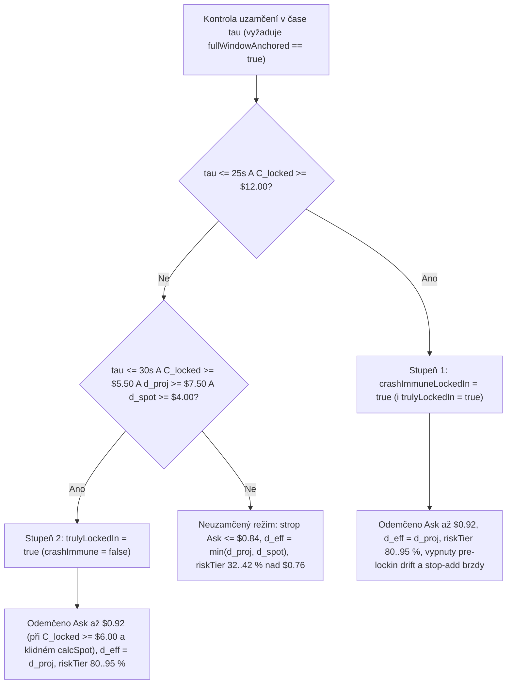

# 09 — Matematické uzamčení TWAPu (*Mathematical Lock-In*) a imunita vůči bleskovému pádu

[← Zpět na hlavní dokument: Optimalizace UtterParameciumStrategy](../strategy/UtterParamecium-optimalizace.MD)

---

## 1. Proč tento koncept ve strategii potřebujeme

V Fázi 1 optimalizace (`V1`–`V3`) jsme snížili maximální vstupní cenu opce ze `0,97 USD` na `0,84 USD`, protože nákup neuzamčených opcí za `0,85–0,97 USD` na začátku minuty měl katastrofální asymetrii rizika ([kapitola 01](01-binarni-opce-stredni-hodnota-a-poplatky.md)).
Když jsme však před Fází 2 (`V4`) analyzovali **největší propásnuté vítězné příležitosti**, objevili jsme desítky trhů, kde v posledních `10` až `30` sekundách před expirací prodávali účastníci trhu opci za `0,85–0,92 USD` (implikujíce `8–15%` riziko obratu), ačkoliv **dosud nasbíraný integrál prvních 30–50 sekund 60s TWAPu byl tak obrovský, že by Bitcoin musel okamžitě zkolabovat o 40 až 100 dolarů pod cílovou cenu $K$, aby se výsledek svíčky vůbec mohl otočit!**

Rozlišení mezi „běžným statistickým náskokem“ a **fyzikálně/matematicky uzamčeným integrálem (*Mathematical TWAP Lock-In*)** je klíčovým pilířem Fáze 2 (`V4` a `V5`).

---

## 2. Formální matematická definice

### 2.1 Uzamčený příspěvek integrálu (*Locked TWAP Contribution*)

Připomeňme z [kapitoly 02](02-twap-integral-nahodna-prochazka-a-rozptyl.md) přesný rozklad konečného vypořádacího průměru $\text{TWAP}_{60}(T_{\text{end}})$ vůči cílové ceně $K$ v okamžiku, kdy uplynulo $e = T - \tau$ milisekund z $T = 60\,000\text{ ms}$ a do expirace zbývá $\tau$ milisekund:

$$
\text{TWAP}_{60}(T_{\text{end}}) - K = \underbrace{\frac{T - \tau}{T}\left(M_{\text{locked}}(t) - K\right)}_{C_{\text{locked}}(t)} + \frac{\tau}{T}\left(\bar{S}_{\text{rem}} - K\right),
$$

kde:
- $C_{\text{locked}}(t) = \frac{T - \tau}{T}\left(M_{\text{locked}}(t) - K\right)$ je **uzamčený dolarový příspěvek k finálnímu TWAPu** (v kódu `upLockedContribCents` resp. `downLockedContribCents`), který je v čase $t$ již **100% deterministickou konstantou**!
- $\bar{S}_{\text{rem}} = \frac{1}{\tau}\int_t^{T_{\text{end}}} S(u)\,du$ je budoucí průměrná cena na zbývajícím úseku délky $\tau$.

### 2.2 Kritická hloubka kolapsu nutná ke zvrácení výsledku (*Break-Even Crash Depth*)

Ze vztahu $\text{TWAP}_{60}(T_{\text{end}}) - K < 0$ okamžitě plyne nutná a postačující podmínka pro prohru strany `UP`:

$$
\frac{\tau}{T}\left(\bar{S}_{\text{rem}} - K\right) < -C_{\text{locked}}(t) \iff K - \bar{S}_{\text{rem}} > \frac{T}{\tau}\,C_{\text{locked}}(t).
$$

Jinými slovy:
1. I kdyby se Bitcoin v této milisekundě **okamžitě skokově propadl** ze současné spotové ceny $S_t$ na novou nízkou hladinu $S_{\text{crash}}$ a zůstal tam po celých zbývajících $\tau$ sekund, musí velikost tohoto okamžitého pádu překonat:

$$
\Delta S_{\text{instant crash}} = (S_t - K) + \frac{T}{\tau}\,C_{\text{locked}}(t) = (S_t - K) + \frac{T - \tau}{\tau}\left(M_{\text{locked}}(t) - K\right).
$$

2. Ještě realističtěji: pokud cena nepadne skokem v nulté milisekundě, ale **klesá lineárně** ze současné hodnoty $S_t$ na koncovou hodnotu $S_{\text{end}}$ (takže průměr na zbývajícím úseku je $\bar{S}_{\text{rem}} = \frac{S_t + S_{\text{end}}}{2}$), musí celkový lineární propad do expirace přesáhnout **dvojnásobek**:

$$
\Delta S_{\text{linear crash}} = S_t - S_{\text{end}} > 2(S_t - K) + \frac{2T}{\tau}\,C_{\text{locked}}(t).
$$

Všimněte si pákového faktoru $\frac{T}{\tau}$:
- Při $\tau = 30\text{ s}$ je $\frac{T}{\tau} = 2{,}0$.
- Při $\tau = 20\text{ s}$ je $\frac{T}{\tau} = 3{,}0$.
- Při $\tau = 10\text{ s}$ je $\frac{T}{\tau} = 6{,}0$.
- Při $\tau = 6\text{ s}$ je $\frac{T}{\tau} = 10{,}0$!

### 2.3 Dvoustupňové matematické uzamčení ve `V4` a `V5`

Aby se vyloučil jakýkoliv falešný poplach z neúplného bufferu, vyžadují oba stupně nejprve `fullWindowAnchored == true` (buffer drží souvislou historii cen pokrývající levý okraj 60s okna $T_{\text{end}} - 60\text{ s}$):

1. **Stupeň 1 — Úplné uzamčení imunní vůči pádu (*Crash-Immune Lock-In*, `crashImmuneLockedIn`)**:
   - $\tau \le 25\,000\text{ ms}$ (`CRASH_IMMUNE_LOCKIN_MAX_TAU_MS`),
   - $C_{\text{locked}}(t) \ge 12{,}00\text{ USD}$ (`CRASH_IMMUNE_MIN_CONTRIB_CENTS = 1200`).
   - *Důsledek:* I v nejzazším bodě $\tau = 25\text{ s}$ leží průměr dosavadních 35 sekund alespoň $+20{,}57\text{ USD}$ nad $K$ a okamžitý pád na nulu celého zbývajícího úseku by musel držet průměrnou cenu po celých 25 sekund o více než **`28,80 USD` pod cílem $K$** (při lineárním pádu ze spotu $+15\text{ USD}$ dokonce pád o **`> 87 USD` za 25 sekund**!). V tomto režimu:
     - se odemyká nákup i tehdy, když už samotný spot $S_t$ mírně překmitl pod $K$ ($d_{\text{eff}} = d_{\text{proj}} + d_{\text{spot}} > 6{,}00\text{ USD}$),
     - vypínají se předoknové driftové a `Stop-Add` brzdy, které by jinak zbytečně bránily posbírání prakticky bezrizikové prémie.

2. **Stupeň 2 — Pozdní matematické uzamčení (*Truly Locked-In*, `trulyLockedIn`)**:
   - Platí buď `crashImmuneLockedIn`, **nebo** současně:
     - $\tau \le 30\,000\text{ ms}$ (`LATE_LOCKIN_MAX_TAU_MS`),
     - $C_{\text{locked}}(t) \ge 5{,}50\text{ USD}$ (`LATE_LOCKIN_MIN_CONTRIB_CENTS = 550`),
     - projektovaný náskok $d_{\text{proj}} \ge 7{,}50\text{ USD}$ (`LATE_LOCKIN_MIN_PROJ_LOCK_CENTS = 750`),
     - a aktuální spot stále drží kladný náskok $d_{\text{spot}} \ge 4{,}00\text{ USD}$ (`LOCKED_HIGH_PRICE_MIN_SPOT_CENTS = 400`).
   - *Důsledek:*
     - efektivní vzdálenost přepíná z pesimistického $\min(d_{\text{proj}}, d_{\text{spot}})$ na skutečný projektovaný náskok $d_{\text{proj}}$,
     - cenový strop opce se zvyšuje z běžných `0,84 USD` (`NON_LOCKED_MAX_ENTRY_PRICE_MC = 840`) až na **`0,92 USD`** (`maxEntryPriceMc = 920`, s dodatečnou kontrolou $C_{\text{locked}} \ge 6{,}00\text{ USD}$ a klidného `onCalculatedSpotTwap`),
     - a cenové krácení inventáře `riskTierBps` se odemyká ze `32–42 %` na **`80–90 %`**.

---

## 3. Vysvětlení pro člověka bez znalosti statistiky

### Fotbalový zápas v 88. minutě za stavu 4 : 0
Představte si sázkovou kancelář během fotbalového zápasu:
- **Ve 12. minutě zápasu za stavu 1 : 0** (náš neuzamčený začátek minuty $\tau = 55\text{ s}$) je nesmysl vsadit na vedoucí tým v kurzu `1,08` (cena opce `0,92 USD`) — zbývá skoro celý zápas a jeden náhodný gól vše zničí.
- **V 88. minutě zápasu za stavu 4 : 0** (naše uzamčené okno $\tau = 12\text{ s}$ s $C_{\text{locked}} = +15\text{ USD}$) už soupeři nestačí dát jeden náhodný gól — musel by dát **pět gólů za dvě minuty**! Pokud vám v této chvíli na CLOBu pomalý účastník trhu stále prodává akcii vítěze za `0,89 USD` (`11 %` zisku za 12 sekund!), nejde o hazard s drahým kurzem, ale o sbírání téměř deterministické arbitráže proti lidem, kteří sledují jen spotový graf a zapomněli spočítat integrál 60s TWAPu!

---

## 4. Konkrétní číselný příklad z `UtterParameciumStrategy`

Nechť cílová cena svíčky je $K = 68\,000{,}00\text{ USD}$ a do expirace zbývá $\tau = 15\,000\text{ ms}$ ($15\text{ s}$, tedy $45\text{ s}$ je již uzamčeno):
1. Průměr prvních 45 sekund v `ChainlinkTwapBuffer` činí $M_{\text{locked}} = 68\,018{,}00\text{ USD}$ (`+18,00 USD` nad cílem).
2. Uzamčený příspěvek k celkovému 60s TWAPu je:

$$
C_{\text{locked}} = \frac{45\,000}{60\,000} \times 18{,}00 = +13{,}50\text{ USD} \quad (\text{`upLockedContribCents = 1350`} \ge 1200).
$$

3. Protože $\tau = 15\text{ s} \le 25\text{ s}$ a $1350 \ge 1200$, aktivuje se **`upCrashImmuneLockedIn = true`** (a tedy i `upTrulyLockedIn = true`).
4. Jak velký propad Bitcoinu by musel v posledních 15 sekundách nastat, aby `BTC-UP` prohrálo?
   - K vymazání uzamčených `+13,50 USD` na čtvrtinovém zbývajícím úseku ($T/\tau = 60/15 = 4$) musí být **průměrná cena** v posledních 15 sekundách pod:

$$
\bar{S}_{\text{rem}} < 68\,000{,}00 - 4 \times 13{,}50 = 67\,946{,}00\text{ USD} \quad (-54{,}00\text{ USD pod } K!).
$$

   - Je-li aktuální spot $S_t = 68\,010{,}00\text{ USD}$, musel by Bitcoin **v nulté milisekundě spadnout skokem o `-64,00 USD`** (nebo rovnoměrně padat během 15 sekund o **`-128,00 USD`** až na `67 882 USD`!).
5. Kniha objednávek mezitím nabízí `BTC-UP` za `askMc = 890` (`0,89 USD`, poplatek `7 mc`).
   - Ve `V2`/`V3` by byl tento obchod zahozen kvůli stropu `maxEntryPriceMc = 840`.
   - Ve `V4`/`V5` model spočítá $d_{\text{eff}} = d_{\text{proj}} = 13{,}50 + \frac{15}{60}\cdot 10{,}00 = +16{,}00\text{ USD}$, Z-skóre přes $+10\sigma$, zastropovanou $p_{\text{model}} = 985\text{ mc}$ a čistou hranu $985 - 890 - 7 = +88\text{ mc}$ (`+0,088 USD` na akcii za 15 sekund čekání!) a bezpečně jej zobchoduje.

---

## 5. Vizualizace

---

## 6. Jak se tento princip vyvíjel napříč verzemi `V0` → `V5`

- **`V0` & `V1`**: Měly pouze jednoduchou výjimku pro záporný spot ($S_t < K$) v posledních `25 s` (`distProj >= $12.00` a `distProj + distSpot > $6.00`), ale pro kladný spot vůbec nerozlišovaly, zda drahá opce za `0,88 USD` stojí na vodě v čase $\tau = 58\text{ s}$, nebo je betonově uzamčená v čase $\tau = 14\text{ s}$.
- **`V2` & `V3`**: Zavedly plošný strop `maxEntryPriceMc = 840` (`0,84 USD`), čímž sice eliminovaly ztráty z drahých neuzamčených opcí, ale zároveň zahodily bezrizikové uzamčené prémie v závěru svíčky.
- **`V4` & `V5`**: Zavedly exaktní výpočet `upLockedContribCents` / `downLockedContribCents` a dvoustupňovou logiku `crashImmuneLockedIn` ($\tau \le 25\text{ s}$) + `trulyLockedIn` ($\tau \le 30\text{ s}$), která selektivně odemkla pásmo `0,85–0,92 USD` při zachování přísného stropu `0,84 USD` pro vše neuzamčené.

---

**Navazující kapitoly teorie:**
- [← 08 — Autokorelace výnosů, vlnový rozsah a Parkinsonův odhad](08-autokorelace-vlnovy-rozsah-a-parkinsonuv-odhad.md)
- [10 — Statistická inference, efektivní vzorek, nestacionarita a audit overfittingu →](10-statisticka-inference-efektivni-vzorek-nestacionarita-a-overfitting.md)
