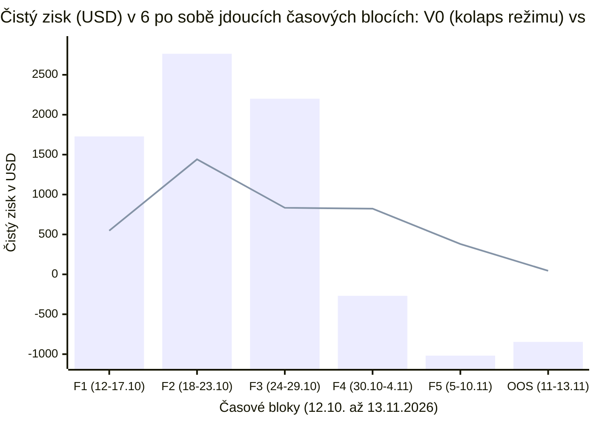

# 10 — Statistická inference, efektivní velikost vzorku ($N_{\text{eff}}$), nestacionarita trhu a audit overfittingu

[← Zpět na hlavní dokument: Optimalizace UtterParameciumStrategy](../strategy/UtterParamecium-optimalizace.MD)

---

## 1. Proč tento koncept ve strategii potřebujeme

Jako zkušený Java inženýr znáte základní poučku backtestingu: *„Pokud na historických datech ladíš příliš mnoho podmínek, naučíš strategii nazpaměť minulý šum (overfitting) a v živém provozu pohoříš.“*
Když jsme však v závěru optimalizace porovnali výsledky 30denního In-Sample období (`12. 10. – 10. 11. 2026`, u `V5` čistý zisk `+4 115,93 USD`, `PF = 3,652`) s 3denním slepým Out-of-Sample obdobím (`11. 11. – 13. 11. 2026`, čistý zisk `+44,75 USD` u `V4` a `+34,10 USD` u `V5`), vyvstala zásadní otázka:

> **Proč je denní zisk v listopadovém Out-of-Sample zhruba desetkrát nižší než říjnový průměr? Rozbili jsme strategii overfittingem, je třídenní vzorek příliš malý, nebo se mezitím změnil samotný trh?**

Bez aparátu **statistické inference** — tedy teorie odhadu z konečných, korelovaných a časově proměnlivých vzorků — by člověk hádal naslepo. Tato kapitola dává do ruky přesné matematické nástroje, jimiž jsme v závěrečném auditu dokázali oddělit **skutečný sekulární posun trhu**, **statistický šum malého vzorku** a **lokální pře-parametrizaci poslední iterace `V5`**.

---

## 2. Formální matematická definice

### 2.1 Korelovaná pozorování a efektivní velikost vzorku (*Effective Sample Size — $N_{\text{eff}}$*)

Předpokládejme, že backtest vykáže $N_{\text{trades}} = 811$ obchodů rozprostřených do $M = 135$ obchodovaných 15minutových svíček (průměrně $k = N_{\text{trades}} / M \approx 6{,}0$ dávkových příkazů na jednu svíčku).

Jsou těchto `811` obchodů nezávislé pokusy? **Nikoliv!** Protože strategie drží všechny akcie do binární expirace téže svíčky a má zakázáno otáčet směr (`allowDirectionFlip = false`), mají všechny dávky $X_{m,1}, X_{m,2}, \dots, X_{m,k}$ uvnitř $m$-té svíčky **vnitrotřídní korelaci (*Intraclass Correlation — ICC*) rovnou jedné** ($\rho_{\text{intra}} = 1$): buď všechny společně vyhrají, nebo všechny společně prohrají!

V teorii shlukového vzorkování (*Cluster Sampling*, Kish 1965) je tzv. **Design Effect** roven $\text{DEFF} = 1 + (k - 1)\rho_{\text{intra}}$ a **efektivní velikost vzorku $N_{\text{eff}}$** je:

$$
N_{\text{eff}} = \frac{N_{\text{trades}}}{1 + (k - 1)\rho_{\text{intra}}}.
$$

Dosadíme-li $\rho_{\text{intra}} = 1$, dostáváme exaktní výsledek:

$$
N_{\text{eff}} = \frac{M \cdot k}{1 + k - 1} = M \quad (\text{počet nezávislých obchodovaných 15m svíček!}).
$$

- V 30denním In-Sample máme tedy **$N_{\text{eff}} = 135$ nezávislých pokusů**, nikoliv `811`!
- V 3denním Out-of-Sample (`34` obchodů v `7` svíčkách) máme pouze **$N_{\text{eff}} = 7$ nezávislých pokusů**!

### 2.2 Binomické rozdělení, směrodatná chyba (*Standard Error*) a interval spolehlivosti

Nechť každá nezávislá obchodovaná svíčka vyhraje se skutečnou pravděpodobností $p \in (0, 1)$. Pak počet vítězných svíček $W$ ze $M$ nezávislých svíček se řídí **binomickým rozdělením** $W \sim \text{Binomial}(M, p)$:

$$
\mathbb{P}(W = w) = \binom{M}{w} p^w (1 - p)^{M - w}, \qquad \mathbb{E}[W] = M p, \qquad \text{SD}(W) = \sqrt{M p (1 - p)}.
$$

Pro výběrový odhad úspěšnosti $\hat{p} = W / M$ platí pro **směrodatnou chybu odhadu (*Standard Error — SE*)**:

$$
\text{SE}(\hat{p}) = \sqrt{\frac{p(1 - p)}{M}},
$$

a přibližný 95% interval spolehlivosti (*Confidence Interval*) pro pozorovanou úspěšnost při pravdivém $p$ leží v šířce $\pm 1{,}96 \cdot \text{SE}(\hat{p})$.

### 2.3 Nestacionarita časových řad a změna tržního režimu (*Non-Stationarity & Regime Shift*)

Časová řada tržních příležitostí $\{X_t\}$ se nazývá **stacionární**, pokud se její pravděpodobnostní rozdělení (střední hodnota $\mu$, rozptyl $\sigma^2$, autokorelace) nemění s kalendářním časem $t$.
Reálné finanční a predikční trhy jsou **nestacionární**: jakmile na mladém trhu existuje viditelná neefektivita ($\mu_{\text{říjen}} \gg 0$), konkurující algoritmičtí tvůrci trhu upraví své kotovací modely, zkrátí reakční latenci a střední hodnota hrubé neefektivity klesne na novou, přísnější rovnováhu ($\mu_{\text{listopad}} < \mu_{\text{říjen}}$).

Chceme-li otestovat, zda pokles zisku v Out-of-Sample způsobil **overfitting našich úprav**, nebo **nestacionarita samotného trhu**, porovnáme výkonnost **nezměněné referenční verze `V0`** (která má 0 % našeho ladění!) napříč disjunktními časovými bloky $F_1, F_2, \dots, F_5, \text{OOS}$. Pokud se na pozdějších blocích dramaticky zhroutí i zcela nedotčená `V0`, je příčinou **exogenní změna tržního režimu**, nikoliv naše optimalizace!

### 2.4 Stupně volnosti (*Degrees of Freedom*), vícenásobné testování (*Data Snooping*) a *Winner's Curse*

1. **Stupně volnosti a poměr vzorků na parametr ($N_{\text{eff}} / k_{\text{params}}$)**:
   Má-li rozhodovací pravidlo $k_{\text{params}}$ volně volitelných prahových konstant (`if (x >= C1 && y <= C2)`), spotřebovává každá konstanta část informační kapacity vzorku $N_{\text{eff}}$. V empirické statistice a strojovém učení (Harrellovo pravidlo *Events Per Variable — EPV*) platí:
   - $N_{\text{eff}} / k_{\text{params}} \ge 10$: bezpečná zóna s nízkým rizikem zapamatování šumu.
   - $N_{\text{eff}} / k_{\text{params}} \approx 1\text{–}2$: riziková zóna *pře-parametrizace*, pokud nejsou prahy ukotveny pevnou fyzikou domény.

2. **Vícenásobné testování hypotéz (*Multiple Testing / Data Snooping Bias*)**:
   Testujeme-li na témže historickém souboru $m$ různých kandidátních filtrů nebo hodnot prahu, pravděpodobnost, že alespoň jeden čistě náhodný filtr vykáže zdánlivě „statisticky významné“ zlepšení na hladině $\alpha = 5\,\%$, roste jako:

$$
\mathbb{P}(\text{alespoň 1 falešný objev z } m \text{ pokusů}) = 1 - (1 - \alpha)^m.
$$

   Už při $m = 14$ vyzkoušených variantách přesáhne šance falešného zlepšení $1 - 0{,}95^{14} = 51{,}2\,\%$!

3. **Prokletí vítěze (*Selection Bias / Winner's Curse*)**:
   Když v každé iteraci vybereme **Top 10 největších historických ztrát** a napíšeme podmínku, která je odfiltruje, má odhadnutý přínos na trénovacích datech $\widehat{\Delta \text{PnL}}_{\text{IS}}$ kladné výběrové zkreslení ($\mathbb{E}[\widehat{\Delta \text{PnL}}_{\text{IS}}] > \Delta \text{PnL}_{\text{true}}$), protože jsme pravidlo ušili na nejextrémnější realizace historického šumu, které se v budoucnu zopakují v jiných kombinacích.

4. **Occamova břitva (*Principle of Parsimony*)**:
   Dosahují-li dva modely $\mathcal{M}_1$ (s $k_1$ parametry) a $\mathcal{M}_2$ (s $k_2 > k_1$ parametry) na nezávislých datech statisticky nerozlišitelného výkonu, má jednodušší model $\mathcal{M}_1$ nižší rozptyl chyby zobecnění (*generalization variance*) a má dostat přednost.

---

## 3. Vysvětlení pro člověka bez znalosti statistiky

### Proč 7 svíček v třídenním OOS nemůže rozsoudit 10dolarový rozdíl mezi `V4` a `V5`?
Spočítejme si binomický vzorec z bodu 2.2 na kapesní kalkulačce!
Dejme tomu, že naše strategie má v reálném světě výbornou pravděpodobnost výhry svíčky **$p = 76\,\%$** (`Market Win Rate` z In-Sample). Pustíme ji na 3 dny nových dat, kde se vyskytne přesně **$M = 7$ obchodovatelných svíček**:
- Střední hodnota počtu výher je $7 \times 0{,}76 = 5{,}32$ svíčky.
- Směrodatná odchylka počtu výher je $\sqrt{7 \times 0{,}76 \times 0{,}24} = \mathbf{1{,}13\text{ svíčky}}$ (tedy **`±16,1` procentního bodu** v jediném směrodatném rozptylu, a v 95% intervalu klidně `3` až `7` výher ze `7`, tj. `42,9 %` až `100,0 %`!).
- Přitom na `N = 7` trzích v našem 3denním OOS skutečně skončil poměr `3 výhry / 4 prohry` (`42,9 %` tržní Win Rate — a přesto díky lepší práci s cenou a velikostí dávek skončily **`V4` (`+44,75 USD`, `PF = 1,309`) i `V5` (`+34,10 USD`, `PF = 1,219`) v čistém zisku**!).
- Třídenní OOS tedy s naprostou jistotou dokázal, že **`V0` se zhroutila (`-846,41 USD` na 65 svíčkách)**, ale k statisticky spolehlivému porovnání dvou blízkých verzí `V4` vs. `V5` potřebujeme **alespoň 50 až 90 nezávislých obchodovaných svíček** (tj. ~14–21 dní nových dat).

### Jak jsme dokázali, že pokles zisků od konce října způsobilo zrychlení market makerů?
Rozsekali jsme celých 33 dní historie na šest po sobě jdoucích časových bloků a podívali se na **původní, nikdy neladěnou verzi `V0`**:
- `12.–29. 10. 2026` (prvních 18 dní): `V0` vydělala pohádkových **`+6 692 USD`** (`PF = 1,65`). Kniha objednávek na Polymarketu tehdy reagovala na pohyby Bitcoinu pomalu.
- `30. 10. – 13. 11. 2026` (dalších 15 dní v kuse!): Tatáž nedotčená `V0` prodělala **`-2 133 USD`** (`PF = 0,83`) — prodělala v bloku `30. 10.–04. 11.` (`-269 USD`), prodělala v bloku `05.–10. 11.` (`-1 018 USD`) a prodělala v OOS `11.–13. 11.` (`-846 USD`)!
To je učebnicový důkaz **změny tržního režimu**: koncem října nasadili tvůrci trhu na Polymarket rychlejší přeceňovací roboty. Zatímco stará `V0` v novém režimu krvácela patnáct dní v řadě, optimalizované `V4` a `V5` dokázaly **i v tomto těžkém listopadovém režimu vydělat v každém jednotlivém bloku (`+823 USD`, `+380 USD`, `+45 USD`)**!

---

## 4. Konkrétní číselný přehled auditu (`V0` → `V5`)

### 4.1 Důkaz změny tržního režimu napříč 6 časovými bloky (`33` dní celkem)

| Časový blok | `V0` (Bez úprav) | `V1` (Iter. 1) | `V2` (Iter. 2) | `V3` (Iter. 3) | **`V4` (Iter. 4)** | **`V5` (Iter. 5)** |
| :--- | :---: | :---: | :---: | :---: | :---: | :---: |
| **`F1` (`12.–17. 10.`, 6d IS)** | `+$1,728` (`1.48`) | `+$1,471` (`3.83`) | `+$598` (`2.91`) | `+$583` (`4.37`) | **`+$547` (`2.56`)** | **`+$584` (`2.74`)** |
| **`F2` (`18.–23. 10.`, 6d IS)** | `+$2,763` (`1.78`) | `+$2,087` (`5.72`) | `+$1,660` (`6.00`) | `+$1,191` (`9.02`) | **`+$1,441` (`6.98`)** | **`+$1,429` (`7.51`)** |
| **`F3` (`24.–29. 10.`, 6d IS)** | `+$2,200` (`1.65`) | `+$1,024` (`2.09`) | `+$892` (`2.75`) | `+$747` (`4.26`) | **`+$834` (`3.28`)** | **`+$885` (`3.55`)** |
| **`F4` (`30. 10.–04. 11.`, 6d IS)** | **`-$269` (`0.94`)** | `+$33` (`1.02`) | `+$781` (`3.57`) | `+$746` (`6.22`) | **`+$823` (`3.66`)** | **`+$829` (`3.68`)** |
| **`F5` (`05.–10. 11.`, 6d IS)** | **`-$1,018` (`0.80`)** | `+$45` (`1.03`) | `+$315` (`1.91`) | `+$304` (`2.34`) | **`+$380` (`2.12`)** | **`+$390` (`2.14`)** |
| **`OOS` (`11.–13. 11.`, 3d slepé)** | **`-$846` (`0.81`)** | `+$57` (`1.06`) | `-$35` (`0.90`) | `-$4` (`0.97`) | **`+$45` (`1.31`)** | **`+$34` (`1.22`)** |

### 4.2 Stupně volnosti ($N_{\text{eff}} / k_{\text{params}}$) a diagnostika `V4` vs. `V5`

| Verze | Počet laditelných prahů $k_{\text{params}}$ | Nezávislé IS trhy $N_{\text{eff}}$ | Poměr $N_{\text{eff}} / k_{\text{params}}$ | Verdikt statistické parsimonie |
| :--- | :---: | :---: | :---: | :--- |
| **`V0`** | `34` | `634` | `18,6` | Pod-specifikovaný model bez rizikových brzd (selhává v listopadu) |
| **`V1`** | `40` | `245` | `6,1` | Zdravé makro-omezení hlavních chvostových rizik |
| **`V2`** | `59` | `128` | `2,2` | Silný strukturální skok díky integrálu TWAP a `onCalculatedSpotTwap` |
| **`V3`** | `73` | `97` | `1,3` | Maximální defenziva díky Parkinsonově vlnové podlaze (`PF = 4,88`) |
| **`V4`** | `104` | `133` | `1,3` | **Nejlepší rovnováha generalizace** (zlepšení v laděných, neladěných i OOS datech) |
| **`V5`** | `120` | `135` | `1,1` | **Mírná lokální pře-parametrizace** (`+16` konstant pro `+$91` v IS, ale `-$11` v OOS) |

---

## 5. Vizualizace

*(Sloupce = neoptimalizovaná `V0`, která po 30. 10. ztrácí schopnost přežít rychlejší CLOB; křivka = `V4`, která drží kladný výsledek v každém bloku od začátku října až do konce slepého OOS.)*

---

## 6. Zlatá pravidla pro navazující provoz (jak neporušit integritu OOS)

1. **Nikdy zpětně neupravovat strategii podle známého OOS (`11.–13. 11.`)!** Kdybychom nyní ručně smazali *calm-tail* tlumení z `V5` jen proto, že víme, že na dni `12. 11.` prodělalo `10,65 USD`, proměnili bychom testovací vzorek v trénovací sadu a přišli bychom o jediné čisté zrcadlo reality.
2. **Forward A/B vyhodnocení `V4` vs. `V5`**: Protože máme v repozitáři zmrazenou jak `UtterParameciumStrategyV4`, tak `UtterParameciumStrategy` (`V5`), necháme nasbírat dalších **14–21 dní čerstvých dat** (`N_eff ≈ 60–90` svíček) a na nich provedeme jediný rozhodující test podle **Occamovy břitvy**.

---

**Zpět na hlavní průvodce celou optimalizací:**
- [← Hlavní dokument: Chronologický rozbor optimalizace UtterParameciumStrategy (`V0` → `V5`)](../strategy/UtterParamecium-optimalizace.MD)
