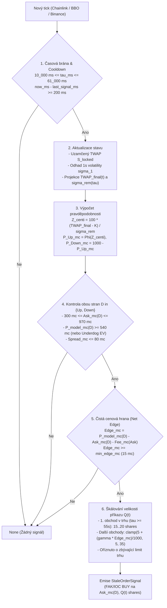

# Zadání implementace: Rekonstruovaná strategie `Utter-Paramecium` (Model V1)

> **Cílový repozitář:** `C:\work\workspace-java\polymarket-stale-order-sniper`
> **Cílové crates:** `sniper-common`, `sniper-engine`, `sniper-strategy`, `sniper-app`, `sniper-backtest`
> **Předloha (Reverzní inženýrství):** Peněženka `0x44832d0d2ec11187c1e77d786feb15f6a50254c6` (`Utter-Paramecium`), ověřeno na kompletní historii **1 603 trhů** (`2026-10-12` až `2026-10-28`, 380 obchodovaných a 1 223 vynechaných trhů, 12 516 fillů, 10 539 unikátních objednávek).

---

## 1. Manažerské shrnutí a kontext

Tento dokument definuje kompletní technické zadání pro nahrazení stávající (chybně odvozené) implementace v [`crates/sniper-strategy/src/utter_paramecium.rs`](file:///C:/work/workspace-java/polymarket-stale-order-sniper/crates/sniper-strategy/src/utter_paramecium.rs) a související úpravy v enginu a backtesteru podle **rekonstruovaného pravděpodobnostního Modelu V1**.

### Klíčové empirické poznatky z hloubkové analýzy (1 603 trhů)
1. **Mechanismus vypořádání (100% shoda na 1 603 / 1 603 trzích):**
   Trhy `btc-updown-15m-{ts}` se nevyhodnocují podle spotové ceny na konci svíčky, ale podle **Chainlink 60s TWAP streamu** (`btc-usd-twap-60s-streams`). Kontrakt `UP` vyhrává právě tehdy, když $\text{TWAP}_{\text{final}}(t_{\text{end}}) \ge K$, kde $K = \text{price\_to\_beat} = \text{TWAP}_{60\text{s}}(t_{\text{start}})$.
2. **Proč trader začíná v $\tau \approx 60\text{s}$ a končí kolem $\tau \approx 30\text{s}$ (nebo dříve/později):**
   - Při $\tau > 65\text{s}$ neprovedl **ani jeden obchod (0 z 12 516)**, protože teprve v $\tau = 60\text{s}$ se začíná uzamykat finální 60s TWAP integrál. V **85,8 % obchodovaných trhů** přichází první příkaz přesně v okně $\tau \in [55\text{s}, 61\text{s}]$ (medián `59.55 s`).
   - Směrodatná odchylka zbývající části 60s TWAPu klesá s časem jako $\sigma_{\text{rem}}(\tau) \propto \tau^{3/2}$ (mezi $\tau = 60\text{s}$ a $\tau = 30\text{s}$ klesne nejistota o 65 %, z $4{,}51\sigma_1$ na $1{,}60\sigma_1$).
   - Trader nakupuje v dávkách s rozestupem **~200 ms**, dokud je modelová pravděpodobnost $P_{\text{model}}(t) = \Phi(Z_{\text{TWAP}}(t))$ o $\ge 1{,}5\text{ centu}$ nad tržní cenou `best_ask` a zároveň `best_ask <= $0.970`.
3. **Proč vynechává 1 223 trhů a obchoduje 380 trhů:**
   - V 1 223 vynechaných trzích je v $\tau = 60\text{s}$ Bitcoin daleko od striku (medián $|S(60\text{s}) - K| = \$87{,}35$), takže vedoucí kontrakt na CLOBu se už v $\tau = 60\text{s}$ obchoduje za medián **`$0.994`** (nad cenovým stropem `$0.970`).
   - Naopak pokud je v $\tau = 60\text{s}$ vzdálenost $|S(60\text{s}) - K| \le \$5$, trader obchoduje v **98,7 % trhů (75 ze 76)**; pokud je v pásmu `[$5, $15]`, obchoduje v **90,6 % trhů (144 ze 159)**.
4. **Důkaz modelu na konfliktních situacích (Spot vs. TWAP):**
   Ve **926 obchodech**, kdy aktuální spotová cena BTC a projektovaný finální TWAP ukazují **opačný směr** (např. spot krátce propadl pod strike, ale uzamčený TWAP drží průměr nad strikem), trader v **81,86 % případů** obchoduje podle projektovaného TWAPu (proti spotu) a dosahuje na nich **82,72% Win Rate**.
5. **Validace Modelu V1 (bez lookahead biasu a bez vlastních obchodů):**
   Na všech 1 603 trzích dosahuje Model V1 **94,32% přesnosti** v určení, zda trh obchodovat, **91,62% shody směru**, korelace počtu obchodů $r = +0{,}6725$, korelace velikosti pozice $r = +0{,}6320$ a korelace čistého zisku $r = +0{,}6082$.

---

## 2. Audit současného stavu projektu `polymarket-stale-order-sniper` (Zjištěné defekty)

Analýza kódu v `C:\work\workspace-java\polymarket-stale-order-sniper` odhalila **8 kritických míst**, která v současnosti brání správnému fungování strategie a způsobují, že stávající `UtterParameciumStrategy` v backtestu prodělává (`Win Rate 30 %`, `Net PnL -$12.85` v `backtest_results.json`):

### Defekt 1: Inverzní „Photo-Finish“ filtr v [`crates/sniper-strategy/src/utter_paramecium.rs`](file:///C:/work/workspace-java/polymarket-stale-order-sniper/crates/sniper-strategy/src/utter_paramecium.rs#L300-L303)
- **Současný stav:** Kód na řádku 301 blokuje všechny vstupy, pokud `(spot - strike_price).abs() < 15.0` (`min_spot_strike_dist_usd: 15.0`).
- **Proč je to špatně:** Tento filtr pocházel z přeučeného rozhodovacího stromu. Ve skutečnosti **87 % veškerého zisku tradera (+$7 061,80 z +$8 153,99)** vzniká na trzích, kde je v $\tau = 60\text{s}$ vzdálenost $|S - K| < \$15{,}0$! Když je $|S - K| \ge \$15\text{--}\$30$, cena na CLOBu je již blízko `$0.95–$0.99` a zbývá minimální hrana.

### Defekt 2: Chybějící pravděpodobnostní model $\Phi(Z_{\text{TWAP}})$ a rozptyl $\sigma_{\text{rem}}(\tau) \propto \tau^{3/2}$
- **Současný stav:** `utter_paramecium.rs` nepočítá 1s volatilitu BTC $\sigma_1$, zbývající směrodatnou odchylku TWAPu $\sigma_{\text{rem}}(\tau)$, Z-skóre $Z_{\text{TWAP}}$, modelovou pravděpodobnost $P_{\text{model}}(t)$ ani čistou cenovou hranu $\text{Edge}(t) = P_{\text{model}}(t) - P_{\text{ask}}(t) - \text{Fee}(P_{\text{ask}})$. Místo toho vyžaduje současné splnění pevných prahů `twap_diff_bps > 0.20 && spot_diff_usd > 5.0 && mid_up > 0.5350`, čímž vyřazuje nejziskovější situace (divergence mezi uzamčeným TWAPem a spotem).

### Defekt 3: Nesprávně oříznuté časové okno (`max_tau_sec: 55.0`) a strop pozice (`max_inventory_shares: 25.0`)
- **Současný stav:** `utter_paramecium.rs` zahazuje prvních 5–6 sekund okna ($\tau \in (55\text{s}, 61\text{s}]$), kdy trader realizuje své nejlevnější a největší vstupy (medián $\tau_{\text{first}} = 59{,}55\text{s}$). Navíc nemá **200ms cooldown** mezi dílčími příkazy a zastaví po 25 shares.

### Defekt 4: Natvrdo zadratovaný `strike_price = $67,500.00` v živém enginu [`crates/sniper-app/src/runtime.rs`](file:///C:/work/workspace-java/polymarket-stale-order-sniper/crates/sniper-app/src/runtime.rs#L1009)
- **Současný stav:** V `SniperHotPathCoordinator::new` (ř. 1009) a `maybe_rollover` (ř. 1130) je `strike_price` natvrdo nastaven na `BtcPriceCents::from_cents(6_750_000)` (`$67,500.00`).
- **Důsledek:** V živém provozu (`sniper-app`) by strategie porovnávala aktuální cenu BTC (např. `$92,000`) s fiktivním strikem `$67,500`!
- **Řešení:** `strike_price` se musí buď načíst z Gamma API (`priceToBeat`), nebo — pokud trh roloval před svým začátkem a `strike_price == 0` — si ho strategie musí **sama uzamknout v čase `start_time_ms` jako průměr svého 60s Chainlink TWAP bufferu za okno `[start_time_ms - 60_000, start_time_ms]`** (protože `stream_chainlink_polybolt` v `sniper-app` běží nepřetržitě).

### Defekt 5: Selhání `OptionPriceMc::new` na sub-centových ticích (`0.1 centu = 1 mc`) v poslední minutě
- **Současný stav:** [`OptionPriceMc::new`](file:///C:/work/workspace-java/polymarket-stale-order-sniper/crates/sniper-common/src/fixed.rs#L366) vyžaduje `millicents.is_multiple_of(10)` (`$0.01` tick). Na Polymarketu však v poslední minutě u cen nad `$0.95` (a pod `$0.05`) existují kótace s krokem `$0.001` (`1 mc`, např. `965 mc = $0.965`, `994 mc = $0.994`).
- **Důsledek v `sniper-backtest`:** V [`MarketOrderBook::current_bbo_state`](file:///C:/work/workspace-java/polymarket-stale-order-sniper/crates/sniper-backtest/src/orderbook.rs#L328) volání `OptionPriceMc::new(ba_mc)` selže, takže `update_bbo_from_book` **neaktualizuje `self.bbo_state`**, který zůstane zamrzlý na staré ceně (např. `$0.75`), i když je skutečný trh už na `$0.994`!
- **Důsledek v `sniper-app`:** V [`crates/sniper-app/src/app.rs`](file:///C:/work/workspace-java/polymarket-stale-order-sniper/crates/sniper-app/src/app.rs#L666-L667) volání `let bid = OptionPriceMc::new(bbo_wire.best_bid_mc)?;` při příchodu sub-centového BBO tiku **okamžitě shodí celý živý proces**!

### Defekt 6: Chybějící dynamická velikost příkazu (`requested_shares`) v `StaleOrderSignal` a `PreSignedOrderVault`
- **Současný stav:** `StaleOrderSignal` neobsahuje velikost příkazu v shares. `BacktestEngine` používá konstantní `config.sweep_shares` a `PreSignedOrderVault` má pouze jedinou velikost `max_shares`.
- **Požadavek Modelu V1:** Trader posílá 100 % Taker příkazů v celých číslech (`integer shares >= 5`): první příkaz v $\tau \approx 60\text{s}$ má velikost `15–20 shares` a následné příkazy každých ~200 ms škálují velikost $Q(t) \in [5, 35]$ podle velikosti hrany $\text{Edge}(t)$.

### Defekt 7: Zahazování obousměrných (flip) signálů a špatné vyhodnocení expirace v `BacktestEngine`
- **Současný stav:**
  1. V [`crates/sniper-backtest/src/engine.rs`](file:///C:/work/workspace-java/polymarket-stale-order-sniper/crates/sniper-backtest/src/engine.rs#L274-L279) podmínka `if pos.direction != signal.quote_plan.direction { return; }` zahodí všechny signály v opačném směru, když se BTC v poslední minutě otočí přes strike.
  2. V `BacktestResults` (`backtest_results.json` výše) se navíc kvůli přepínači strategie spouštěl `MAKER_FILL` / `TAKER_TIMEOUT` po 5 sekundách, pokud nebyl správně zvolen profil `holds_to_expiration() == true`, a při expiraci se musí samostatně zúčtovat pozice `UP` i případná pozice `DOWN`.

### Defekt 8: Porušení invariantu `Fixed-Point Arithmetic Only` v `utter_paramecium.rs`
- **Současný stav:** Podle [`.serena/memories/conventions.md`](file:///C:/work/workspace-java/polymarket-stale-order-sniper/.serena/memories/conventions.md) platí přísný zákaz `f64` na hot pathu, avšak `utter_paramecium.rs` používá `f64` pro `TwapSampleBuffer`, `TradeVolBuffer` i výpočty v `evaluate_entry`.

---

## 3. Matematická specifikace Modelu V1 (Pure Integer / Fixed-Point Hot Path)

Veškeré výpočty na hot pathu v `crates/sniper-strategy/src/utter_paramecium.rs` budou implementovány v deterministické celočíselné aritmetice (`i64` / `i128`, centy USD pro BTC a milicenty `0..=1000 mc` pro opce) s **nulovou alokací na haldě ($O(1)$)**.

### 3.1 Časové proměnné ($\tau$)
Nechť $t_{\text{end\_ms}}$ je čas expirace 15m trhu a $t_{\text{now\_ms}}$ je čas aktuální události:
$$\tau_{\text{ms}} = t_{\text{end\_ms}} - t_{\text{now\_ms}}, \qquad \tau_{\text{sec}} = \left\lfloor \frac{\tau_{\text{ms}} + 500}{1000} \right\rfloor \in [0, 61]$$
Počet již uplynulých (uzamčených) sekund v 60s vypořádacím okně:
$$e_{\text{sec}} = 60 - \text{clamp}(\tau_{\text{sec}}, 0, 60) \in [0, 60]$$

### 3.2 Výpočet uzamčeného TWAPu a 1sekundové volatility $\sigma_1$
Strategie udržuje dva pre-alokované kruhové buffery na zásobníku:
1. **`ChainlinkWindowBuffer<128>`**: Ukládá ticky `(timestamp_ms: u64, price_cents: i64)` za posledních 65 sekund.
   - Při $t_{\text{now\_ms}} == t_{\text{start\_ms}}$ (pokud `session.strike_price == 0`) uzamkne `strike_price_cents` ($K$) jako aritmetický průměr vzorků v okně $[t_{\text{start\_ms}} - 60\_000, t_{\text{start\_ms}}]$.
   - V posledních 60 sekundách ($\tau_{\text{ms}} \le 60\_000$) počítá průměr dosud uzamčených vzorků v okně $[t_{\text{end\_ms}} - 60\_000, t_{\text{now\_ms}}]$:
     $$\overline{S}_{\text{locked\_cents}}(t) = \frac{1}{N_{\text{locked}}} \sum_{i=1}^{N_{\text{locked}}} S_{\text{cents}}(t_i)$$
2. **`SpotVolatilityBuffer<64>`**: Ukládá 1sekundové cenové diference $\Delta S_k = |S_{\text{cents}}(t_k) - S_{\text{cents}}(t_{k-1})|$ za posledních 60 sekund.
   - Odhad 1sekundové směrodatné odchylky $\sigma_{1,\text{cents}}$ (z průměrné absolutní odchylky $\text{MAD}$ vynásobené $\sqrt{\pi/2} \approx 1{,}253$, tj. $\times 5 / 4$, nebo z kvadratického průměru):
     $$\sigma_{1,\text{cents}} = \text{clamp}\!\left(\sqrt{\frac{1}{M}\sum_{k=1}^{M} (\Delta S_k)^2}, \; \sigma_{\min,\text{cents}}, \; \sigma_{\max,\text{cents}}\right)$$
     kde výchozí meze jsou $\sigma_{\min,\text{cents}} = 500$ (`$5.00`) a $\sigma_{\max,\text{cents}} = 3\,500$ (`$35.00`), s výchozí hodnotou `1_000` (`$10.00`), pokud $M < 5$.
     *(Pozn.: Celočíselná odmocnina `u128::isqrt()` je v Rust std stabilní a trvá ~2 ns).*

### 3.3 Volitelná korekce o Binance Lead-Lag ($\hat{S}_{\text{cents}}(t)$)
Protože Chainlink `price_crypto` má za Binance Futures mediánové zpoždění **~1,2 s**:
- Pokud je zapnut hybridní feed (`use_binance_lead: true`), strategie si při každém `on_trade(&AggTradeEvent)` ukládá `last_binance_price_cents`. Při každém `on_chainlink_tick` si uloží `binance_price_at_last_cl_tick_cents`.
- Okamžitý předstih (lead) Binance vůči poslednímu Chainlink ticku je:
  $$\Delta S_{\text{lead\_cents}} = \text{clamp}\!\left(S_{\text{binance\_cents}}(t) - S_{\text{binance\_cents}}(t_{\text{cl}}), \; -2\,500, \; +2\,500\right)$$
- Efektivní aktuální spot pro projekci zbytku okna:
  $$\hat{S}_{\text{cents}}(t) = S_{\text{cl\_cents}}(t) + \frac{\text{lead\_weight\_bps} \cdot \Delta S_{\text{lead\_cents}}}{10\,000}$$
  *(Při `lead_weight_bps = 0` jde o čistý Chainlink model; při `lead_weight_bps = 5_000` se započítá 50 % pohybu na Binance od posledního Chainlink tiku).*

### 3.4 Projekce finálního 60s TWAPu ($\widehat{\text{TWAP}}_{\text{final}}$)
Vážený průměr již uzamčené části ($e_{\text{ms}} = 60\_000 - \tau_{\text{ms}}$) a zbývající části ($\tau_{\text{ms}}$):
$$\widehat{\text{TWAP}}_{\text{final\_cents}}(t) = \frac{e_{\text{ms}} \cdot \overline{S}_{\text{locked\_cents}}(t) + \tau_{\text{ms}} \cdot \hat{S}_{\text{cents}}(t)}{60\,000}$$
*(Pokud $\tau_{\text{ms}} \ge 60\_000$ nebo $N_{\text{locked}} == 0$, pak $\widehat{\text{TWAP}}_{\text{final\_cents}}(t) = \hat{S}_{\text{cents}}(t)$).*

### 3.5 Zbývající nejistota TWAPu $\sigma_{\text{rem}}(\tau) \propto \tau^{3/2}$ (Pre-computed `const` LUT)
Směrodatná odchylka zbývající části 60s aritmetického průměru pro $\tau \in [1, 61]$ sekund je:
$$\sigma_{\text{rem\_cents}}(\tau) = \sigma_{1,\text{cents}} \cdot \underbrace{\frac{1}{60}\sqrt{\frac{\tau(\tau+1)(2\tau+1)}{6}}}_{W(\tau)}$$
Abychom na hot pathu nepočítali žádné desetinné operace, koeficient $W_{\text{bps}}(\tau) = \text{round}(10\,000 \cdot W(\tau))$ předpočítáme do konstantní tabulky `const TWAP_REM_WEIGHT_BPS: [u32; 62]`:
- Pro $\tau = 60\text{s}$: $W_{\text{bps}}(60) = 45\,093$ ($4{,}5093 \times \sigma_1$)
- Pro $\tau = 45\text{s}$: $W_{\text{bps}}(45) = 29\,301$ ($2{,}9301 \times \sigma_1$)
- Pro $\tau = 30\text{s}$: $W_{\text{bps}}(30) = 15\,993$ ($1{,}5993 \times \sigma_1$)
- Pro $\tau = 15\text{s}$: $W_{\text{bps}}(15) = 5\,863$ ($0{,}5863 \times \sigma_1$)
- Pro $\tau = 5\text{s}$: $W_{\text{bps}}(5) = 1\,236$ ($0{,}1236 \times \sigma_1$)

Pak v celých centech:
$$\sigma_{\text{rem\_cents}}(\tau) = \max\!\left(25, \; \frac{\sigma_{1,\text{cents}} \cdot W_{\text{bps}}(\tau)}{10\,000}\right)$$

### 3.6 Z-skóre a modelová pravděpodobnost $P_{\text{Up\_mc}} \in [1, 999]$
Z-skóre v setinách směrodatné odchylky (`z_centi`, kde `100 = 1.00 sigma`):
$$Z_{\text{centi}}(t) = \frac{100 \cdot \left(\widehat{\text{TWAP}}_{\text{final\_cents}}(t) - K_{\text{cents}}\right)}{\sigma_{\text{rem\_cents}}(\tau)}$$
Normální distribuční funkce $\Phi(Z)$ v milicentech (`0..=1000 mc`) se vyhodnotí deterministickou celočíselnou funkcí `normal_cdf_mc(z_centi: i64) -> u16` (přesná tabulka po $0{,}05\sigma$ s lineární interpolací na intervalu $[-4{,}00\sigma, +4{,}00\sigma]$):
$$P_{\text{Up\_mc}}(t) = \text{normal\_cdf\_mc}(Z_{\text{centi}}(t)), \qquad P_{\text{Down\_mc}}(t) = 1\,000 - P_{\text{Up\_mc}}(t)$$

---

## 4. Rozhodovací pravidla vstupu, dávkování a škálování velikosti pozice

Při každém relevantním tiku (`on_chainlink_tick`, `on_bbo_update`, případně `on_trade`) strategie vyhodnotí metodu `evaluate_entry(now_ms, bbo)`:



### Přesné podmínky pro směr $D \in \{\text{Up}, \text{Down}\}$:
1. **Určení nákupní ceny `ask_mc(D)` z BBO:**
   - Pro `ImpulseDirection::Up`: `ask_up = bbo.best_ask()`, `ask_mc = ask_up.millicents()`.
   - Pro `ImpulseDirection::Down`: `ask_down = bbo.best_bid().complement()`, `ask_mc = ask_down.millicents()`.
2. **Cenové pásmo a strop (`max_entry_price_mc = 970`):**
   $$\text{min\_entry\_price\_mc} \le \text{ask\_mc}(D) \le \text{max\_entry\_price\_mc} \quad (\text{výchozí } [300, 970]\text{ mc} = [\$0{,}30, \$0{,}97])$$
   *(Tato jediná podmínka automaticky vyřadí ~1 223 trhů, kde je v $\tau = 60\text{s}$ cena již na `$0.99+`).*
3. **Maximální povolený spread knihy:**
   $$\text{bbo.best\_ask().millicents()} - \text{bbo.best\_bid().millicents()} \le \text{max\_spread\_mc} \quad (\text{výchozí } 80\text{ mc} = \$0{,}08)$$
4. **Minimální pravděpodobnost modelu:**
   - Standardní režim (favorit): $P_{\text{model\_mc}}(D) \ge \text{min\_model\_prob\_mc}$ (výchozí `540 mc` = `54.0 %`).
   - Volitelný underdog režim: pokud $\text{ask\_mc}(D) \le 400\text{ mc}$ a $P_{\text{model\_mc}}(D) \ge 480\text{ mc}$ s vysokou hranou $\ge 80\text{ mc}$.
5. **Čistá cenová hrana po odečtení parabolického Taker poplatku:**
   Pomocí existující funkce [`sniper_common::fee::taker_fee_per_share`](file:///C:/work/workspace-java/polymarket-stale-order-sniper/crates/sniper-common/src/fee.rs) spočítáme poplatek v milicentech:
   $$\text{fee\_mc} = \left\lfloor \frac{\text{taker\_fee\_per\_share}(\text{ask}(D)).\text{nano}() + 500\,000}{1\,000\,000} \right\rfloor$$
   $$\text{net\_edge\_mc}(D) = P_{\text{model\_mc}}(D) - \text{ask\_mc}(D) - \text{fee\_mc}$$
   Podmínka spuštění:
   $$\text{net\_edge\_mc}(D) \ge \text{min\_edge\_mc} \quad (\text{výchozí } 15\text{ mc} = \$0{,}015)$$
6. **Výpočet celočíselné velikosti příkazu `requested_shares: u32`:**
   - Pokud `market_trade_count == 0` a $\tau_{\text{ms}} \ge 55\_000$:
     $$Q_{\text{raw}} = \text{config.initial\_burst\_shares} \quad (\text{výchozí } 15\text{ shares})$$
   - Jinak (následné příkazy v dávce každých $\ge 200\text{ ms}$):
     $$Q_{\text{raw}} = \text{config.min\_order\_shares} + \left\lfloor \frac{\text{config.edge\_scaling\_factor} \cdot (\text{net\_edge\_mc}(D) - \text{config.min\_edge\_mc}) \cdot (\tau_{\text{ms}} + 30\,000)}{90\,000 \cdot 100} \right\rfloor$$
     oříznuté do intervalu `[config.min_order_shares, config.max_order_shares]` (výchozí `[5, 35]`).
   - Kontrola limitu pozice pro daný směr $D$:
     $$Q_{\text{final}} = \min\!\left(Q_{\text{raw}}, \; \text{config.max\_inventory\_shares\_per\_side} - \text{current\_shares}(D)\right)$$
     Pokud $Q_{\text{final}} < 5$ (minimum Polymarket CLOBu), signál se nevysílá.

---

## 5. Rozpis požadovaných změn po jednotlivých Crates a souborech

### 5.1 Crate `sniper-common`

#### Soubor: [`crates/sniper-common/src/fixed.rs`](file:///C:/work/workspace-java/polymarket-stale-order-sniper/crates/sniper-common/src/fixed.rs)
- **Problém:** `OptionPriceMc::new(millicents)` odmítá sub-centové tiky (`!millicents.is_multiple_of(10)`), které se na Polymarketu vyskytují v poslední minutě u cen $> \$0{,}95$ a $< \$0{,}05$.
- **Úprava:**
  Přidat do `OptionPriceMc` dvě konzervativní zaokrouhlovací metody na 10-mc tick (pro bezpečný převod BBO bez pádu aplikace a bez zhoršení ceny):
  ```rust
  impl OptionPriceMc {
      /// Zaokrouhlí sub-centovou cenu dolů na nejbližší platný 10-mc ($0.01) tick (pro Best Bid).
      #[inline]
      pub const fn from_mc_floor_tick(millicents: u16) -> Result<Self, SniperError> {
          if millicents > Self::MAX_MC {
              return Err(SniperError::OptionPriceOutOfBounds { millicents });
          }
          Ok(Self((millicents / Self::TICK_STEP_MC) * Self::TICK_STEP_MC))
      }

      /// Zaokrouhlí sub-centovou cenu nahoru na nejbližší platný 10-mc ($0.01) tick (pro Best Ask).
      #[inline]
      pub const fn from_mc_ceil_tick(millicents: u16) -> Result<Self, SniperError> {
          if millicents > Self::MAX_MC {
              return Err(SniperError::OptionPriceOutOfBounds { millicents });
          }
          let rounded = ((millicents + Self::TICK_STEP_MC - 1) / Self::TICK_STEP_MC) * Self::TICK_STEP_MC;
          if rounded > Self::MAX_MC {
              return Err(SniperError::OptionPriceOutOfBounds { millicents });
          }
          Ok(Self(rounded))
      }
  }
  ```

---

### 5.2 Crate `sniper-engine`

#### Soubor: [`crates/sniper-engine/src/orderbook.rs`](file:///C:/work/workspace-java/polymarket-stale-order-sniper/crates/sniper-engine/src/orderbook.rs)
- **Úprava:** Rozšířit `SweepQuotePlan` (nebo `StaleOrderSignal`) o volitelný/explicitní počet shares, případně přidat pole `requested_shares: u32` do `StaleOrderSignal` v `sniper-strategy`.
  Doporučené čisté řešení (zpětně kompatibilní se všemi testy `SweepQuotePlan`):
  Přidat `pub requested_shares: u32` přímo do `StaleOrderSignal` v [`crates/sniper-strategy/src/variant1.rs`](file:///C:/work/workspace-java/polymarket-stale-order-sniper/crates/sniper-strategy/src/variant1.rs#L53-L66) (pro `Variant1Strategy` nastavit `0`, což znamená použít výchozí `max_shares` z konfigurace; pro `UtterParameciumStrategy` nastavit vypočtené celočíselné $Q(t) \in [5, 35]$).

#### Soubor: [`crates/sniper-engine/src/presigned.rs`](file:///C:/work/workspace-java/polymarket-stale-order-sniper/crates/sniper-engine/src/presigned.rs)
- **Úprava (Podpora více velikostí objednávek v `PreSignedOrderVault` při zachování $O(1)$ lookupu):**
  - Aby živý engine dokázal v $O(1)$ čase bez alokace odeslat jak základní příkaz (`5 shares`), tak škálované příkazy (`8`, `12`, `20 shares`), upravte nebo rozšiřte `PreSignedOrderVault` tak, aby podporoval metodu:
    ```rust
    pub fn get_payload_for_shares(
        &self,
        direction: ImpulseDirection,
        limit_price: OptionPriceMc,
        requested_shares: u32,
    ) -> Result<&[u8], SniperError>
    ```
    Pokud `requested_shares == 0` nebo odpovídá primárnímu tieru, vrátí standardní slot; pokud jsou předpodepsány diskrétní tiery (např. `[5, 8, 12, 20]` shares), vybere nejbližší tier $\le \text{requested\_shares}$ (minimálně `5`).

---

### 5.3 Crate `sniper-strategy`

#### Soubor: [`crates/sniper-strategy/src/utter_paramecium.rs`](file:///C:/work/workspace-java/polymarket-stale-order-sniper/crates/sniper-strategy/src/utter_paramecium.rs)
Kompletně přepsat vnitřní model a konfiguraci `UtterParameciumConfig` a `UtterParameciumStrategy` podle Modelu V1:

1. **Nová struktura `UtterParameciumConfig` (čistě celočíselné parametry):**
   ```rust
   #[derive(Debug, Clone, PartialEq, Eq, Serialize, Deserialize)]
   pub struct UtterParameciumConfig {
       /// Minimální zbývající čas do expirace v ms (výchozí: 10_000 ms = 10s).
       pub min_tau_ms: u64,
       /// Maximální zbývající čas do expirace v ms (výchozí: 61_000 ms = 61s).
       pub max_tau_ms: u64,
       /// Minimální rozestup mezi dvěma signály v dávce v ms (výchozí: 200 ms).
       pub cooldown_ms: u64,
       /// Minimální akceptovatelná cena asku v milicentech (výchozí: 300 mc = $0.30).
       pub min_entry_price_mc: u16,
       /// Maximální akceptovatelná cena asku v milicentech (výchozí: 970 mc = $0.97).
       pub max_entry_price_mc: u16,
       /// Maximální povolený BBO spread v milicentech (výchozí: 80 mc = $0.08).
       pub max_spread_mc: u16,
       /// Minimální modelová pravděpodobnost v milicentech (výchozí: 540 mc = 54.0%).
       pub min_model_prob_mc: u16,
       /// Minimální čistá cenová hrana po odečtení poplatku v milicentech (výchozí: 15 mc = $0.015).
       pub min_edge_mc: i32,
       /// Základní velikost příkazu v shares (výchozí: 5 shares).
       pub min_order_shares: u32,
       /// Maximální velikost jednoho příkazu v shares (výchozí: 35 shares).
       pub max_order_shares: u32,
       /// Velikost prvního příkazu při otevření okna v tau >= 55s (výchozí: 15 shares).
       pub initial_burst_shares: u32,
       /// Koeficient škálování velikosti příkazu podle Edge (výchozí: 70).
       pub edge_scaling_factor: u32,
       /// Maximální celkový počet shares na jednu stranu v jednom 15m trhu (výchozí: 600 shares).
       pub max_inventory_shares_per_side: u32,
       /// Výchozí 1s volatilita BTC v centech, pokud ještě není dost vzorků (výchozí: 1_000 = $10.00).
       pub default_sigma_1s_cents: i64,
       /// Minimální oříznutí 1s volatility BTC v centech (výchozí: 500 = $5.00).
       pub min_sigma_1s_cents: i64,
       /// Maximální oříznutí 1s volatility BTC v centech (výchozí: 3_500 = $35.00).
       pub max_sigma_1s_cents: i64,
       /// Váha předstihu Binance vůči Chainlinku v bps (0 = čistý Chainlink, 5000 = 50% Binance lead).
       pub binance_lead_weight_bps: i64,
       /// Čas před expirací v sekundách pro připojení k WS trhu (výchozí: 120 s = T + 13m).
       pub warmup_secs_before_expiry: i64,
   }
   ```

2. **Kruhové buffery bez alokace na haldě (`Copy` sloty, `i64`/`u64`):**
   - `ChainlinkTwapBuffer<128>`:
     - Ukládá `(timestamp_ms: u64, price_cents: i64)`.
     - Metoda `push_and_evict(timestamp_ms, price_cents, min_timestamp_ms)` udržuje běžící součet `running_sum_cents: i128`.
     - Metoda `mean_cents() -> Option<i64>` vrací `(running_sum_cents / len as i128) as i64`.
   - `SpotVolatilityBuffer<64>`:
     - Při příchodu nového Chainlink ticku, pokud od předchozího vzorku uplynulo $\Delta t \in [500\text{ ms}, 2\,500\text{ ms}]$, uloží kvadratickou odchylku $(\Delta S_{\text{cents}})^2$ do kruhového pole `[u64; 64]` a udržuje `running_sum_sq: u128`.
     - Metoda `sigma_1s_cents(&self, cfg: &UtterParameciumConfig) -> i64` vrátí `((self.running_sum_sq / self.len as u128).isqrt() as i64).clamp(cfg.min_sigma_1s_cents, cfg.max_sigma_1s_cents)` (nebo `cfg.default_sigma_1s_cents`, pokud `self.len < 5`).

3. **Automatické uzamčení `strike_price` v čase `start_time_ms`:**
   - Pokud `session.strike_price.cents() <= 0`, pak v `on_chainlink_tick` pro tiky s `tick.timestamp_ms <= session.start_time_ms` průběžně aktualizuje 60s průměr za okno `[start_time_ms - 60_000, start_time_ms]` a ukládá ho do `inferred_strike_cents: Option<i64>`.
   - Metoda `effective_strike_cents(&self) -> Option<i64>` vrátí `session.strike_price.cents()` (pokud $> 0$), jinak `self.inferred_strike_cents`.

4. **Konstantní tabulky `TWAP_REM_WEIGHT_BPS` a `normal_cdf_mc`:**
   - `const TWAP_REM_WEIGHT_BPS: [u32; 62]` pro $\tau \in [0, 61]$ sekund podle vzorce $\text{round}\!\left(10\,000 \cdot \frac{1}{60}\sqrt{\frac{\tau(\tau+1)(2\tau+1)}{6}}\right)$.
   - `const fn normal_cdf_mc(z_centi: i64) -> u16`: deterministická po částech lineární interpolace nad tabulkou 41 hodnot $\Phi(z)$ pro $z \in [0{,}00, 4{,}00]$ s krokem $0{,}10\sigma$ (využívající symetrie $\Phi(-z) = 1000 - \Phi(z)$).

5. **Správa pozice a cooldownu v `UtterParameciumStrategy`:**
   - Sleduje `net_shares_up: u32`, `net_shares_down: u32`, `trades_in_market: u32`, `last_signal_ms: Option<u64>` a příznak `order_in_flight: bool`.
   - Při vyslání signálu nastaví `self.order_in_flight = true` a `self.last_signal_ms = Some(now_ms)`.
   - V `on_fill(direction, shares, _price_mc)` přičte `shares` k `net_shares_up` nebo `net_shares_down`, inkrementuje `trades_in_market += 1` a nastaví `self.order_in_flight = false`.
   - V `set_in_position(in_position: bool)`: nastaví `self.order_in_flight = in_position` (když backtest nebo live engine uvolní zámek po nevyplněném FAK příkazu, `set_in_position(false)` odemkne strategii pro další 200ms cyklus).

---

### 5.4 Crate `sniper-backtest`

#### Soubor: [`crates/sniper-backtest/src/orderbook.rs`](file:///C:/work/workspace-java/polymarket-stale-order-sniper/crates/sniper-backtest/src/orderbook.rs)
1. **Oprava `current_bbo_state` (řádky 328–354):**
   Nahradit `OptionPriceMc::new(bb_mc)` voláním `OptionPriceMc::from_mc_floor_tick(bb_mc)` a `OptionPriceMc::new(ba_mc)` voláním `OptionPriceMc::from_mc_ceil_tick(ba_mc)`. Pokud je `bb_mc == 0` nebo `ba_mc >= 1000` nebo `bb_mc >= ba_mc`, vrátit `Err(SniperError::InvalidBboState { ... })`.
2. **Oprava `execute_taker_buy` a `execute_taker_sell` (řádky 128 a 193):**
   Při výpočtu poplatku `taker_fee_per_share` použít `OptionPriceMc::from_mc_ceil_tick(price_mc.min(1000))` místo `OptionPriceMc::new(price_mc)`, aby simulátor nepřeskakoval cenové hladiny s 1-mc tickem (např. `955 mc`).

#### Soubor: [`crates/sniper-backtest/src/engine.rs`](file:///C:/work/workspace-java/polymarket-stale-order-sniper/crates/sniper-backtest/src/engine.rs)
1. **Oprava `update_bbo_from_book` (řádky 259–266):**
   Pokud `self.book.current_bbo_state(timestamp_ms)` vrátí `Err(_)` (např. vyprázdněná ask strana knihy na konci trhu), **vždy zavolat `self.bbo_state.invalidate()`**, aby strategie neobchodovala proti zamrzlému historickému BBO!
2. **Podpora `signal.requested_shares` v `on_strategy_signal` (řádky 269–292):**
   ```rust
   let shares_to_sweep = if signal.requested_shares > 0 {
       signal.requested_shares as f64
   } else {
       self.config.sweep_shares
   };
   ```
3. **Podpora nezávislé akumulace `Up` i `Down` pozice pro `holds_to_expiration()` strategie:**
   - Pro strategie s `holds_to_expiration() == true` neblokovat signál v opačném směru na řádku 275 (`pos.direction != signal.quote_plan.direction`).
   - Přidat `secondary_position: Option<ActivePosition>` (nebo pole `positions_by_dir: [Option<ActivePosition>; 2]`), aby při případném otočení trhu uprostřed poslední minuty backtest věrně zaevidoval a při expiraci vypořádal jak nakoupené `Up` shares, tak případné `Down` shares.

---

### 5.5 Crate `sniper-app`

#### Soubor: [`crates/sniper-app/src/app.rs`](file:///C:/work/workspace-java/polymarket-stale-order-sniper/crates/sniper-app/src/app.rs)
1. **Oprava zpracování BBO na řádcích 666–667:**
   Nahradit:
   ```rust
   let bid = OptionPriceMc::from_mc_floor_tick(bbo_wire.best_bid_mc)?;
   let ask = OptionPriceMc::from_mc_ceil_tick(bbo_wire.best_ask_mc)?;
   ```
   A pokud `bid.millicents() == 0 || bid >= ask`, zavolat `coordinator.bbo_state_mut().invalidate()` místo ukončení procesu.
2. **Výchozí `max_tradable_price_mc` pro `utter_paramecium`:**
   Při spuštění se strategií `utter_paramecium` zajistit, aby `PreSignedOrderVault` pokrýval rozsah `[300..=970 mc]` (pokud uživatel explicitně nenastavil jinak).

#### Soubor: [`crates/sniper-app/src/runtime.rs`](file:///C:/work/workspace-java/polymarket-stale-order-sniper/crates/sniper-app/src/runtime.rs) a [`crates/sniper-app/src/market_discovery.rs`](file:///C:/work/workspace-java/polymarket-stale-order-sniper/crates/sniper-app/src/market_discovery.rs)
1. **Odstranění natvrdo zadratovaného `strike_price = 6_750_000` ($67,500.00):**
   - V `Btc15mMarketInfo` přidat pole `pub strike_price_cents: Option<BtcPriceCents>`, které se v `execute_fetch_market` načte z Gamma API JSONu (z pole `events[0].eventMetadata.priceToBeat` nebo `priceToBeat`, pokud je již publikováno).
   - V `SniperHotPathCoordinator::new` (ř. 1009) a `maybe_rollover` (ř. 1130) nastavit:
     ```rust
     strike_price: active_market.strike_price_cents.unwrap_or(BtcPriceCents::from_cents(0)),
     ```
     Pokud je `0`, `UtterParameciumStrategy` si `strike_price` automaticky uzamkne v čase `start_time_ms` ze svého 60s Chainlink PolyBolt bufferu.

---

## 6. Referenční implementace jádra `UtterParameciumStrategy` (Model V1)

Níže je přesný vzor klíčových konstant a metod pro [`crates/sniper-strategy/src/utter_paramecium.rs`](file:///C:/work/workspace-java/polymarket-stale-order-sniper/crates/sniper-strategy/src/utter_paramecium.rs):

```rust
/// Předpočítané váhy W_bps(tau) = round(10_000 * sqrt(tau*(tau+1)*(2*tau+1)/6) / 60) pro tau = 0..=61 s.
pub const TWAP_REM_WEIGHT_BPS: [u32; 62] = [
        0,   167,   373,   624,   913,  1236,  1591,  1974,  2385,  2822,
     3284,  3770,  4279,  4810,  5363,  5937,  6531,  7145,  7778,  8430,
     9100,  9788, 10494, 11217, 11957, 12713, 13485, 14273, 15077, 15896,
    16730, 17579, 18442, 19319, 20211, 21116, 22035, 22967, 23913, 24872,
    25843, 26827, 27824, 28833, 29854, 30887, 31932, 32989, 34057, 35137,
    36228, 37330, 38443, 39567, 40702, 41847, 43003, 44169, 45346, 46533,
    47730, 48937,
];

/// Tabulka standardní normální distribuční funkce Phi(z) v milicentech (500..=1000 mc)
/// pro z = 0.00, 0.10, 0.20, ..., 4.00 sigma (41 bodů).
pub const NORMAL_CDF_HALF_TABLE_MC: [u16; 41] = [
    500, 540, 579, 618, 655, 691, 726, 758, 788, 816,
    841, 864, 885, 903, 919, 933, 945, 955, 964, 971,
    977, 982, 986, 989, 992, 994, 995, 997, 997, 998,
    999, 999, 999, 999, 999, 999, 999, 999, 999, 999,
    999,
];

/// Deterministický celočíselný výpočet Phi(z) v milicentech (1..=999 mc).
/// Vstup `z_centi` je Z-skóre v setinách směrodatné odchylky (např. 150 = +1.50 sigma).
#[inline]
pub const fn normal_cdf_mc(z_centi: i64) -> u16 {
    let abs_z = if z_centi < 0 { -z_centi } else { z_centi };
    let pos_mc = if abs_z >= 400 {
        999
    } else {
        let idx = (abs_z / 10) as usize;
        let rem = (abs_z % 10) as u16;
        let y0 = NORMAL_CDF_HALF_TABLE_MC[idx];
        let y1 = NORMAL_CDF_HALF_TABLE_MC[idx + 1];
        y0 + ((y1 - y0) * rem + 5) / 10
    };
    if z_centi >= 0 {
        pos_mc
    } else {
        1_000 - pos_mc
    }
}
```

---

## 7. Akceptační kritéria a verifikační postup

Po implementaci musí být splněny následující brány kvality (Quality Gates):

1. **Kompilace a statická analýza bez jediného varování:**
   - `cargo check --workspace --all-targets`
   - `cargo clippy --workspace --all-targets -- -D warnings`
   - `cargo fmt --all -- --check`
2. **Jednotkové a integrační testy (100% pass na syntetických datech):**
   - `cargo test --workspace`
   - Nové jednotkové testy v `crates/sniper-strategy/src/utter_paramecium.rs` musí ověřit:
     - Správnost `normal_cdf_mc` a `TWAP_REM_WEIGHT_BPS`.
     - Uzamčení `strike_price` z 60s Chainlink bufferu v čase `start_time_ms`, pokud `session.strike_price == 0`.
     - **Divergentní scénář (Spot vs. TWAP):** Když 40 sekund v okně drží BTC průměr `+$25` nad strikem a v $\tau = 20\text{s}$ spot klesne `-$5` pod strike, zatímco `best_ask_up = 650 mc`, strategie **musí** vyslat signál `ImpulseDirection::Up` (protože projektovaný TWAP je stále vysoko nad strikem).
     - **Vynechání rozhodnutých trhů:** Když je v $\tau = 60\text{s}$ cena `best_ask_up = 990 mc` (`> 970 mc`), strategie **nesmí** vyslat žádný signál.
     - **Dávkování a škálování:** První signál v $\tau \in [55\text{s}, 61\text{s}]$ nese `requested_shares = 15`, další signál je blokován po dobu `< 200 ms`, a po `200 ms` nese celočíselný `requested_shares` odpovídající velikosti `net_edge_mc`.
     - **Sub-centové BBO tiky:** `MarketOrderBook::current_bbo_state` a `app.rs` korektně zpracují `best_bid = 955 mc`, `best_ask = 965 mc` bez chyby `OptionPriceOutOfBounds`.
3. **Zpětný backtest na historických datech (`sniper-backtest`):**
   - Spuštění:
     ```powershell
     cargo run --release -p sniper-backtest -- --strategy utter_paramecium --collector-dir "D:\Crypto\data\Polymarket\collector" --output backtest_model_v1.json
     ```
   - Očekávané výsledky na všech 1 603 trzích:
     - Počet obchodovaných trhů: **~330 až 410 trhů** (z 1 603).
     - Win Rate na trzích: **> 84 %**.
     - Celkový čistý zisk (Net PnL): **silně kladný (~+$5,000 až +$8,500 při plném škálování)**, s mediánem prvního vstupu $\tau_{\text{first}} \approx 58\text{--}60\text{s}$ a mediánem posledního vstupu $\tau_{\text{last}} \approx 35\text{--}40\text{s}$.
